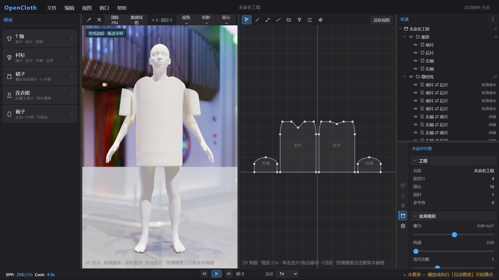

# OpenCloth

WebGPU 服装制版与试衣软件：画版型、缝合、自动着装、实时布料模拟，最后导出服装模型或截图。无需安装，用最新版 Chrome / Edge 打开即可。



## 能做什么

- **2D 制版**：Canvas2D 工作台，贝塞尔曲线、缝份偏移、三角化与保形细化；五张参数化模板（T 恤、衬衫、裙子、连衣裙、袖子）可「应用」或「追加」。
- **缝合与自动着装**：模板自带侧缝、肩线、袖山等缝合关系，按 `Ctrl+D` 走三阶段动画（缝合收拢 → 沿引导轨迹贴体 → 零重力松弛），版片自动穿到人体上。
- **GPU 布料模拟**：自研 WebGPU compute shader 实现的 XPBD 求解器，数千粒子规模实时运行（60fps 是目标值，尚无实测，见 [04-布料模拟](docs/dev/04-布料模拟.md) §6.1）；刚度、克重、阻尼等参数改动立刻作用在正在运行的模拟上。
- **材质与渲染**：PBR + Sheen 表现织物，材质槽按引用次数组织、可共用可拆分；多光源（方向光 / 点光源 / 聚光灯 / 面积光）加 HDRI 环境光。显示模式有光栅化、WebGPU 光线追踪、线框、UV 检查与法线可视化，光追支持渐进采样、间接光、软阴影与 OIDN 降噪（权重随包，离线可用）。
- **人体**：内置三种人体模型与程序化人台，体型参数（身高、胸围、腰围、臀围）同时驱动碰撞体与版片的环绕摆放。
- **工程与导出**：`.ocproj.json` 保存完整设计，浏览器内保存最近工程与自动保存快照；导出服装 GLB / OBJ 与 PNG 截图。
- **专业界面**：菜单栏 + 左模板库 + 中央双窗格 + 右场景树/属性 + 底部时间轴，37 项快捷键，布局与界面偏好存在浏览器本地。

## 环境要求

| 项 | 要求 |
| --- | --- |
| 浏览器 | Chrome 113+ / Edge 113+（需支持 WebGPU） |
| Node.js | 20 以上（仅本地运行时需要） |
| npm | 10 以上 |
| 显卡 | 光栅化可用集显；光线追踪建议独显，并先暂停模拟让画面收敛 |

> **注**：打开后提示「当前浏览器不支持 WebGPU」时，更新浏览器与显卡驱动，或在 `chrome://gpu` 查看状态。Safari 与 Firefox 目前支持不完整，且应用没有第二套渲染后端可降级。

## 快速开始

```bash
npm install
npm run dev
```

- 默认地址 `http://localhost:5173`，会自动拉起浏览器。
- 首次进入载入起步工程：女性人体 + 环绕在体外的 T 恤四片。
- 按 `空格`（3D 窗格聚焦时）或 `Ctrl+D` 自动着装，之后可旋转视角、调材质与物理参数、导出作品。

完整上手路径见 [docs/user/01-快速上手.md](docs/user/01-快速上手.md)。

## 文档

**用户文档**（面向使用者，含界面截图）：[快速上手](docs/user/01-快速上手.md) · [版型设计](docs/user/02-版型设计.md) · [缝合与着装](docs/user/03-缝合与着装.md) · [布料模拟](docs/user/04-布料模拟.md) · [材质与渲染](docs/user/05-材质与渲染.md) · [导出与工程](docs/user/06-导出与工程.md)

**开发文档**（按编号顺序读即可）：

| 文档 | 内容 |
| --- | --- |
| [00-开发指南](docs/dev/00-开发指南.md) | 环境搭建、命令与门禁、代码规范、文档规范、测试与调试入口 |
| [01-架构总览](docs/dev/01-架构总览.md) | 分层与依赖规则、目录树、端到端数据流与主循环 |
| [02-数据模型](docs/dev/02-数据模型.md) | 每个字段的语义与读取方、序列化与兼容 |
| [03-渲染管线](docs/dev/03-渲染管线.md) | 渲染上下文、显示模式、材质与灯光、光线追踪与降噪 |
| [04-布料模拟](docs/dev/04-布料模拟.md) | 求解器 pass、约束生成、固定点、着装编排、稳定性 |
| [05-版型系统](docs/dev/05-版型系统.md) | 曲线与偏移、三角化与细化、片网格、模板与环绕落片 |
| [06-UI与状态管理](docs/dev/06-UI与状态管理.md) | store 划分、命令与撤销、组件树、交互、菜单与偏好 |

代码注释风格与命名约定见 [AGENTS.md](AGENTS.md)，文档写作规范见 [00-开发指南](docs/dev/00-开发指南.md) §5。

> **说明**：全部文档的排版约定——并列事项分点（列表 / 表格 / 编号步骤），易错点与约束用 `> **注**：…`、中性补充用 `> **说明**：…` 单独成条。

## 当前限制

当前限制按主题分组：

- **制版与缝合**：版型片来自模板库，还不能在 2D 里从零手绘轮廓；缝合关系同样由模板生成，界面只提供缝线显示开关。
- **密度与贴图**：片级「网格边长」不参与模拟，密度以场景标签的全局值为准；没有面料贴图入口，外观只能用颜色与光泽表达。
- **碰撞**：布料之间没有自碰撞 pass；人体碰撞是解析胶囊近似。
- **工程可移植性**：工程文件不保存导入的模特模型与参考物体本体，换机器后需重新导入。
- **渲染**：光线追踪是 WebGPU compute + BVH 路径追踪，不是 DXR/Vulkan 硬件光追扩展；布料每帧变形都会重置渐进采样，动态模拟显著比静态预览昂贵；光追画面里没有选中高亮、PIN 小球等辅助对象。
- **工程配套**：尚无 ESLint 配置、E2E 自动化测试与 GPU timestamp 性能度量。

## 许可与素材

三个内置人体模型与默认环境贴图来源与许可证各不相同，逐项署名见 [assets/models/ATTRIBUTION.md](assets/models/ATTRIBUTION.md)、[assets/env/ATTRIBUTION.md](assets/env/ATTRIBUTION.md) 与 [assets/weights/ATTRIBUTION.md](assets/weights/ATTRIBUTION.md)。要点：

- 默认女性人体 `human-body-f.glb`（Blender Studio Human Base Meshes，CC0）与环境贴图 `royal_esplanade_1k.hdr`（CC0）可自由使用。
- `human-body.glb` 源自 Cesium Man（CC-BY-4.0），需保留署名。
- `human-body-pro.glb` 源自 Mixamo X-Bot。
- OIDN 降噪权重来自 Intel Open Image Denoise（Apache-2.0）。

> **注**：`human-body-pro.glb` 的再分发授权未确认，**公开分发前需替换**。
