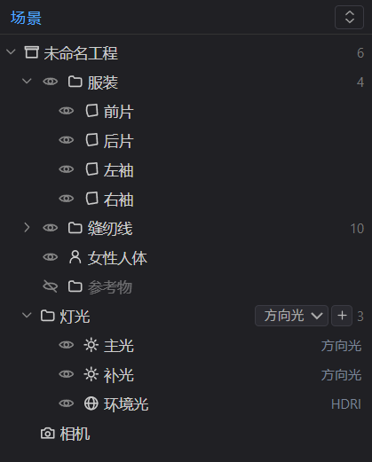

# 快速上手

欢迎使用 **OpenCloth**——在浏览器里运行的服装制版与试衣软件。这篇带你认识界面并完成第一件作品；只想做一件事的话，直接看 §3。

## 1. 开始之前

用**最新版 Chrome 或 Edge** 打开即可，不需要安装任何东西。它要求浏览器支持 WebGPU：光栅化在较新的核显上也能跑，光线追踪建议用独显；老浏览器或老显卡会明显卡顿，Safari 与 Firefox 支持不完整。

看到「当前浏览器不支持 WebGPU」时，更新浏览器与显卡驱动（笔记本确认用的是独立显卡），或换一台机器。

## 2. 界面

OpenCloth 用专业软件的经典布局：顶部菜单栏，左侧模板库，中央是 3D 试衣与 2D 制版两个窗格，右侧是场景大纲与属性编辑器，底部是时间轴。左右两栏的外缘、两栏内部与两个窗格之间的分隔条都能拖动改尺寸。

### 2.1 菜单栏

五个下拉菜单，右端常驻显示自动保存状态（「自动保存 关闭」或「自动保存 30s · 14:05」），当前工程名显示在正中。

| 菜单 | 内容 |
| --- | --- |
| 文件 | 新建 / 打开 / 保存 / 另存为；子菜单「最近打开」「自动保存」「导入」（模特模型、参考物体、环境贴图）「导出」（服装 GLB、服装 OBJ、截图 PNG） |
| 编辑 | 撤销 / 重做（条目里直接写出将要撤销的动作名）、复制选中版片 / 粘贴版片 / 删除选中、全选版片 / 取消选择 |
| 视图 | 布局（四种，含左右均分与切换焦点）、视角（十个预设）、投影（透视 / 正交）、适应视图、显示全部版片 / 隐藏未选版片 / 隐藏选中版片 |
| 窗口 | 模板库、场景大纲、属性编辑器、时间轴的开关，以及五个属性页的快捷切换 |
| 帮助 | 快捷键总览、关于 OpenCloth |

> **注**：菜单里没有「模拟」和「渲染」两项，因为这两件事有更顺手的入口——播放 / 暂停 / 单步 / 重置在底部时间轴，打 PIN / 清除 PIN / 重建网格 / 视角 / 投影 / 显示模式在 3D 窗格工具条，材质、物理、全局模拟参数、光源、色调映射与光线追踪参数在右侧属性编辑器。自动着装用 `Ctrl+D`（焦点在 3D 窗格时也可按 `空格`）。

用法与桌面软件一致：

- 悬停即切换菜单，子菜单在父项右侧展开（靠近屏幕右缘时改往左），点击外部关闭。
- 方向键移动、回车执行、Esc 逐层退出，`Alt+字母`（F / E / V / W / H）直接打开。
- 用不了的条目置灰，已生效的选项带 ✓。

### 2.2 模板库

版型的来源：五张参数化模板卡（T 恤、衬衫、裙子、连衣裙、袖子）。点开卡片调尺寸后，用「应用」整体替换现有版型，或用「追加」把新片并入；两者的差别与每张卡的参数范围见 [02-版型设计](./02-版型设计.md)。

### 2.3 中央窗格

| 布局 | 快捷键 | 说明 |
| --- | --- | --- |
| 3D 左 + 2D 右 分屏 | `3` | 默认 |
| 2D 左 + 3D 右 分屏 | `4` | 同一组窗格换顺序 |
| 仅 3D 视口 | `1` | 专注试衣与渲染 |
| 仅 2D 制版 | `2` | 专注版型 |

- 切换布局不会打断模拟，也不会重置 3D 相机。
- 分屏默认左右各半，中缝可拖动，「视图 → 布局 → 左右均分」复位。

**工具条只放属于该窗格的操作**：

- 3D 窗格：打 PIN、拔 PIN、清除 PIN、重建网格，旁边是 `PIN 徽标：手动点数 · 固定点总数`（[03-缝合与着装](./03-缝合与着装.md) §3.2），再加「视角」下拉（十个预设）、「投影」下拉（透视 / 正交）、「显示」下拉（显示模式）。双击视口里的版片可直接选中它。
- 2D 窗格：选择、线上加点、直线、曲线、内部线、省道、缝合、平移画布，以及适应视图（双击空白处同样适应视图）。

### 2.4 右侧面板

上半是**场景树**：工程名 → 服装（每张版型片一行）、缝纫线（每条缝线一行）、模特、参考物、灯光（工程里真实存在的每盏光源，行尾标出类型）、环境光、相机。

- 行首的眼睛图标控制视口显隐——光源是开关这盏灯，缝线是画不画这条线。
- 点集合名折叠，右上角一键折叠或展开全部。

下半是**属性编辑器**，左缘一列竖排图标（悬停显示名称）：

- 对象、材质、物理、场景、渲染。
- 不适用于当前对象的标签置灰（例如材质只对版型片开放）。
- 上下两栏可拖动分高度；未选中对象时显示工程概要与全局模拟参数。

在场景树点一张版型片，材质页给出该片的材质槽（名称、引用次数、材质模型）与外观参数：

渲染页给出显示模式与色调映射；把显示模式切到「光线追踪」后，同一页会展开光线追踪、降噪与画质调节三组参数（[05-材质与渲染](./05-材质与渲染.md) §4）。

### 2.5 时间轴

控制布料模拟：重置、播放 / 暂停、单步三个按钮与帧读数、速度档位居中一排；右端是模拟状态，左端是 3D 窗格的绘制读数。

| 左端读数 | 含义 |
| --- | --- |
| `FPS(3D): 60` | 3D 窗格每秒实际绘制的帧数（窗格被隐藏或不重绘时为 0） |
| `SPP: 128/256  Cost: 12.4s` | 切到「光线追踪」后同一位置改为采样分数 + 耗时：每像素累计采样数 / 最大采样数，分子越大噪点越少，走满后不再增长；`Cost` 是这一轮采样用的时间，攒满后停在最终值 |

> **注**：光线追踪只在画面静止时累积，因此拖动相机或播放模拟期间这个读数是 0。完整机制见 [04-布料模拟](./04-布料模拟.md) §1 与 [05-材质与渲染](./05-材质与渲染.md) §3。

### 2.6 焦点与界面记忆

快捷键只作用于你最后点击过的窗格，聚焦窗格带蓝色描边；在工具条上选工具也会把焦点切过去。同一个空格键，在 3D 窗格是播放 / 暂停，在 2D 窗格是平移画布。

- 布局、分屏比例、栏宽、焦点窗格、当前属性页、显示模式、相机投影、四个面板的开关、自动保存间隔都存在本机浏览器里，刷新或重开标签页后回到上次的界面。
- 工程数据本身不会被这些偏好影响。

## 3. 第一个作品：五分钟完成一件 T 恤

打开时一个起步工程已经备好：**女性人体**模特，身上环绕着一件 **T 恤**的四张版型片（前片、后片、左袖、右袖），侧缝、肩线、袖山、袖下缝都已由模板自动配好。此时状态是「未着装」——版片悬在人体外侧，等待试穿。

1. **试穿**：按 `空格`（焦点在 3D 窗格时）或 `Ctrl+D` 执行自动着装。版片先各自环绕在身体周围、缝线连出配对关系，随后缝线收缩、版片彼此靠拢拼合成整件衣服，再贴回体表。整个动画约一秒钟，走完后时间轴显示「模拟中」，布料在重力下自然下垂、贴合人体并起褶。
2. **换个视角看**：左键拖拽旋转、滚轮推拉、右键平移；小键盘 `2 8 4 6 0 5` 跳到正视 / 后视 / 左视 / 右视 / 仰视 / 俯视，`1 3 7 9` 是正左 / 正右 / 后左 / 后右四个 45° 侧位。每个视角都会按场景整体大小取景，服装摊开时也不会把版片裁到画面外。
3. **调效果**：在场景树点一张版型片。
   - 用材质标签换面料、改颜色；
   - 用物理标签改刚度与克重——弯曲刚度调高会更挺括，克重调大下摆垂得更沉；
   - 改动立刻作用在正在运行的模拟上，不用重跑；
   - 想看真实面料的观感，把「显示」下拉切到「光线追踪」，暂停模拟后画面会逐帧收敛出软阴影与间接光。
4. **换个版型**：左侧模板库点开一张卡（例如「连衣裙」），调好尺寸后点「应用」；想给衬衫补一对袖子就用「追加」。
5. **导出作品**：文件 → 导出 → 服装 GLB… / 服装 OBJ…；只要一张图就走同一子菜单里的「导出截图 PNG」。

> **注**：版片顶部一小条是被自动「假缝」固定住的，所以未着装时衣服不会滑落。点**清除 PIN** 会把这些自动固定点连同你手动打的点一起释放，衣服可能整片下滑——按 `R` 重置即可回到初始状态。

## 4. 常用快捷键

完整清单在 帮助 → 快捷键总览（`F1`），共 37 项。下面是最高频的：

| 快捷键 | 功能 |
| --- | --- |
| `空格` | 3D 窗格聚焦时：播放 / 暂停；2D 窗格聚焦时：按住平移画布 |
| `Ctrl+D` | 自动着装（未着装时播放或单步也会触发） |
| `R` / `.` | 重置模拟 / 单步推进一帧 |
| `1` `2` `3` `4` | 布局：仅 3D / 仅 2D / 3D 左分屏 / 2D 左分屏 |
| `Tab` | 在 3D 与 2D 窗格之间切换焦点 |
| 小键盘 `2 8 4 6 0 5` | 正视 / 后视 / 左视 / 右视 / 仰视 / 俯视（`1 3 7 9` 为四个 45° 侧位） |
| `F` | 适应视图（把 2D 制版视图收放到全部版型片） |
| `Ctrl+Z` / `Ctrl+Shift+Z` | 撤销 / 重做（`Ctrl+Y` 同样重做），最多回退 100 步 |
| `Ctrl+C` / `Ctrl+V` | 复制选中版片 / 粘贴（副本落在右侧，可撤销） |
| `Ctrl+A` / `Esc` | 全选版片 / 取消选择 |
| `Delete` | 删除选中对象（`Backspace` 同）；`方向键` 微调 0.5cm，`Shift+方向键` 1cm |
| `Ctrl+N` / `Ctrl+O` | 新建 / 打开工程 |
| `Ctrl+S` / `Ctrl+Shift+S` | 保存工程 / 另存为（下载 `.ocproj.json`） |
| `Alt+F/E/V/W/H` | 打开对应下拉菜单 |
| `F1` | 快捷键总览 |

> **注**：菜单打开时方向键、回车与 Esc 优先给菜单；光标停在输入框或下拉框里时快捷键不生效。

## 5. 常见问题

**Q：打开后一片黑，或提示渲染失败？**
A：换最新版 Chrome/Edge，更新显卡驱动；笔记本请确认用的是独立显卡。

**Q：衣服「炸开」或穿过了身体？**
A：多半是参数太极端。把刚度往回调、克重加大一点，或在场景标签提高「迭代次数」，然后按 `R` 重置。布料卡住不动也是同一种情况：那一步算坏了，画面停在最后一个正常形态。详见 [04-布料模拟](./04-布料模拟.md) §6。

**Q：帧率很低、操作发涩？**
A：在场景标签把「全局网格边长」调大（布料更粗但更快），并降低「迭代次数」。模拟与渲染共用显卡，独显体验明显更好。

**Q：改了版型片上的「网格边长」，密度没变化？**
A：密度一律取场景标签的「全局网格边长」，片级滑条当前不参与模拟，改它不会有任何效果（详见 [02-版型设计](./02-版型设计.md) §6）。

**Q：我点的是 2D 窗格，为什么按 `R` 没反应？**
A：快捷键只作用于当前聚焦窗格（蓝色描边那一个）。先在该窗格里点一下，或按 `Tab` 切换焦点。

**Q：按 `F` 3D 画面没动？**
A：`F` 只收放 2D 制版视图。3D 想回到默认机位用小键盘的视角键，或点工具条「视角」下拉。

## 6. 当前不支持

- 从零手绘裁片轮廓：工具条上的直线、曲线、内部线、省道按钮还没有接入绘制，版型来自模板库。
- 手工新建缝合关系：工具条的「缝合」只切换缝线显示的开与关。
- 面料贴图：不能上传花型、针织纹路或 Logo。
- 布料之间的自碰撞：褶皱互穿、衣袖贴进衣身属预期表现。
- 投影阴影（光栅化模式下）：遮挡只在「光线追踪」里由路径追踪计算。
- 逐帧导出动画序列、慢放（0.25x / 0.5x 与 1x 实际相同）。
- 工程文件里保存导入的模特模型与参考物体本体。

## 7. 下一步

[02-版型设计](./02-版型设计.md) → [03-缝合与着装](./03-缝合与着装.md) → [04-布料模拟](./04-布料模拟.md) → [05-材质与渲染](./05-材质与渲染.md) → [06-导出与工程](./06-导出与工程.md)
