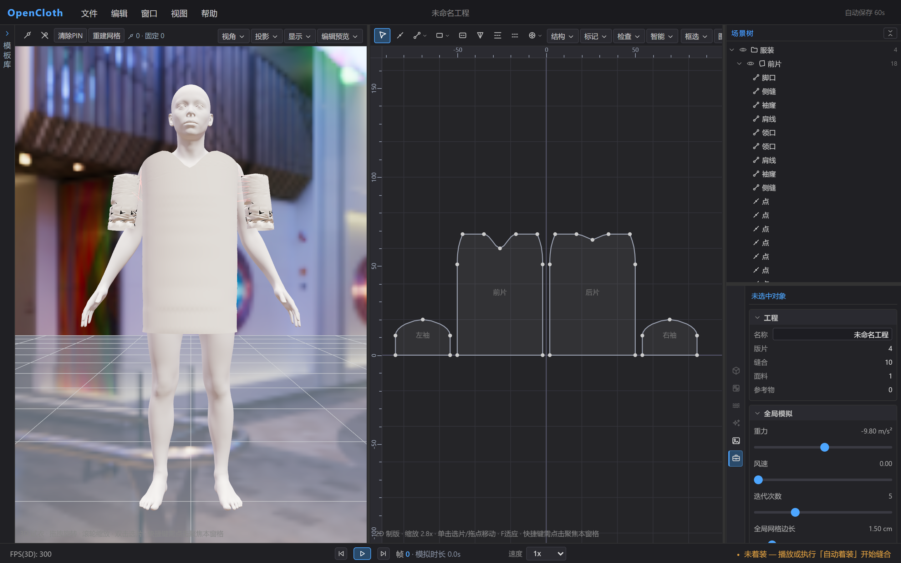
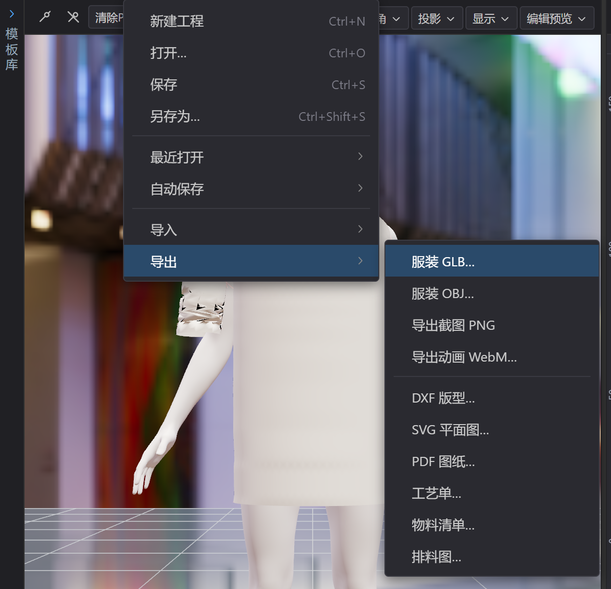
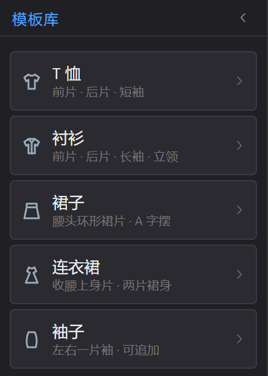
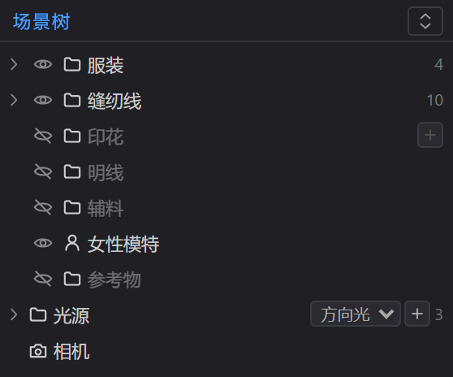
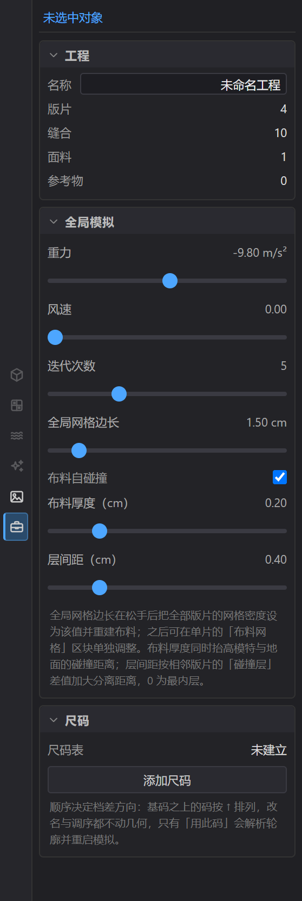
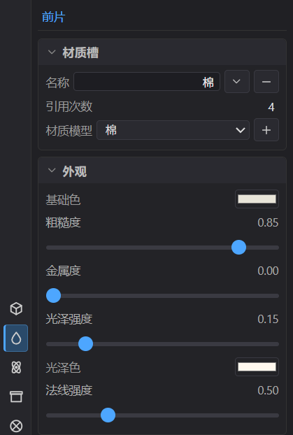
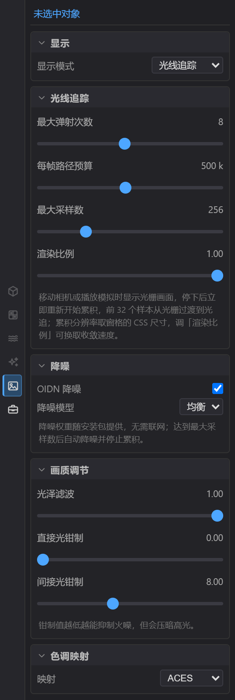
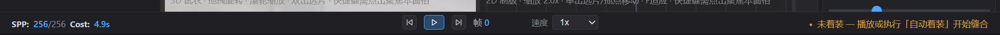
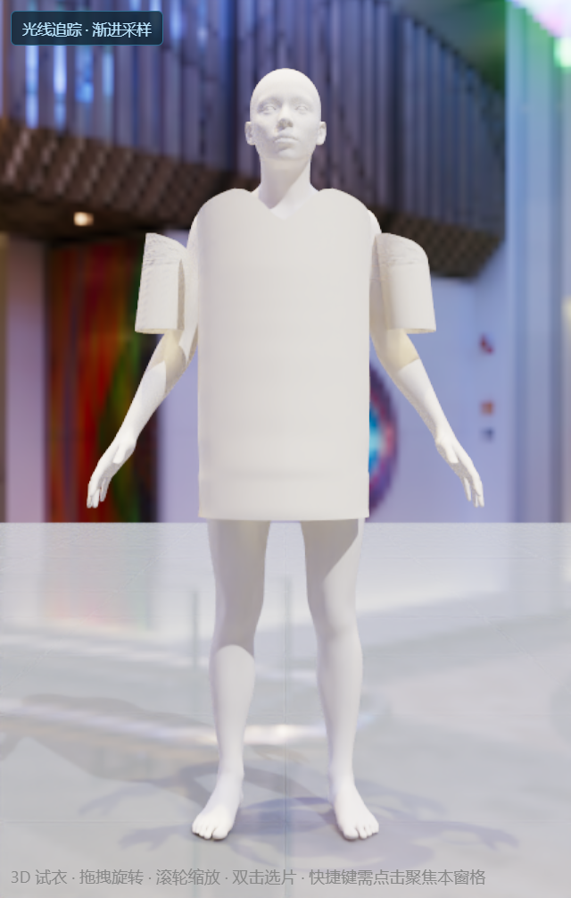
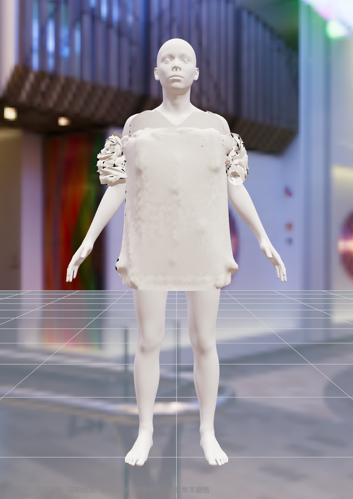

# 快速上手

欢迎使用 **OpenCloth**，一款在浏览器里运行的服装制版与试衣软件。这篇介绍界面组成与第一件作品的完整流程；只做一件作品时直接看 §3。章节顺序依次为：运行环境与界面组成（§1、§2）、一次完整的试衣与导出（§3）、快捷键与常见问题（§4–§6）、下一步（§7）。

## 1. 开始之前

用**最新版 Chrome 或 Edge** 打开即可，无需安装。浏览器需支持 WebGPU：光栅化在较新的核显上也能运行，光线追踪建议用独显；桌面版 Safari 与 Firefox 支持不完整（手机端见 [07-移动端使用](./07-移动端使用.md) §1）。

提示【当前浏览器不支持 WebGPU】时，更新浏览器与显卡驱动，或换一台机器。

## 2. 界面

OpenCloth 界面布局：顶部菜单栏，中央是 3D 试衣与 2D 制版两个窗格，右侧是场景树与属性编辑器，底部是时间轴。模板库平时收成左缘的窄条，单击即展开；左右两栏的外缘、两栏内部与两个窗格之间的分隔条都能拖动改尺寸。

### 2.1 菜单栏

五个下拉菜单，右端常驻显示自动保存状态（【自动保存 关闭】或【自动保存 60s · 14:05】），当前工程名显示在正中。

| 菜单 | 内容 |
| --- | --- |
| 文件 | 新建工程 / 打开… / 保存 / 另存为…；子菜单【最近打开】（最近存档与【清除列表】）、【自动保存】（关闭 / 每 30 秒 / 每 1 分钟 / 每 5 分钟，以及【立即保存快照】与快照列表）、【导入】（模特模型、参考物体、环境贴图、DXF 版型、JSON 版型、恢复内置环境、清除全部参考物体），以及子菜单【导出】（服装 GLB…、服装 OBJ…、导出截图 PNG、导出动画 WebM…、DXF 版型…、SVG 平面图…、PDF 图纸…、工艺单…、物料清单…、排料图…） |
| 编辑 | 撤销 / 重做（条目里直接写出将要撤销的动作名）、复制选中版片 / 粘贴版片 / 删除选中、全选版片 / 取消选择 |
| 窗口 | 模板库的展开 / 收起、场景树、属性编辑器、时间轴的开关，以及六个属性页的快捷切换 |
| 视图 | 只有布局：3D 左 + 2D 右、2D 左 + 3D 右、仅 3D、仅 2D，另有左右均分与切换焦点 |
| 帮助 | 快捷键总览、关于 OpenCloth |

用法与桌面软件一致：

- 悬停即切换菜单，子菜单在父项右侧展开（靠近屏幕右缘时改往左），点击外部关闭。
- 方向键移动、回车执行、Esc 逐层退出，`Alt+字母`（F / E / V / W / H）直接打开。
- 用不了的条目置灰，已生效的选项带勾选标记。

### 2.2 模板库

点击左缘的【模板库】窄条或【窗口 > 模板库面板】展开，标题行右端的箭头收回；展开状态记在本机浏览器里。

版型的来源：五张参数化模板卡（T 恤、衬衫、裙子、连衣裙、袖子）。点开卡片调尺寸后，用【替换版型】整体替换现有版型，或用【追加版型】把新片并入；替换会清空当前版型。两者的差别与每张卡的参数范围见 [02-版型设计](./02-版型设计.md) §2.1。

### 2.3 中央窗格

| 布局 | 快捷键 | 说明 |
| --- | --- | --- |
| 3D 左 + 2D 右 分屏 | `3` | 默认 |
| 2D 左 + 3D 右 分屏 | `4` | 同一组窗格换顺序 |
| 仅 3D 视口 | `1` | 专注试衣与渲染 |
| 仅 2D 制版 | `2` | 专注版型 |

切换布局不会打断模拟，也不会重置 3D 相机。分屏默认左右各半，中缝可拖动，【视图 → 布局 → 左右均分】复位。

工具条只放属于该窗格的操作。3D 窗格有【打PIN】【拔PIN】【清除PIN】【重建网格】四个按钮，旁边是 PIN 徽标（手动 PIN 数 · 固定点总数，见 [03-缝合与着装](./03-缝合与着装.md) §3.2），再加【视角】下拉（十个预设）、【投影】下拉（透视 / 正交）、【显示】下拉（显示模式）、【编辑预览】下拉（[04-布料模拟](./04-布料模拟.md) §5.1）。

双击视口里的版片可直接选中它。

2D 窗格有一排绘图与选择工具（【选择】【线上加点】【直线 / 曲线】【矩形 / 圆 / 椭圆】【内部线】【省道】【缝合】【明线】【辅料】；带箭头的按钮展开同类工具或辅料类型），四个操作菜单【结构 / 标记 / 检查 / 智能】，右侧【框选 / 图层】两个下拉与【适应】按钮（悬停提示【适配版型范围】）。

双击空白处或按 `F` 是同一个适应视图动作。窗格变窄时工具条横向滚动，右端按钮不会被裁掉。

视图平移用中键拖拽或按住 `空格` 拖动。整套制版操作见 [02-版型设计](./02-版型设计.md) §2–§9。

### 2.4 右侧面板

#### 2.4.1 场景树

上半是**场景树**：顶层并排是服装（每张版片一行）、缝纫线（每条缝纫线一行）、印花、明线、辅料（每件生产物件一行，行尾注记所属版片）、模特、参考物、光源（工程里真实存在的每盏光源，另含环境光一行，行尾标出类型）、相机。

- 点一行选中这个对象；行首箭头或双击展开 / 收起子项，版片下可以展开出边、点、内部线、省道、刀口、注释、尺寸线等（[02-版型设计](./02-版型设计.md) §5.1）。
- 【印花】集合行右端的 `＋` 以当前选中版片的中心为落点添加印花。
- 行首的眼睛图标控制视口显隐：光源是开关这盏灯，缝纫线是画不画这条线。
- 点集合名折叠，右上角一键折叠或展开全部。

#### 2.4.2 属性编辑器

下半是**属性编辑器**，左缘一列竖排图标（悬停显示名称，依次为：对象、材质、模拟、变换、渲染、工程）。

对象页是所选对象本身的属性；材质页是面料的属性；模拟页是所选对象的模拟参数；变换页是对象的位姿（位置 / 旋转 / 缩放）与版片的环绕方式；渲染页与工程页与选中对象无关。

不适用于当前对象的标签置灰（例如材质只对版片开放，模拟只对版片、模特开放）。上下两栏可拖动分高度；未选中对象时默认显示工程页，即工程概要、网格生成与全局模拟参数。

在场景树点一张版片，属性页随对象切换。对象页给出名称、可见性、锁定与分组、版型、尺寸、倒圆角与生产信息；模拟页给出面料物理与布料网格；变换页给出位置 / 旋转 / 缩放与环绕方式；材质页给出该片的材质槽（名称、使用片数、面料类型）与外观参数。

渲染页给出显示模式与色调映射，把显示模式切到【光线追踪】后，同一页会展开光线追踪、降噪与画质调节三组参数（[05-材质与渲染](./05-材质与渲染.md) §4）；工程页是工程概要、网格生成、全局模拟与尺码表。

### 2.5 时间轴

控制布料模拟：重置、播放 / 暂停、单步三个按钮与帧读数、速度档位居中一排；右端是模拟状态，左端是 3D 窗格的绘制读数。帧读数后面是**模拟时长**（累计模拟时间，重置后归零）。

| 左端读数 | 含义 |
| --- | --- |
| `FPS(3D): 60` | 3D 窗格每秒实际绘制的帧数（窗格被隐藏或不重绘时为 0） |
| `SPP: 128/256  Cost: 12.4s` | 切到【光线追踪】后同一位置改为采样分数 + 耗时：每像素累计采样数 / 最大采样数，分子越大噪点越少，达到最大采样数后不再增长；`Cost` 是这一轮采样用的时间，达到上限后停在最终值。分子为 0 时后面会追加一段状态码，写明当前是相机未静止、布料还在变形、光栅过渡中、光追内核在加载，还是这台设备不支持光追 |

> **注**：光线追踪只在画面静止时累积，拖动相机或播放模拟期间读数为 0。完整机制见 [04-布料模拟](./04-布料模拟.md) §1 与 [05-材质与渲染](./05-材质与渲染.md) §3。

### 2.6 焦点与界面记忆

作用于窗格的快捷键只认最后一次点击的窗格，聚焦窗格带蓝色描边；在工具条上选工具也会把焦点切过去。同一个空格键，在 3D 窗格是播放 / 暂停，在 2D 窗格是平移画布；布局、工程与菜单等全局快捷键不受焦点影响。

布局、分屏比例、栏宽、场景与属性上下栏的比例、焦点窗格、当前属性页、显示模式、相机投影、编辑预览档位、四个面板的开关、自动保存间隔都存在本机浏览器里，刷新或重开标签页后回到上次的界面；工程数据本身不受这些偏好影响。

## 3. 第一个作品：五分钟完成一件 T 恤

打开时一个起步工程已经备好：**女性模特**，身上环绕着一件 **T 恤**的四张版片（前片、后片、左袖、右袖），侧缝、肩线、袖山、袖下缝都已由模板自动配好。此时状态是【未着装】，版片悬在模特外侧，等待试穿。

### 3.1 试穿与查看

按 `空格`（焦点在 3D 窗格时）或 `Ctrl+D` 执行自动着装：缝纫线收缩、版片拼合成整件衣服，再贴合体表。动画约一秒钟，结束后时间轴显示【模拟中】，布料在重力下下垂并形成褶皱。

换视角用左键拖拽旋转、滚轮缩放、右键平移；小键盘 `2 8 4 6 0 5` 切到正视 / 后视 / 左视 / 右视 / 仰视 / 俯视，`1 3 7 9` 是正左 / 正右 / 后左 / 后右四个 45° 侧位。每个视角都会按场景整体大小取景，版片展开时也不会被裁到画面外。

### 3.2 调效果与换版型

在场景树点一张版片后，可做以下调整：

- 用材质标签换面料、改颜色；
- 用模拟标签改刚度与克重：弯曲刚度调高更挺括，克重调大下摆垂得更沉；改动立刻作用在正在运行的模拟上，不用重新运行；
- 查看真实面料的观感，把【显示】下拉切到【光线追踪】，暂停模拟后画面会逐帧收敛出软阴影与间接光。

换版型则点左缘窄条展开模板库，点开一张卡（例如【连衣裙】），调好尺寸后点【替换版型】；想给衬衫补一对袖子就用【追加版型】。

### 3.3 导出作品

【文件 → 导出 → 服装 GLB… / 服装 OBJ…】；只要一张图就走同一子菜单里的【导出截图 PNG】。

> **注**：版片顶部一小条被自动【假缝】固定，未着装时衣服不会滑落。点【清除PIN】会把这些自动固定点连同手动打的点一起释放，衣服可能整片下滑，按 `R` 重置即可回到初始状态。

## 4. 常用快捷键

完整清单在【帮助 → 快捷键总览】（`F1`），共 37 项。下面是最高频的：

| 快捷键 | 功能 |
| --- | --- |
| `空格` | 3D 窗格聚焦时：播放 / 暂停；2D 窗格聚焦时：按住平移画布 |
| `Ctrl+D` | 自动着装（未着装时播放或单步也会触发） |
| `R` / `.` | 重置模拟 / 单步推进一帧 |
| `1` `2` `3` `4` | 布局：仅 3D / 仅 2D / 3D 左分屏 / 2D 左分屏 |
| `Tab` | 在 3D 与 2D 窗格之间切换焦点 |
| 小键盘 `2 8 4 6 0 5` | 正视 / 后视 / 左视 / 右视 / 仰视 / 俯视（`1 3 7 9` 为四个 45° 侧位） |
| `F` | 适应视图（把 2D 制版视图收放到全部可见版片） |
| `Ctrl+Z` / `Ctrl+Shift+Z` | 撤销 / 重做（`Ctrl+Y` 同样重做），最多回退 100 步 |
| `Ctrl+C` / `Ctrl+V` | 复制选中版片 / 粘贴（副本落在右侧，可撤销） |
| `Ctrl+A` / `Esc` | 全选版片 / 取消选择 |
| `Delete` | 删除选中对象（`Backspace` 同）；`方向键` 微调 0.5 cm，`Shift+方向键` 1 cm |
| `Ctrl+N` / `Ctrl+O` | 新建 / 打开工程 |
| `Ctrl+S` / `Ctrl+Shift+S` | 保存工程 / 另存为（下载 `.ocproj.json`） |
| `Alt+F/E/V/W/H` | 打开对应下拉菜单 |
| `F1` | 快捷键总览 |

> **注**：菜单打开时方向键、回车与 Esc 优先给菜单；光标停在输入框或下拉框里时快捷键不生效。

## 5. 常见问题

**Q：打开后一片黑，或提示渲染失败？**
A：换最新版 Chrome/Edge，更新显卡驱动；笔记本请确认用的是独立显卡。

**Q：衣服散开或穿过了身体？**
A：多半是参数太极端。把刚度调低、克重调大一点，或在工程标签提高【迭代次数】，然后按 `R` 重置。画面停住不动也是同一类问题：求解发散后，画面停在最后一个正常形态。详见 [04-布料模拟](./04-布料模拟.md) §6。

**Q：帧率很低、操作卡顿？**
A：在工程标签把【网格边长】调大（布料更粗但更快），并降低【迭代次数】。模拟与渲染共用显卡，独显体验明显更好。

**Q：改了版片上的【网格密度】，密度没变化？**
A：每片按模拟标签【布料网格】区块的【网格密度】单独重建；如果之后又拖动过工程标签的【网格边长】，它会一次覆盖所有版片（详见 [02-版型设计](./02-版型设计.md) §10）。

**Q：我点的是 2D 窗格，为什么按 `R` 没反应？**
A：窗格快捷键只作用于当前聚焦窗格（蓝色描边那一个）。先单击该窗格，或按 `Tab` 切换焦点。

**Q：按 `F` 3D 画面没动？**
A：`F` 只收放 2D 制版视图。3D 想回到默认机位用小键盘的视角键，或点工具条【视角】下拉。

## 6. 当前不支持

- 投影阴影（光栅化模式下）：遮挡只在【光线追踪】里由路径追踪计算。
- 逐帧导出动画序列。
- 全局按尺寸求解：改一个尺寸不会连带解算其它约束，复杂调整靠拖点、拖手柄与放码（[02-版型设计](./02-版型设计.md) §11）。

## 7. 下一步

[02-版型设计](./02-版型设计.md) → [03-缝合与着装](./03-缝合与着装.md) → [04-布料模拟](./04-布料模拟.md) → [05-材质与渲染](./05-材质与渲染.md) → [06-导出与工程](./06-导出与工程.md)
