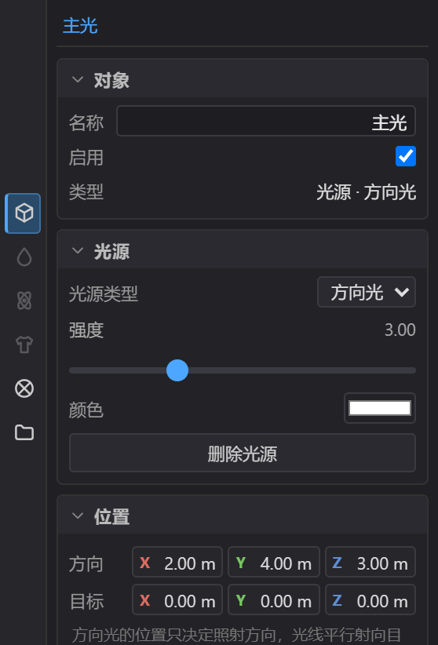
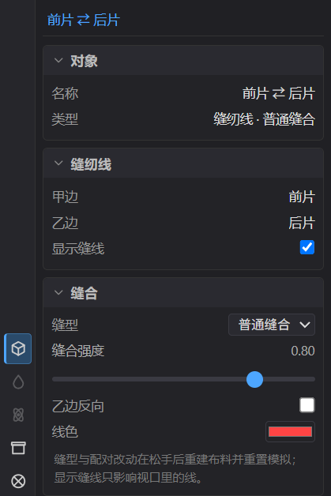
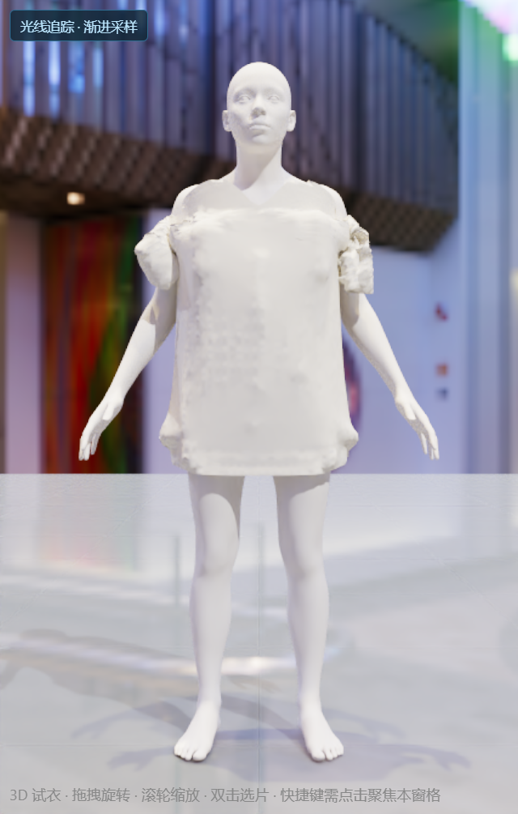

# 材质与渲染

OpenCloth 用基于物理的着色（PBR）表现织物：颜色、粗糙度、边缘绒毛光泽共同决定面料看上去是棉、是丝绸还是牛仔。章节顺序依次为：材质编辑器与外观参数（§1）、光照、环境光与缝纫线（§2）、显示模式与光线追踪、降噪（§3、§4）、渲染效果与相机（§5）、当前不支持的功能（§6）、下一步（§7）。

## 1. 材质编辑器（材质标签）

材质是独立的一份记录，每张版片指向其中一份，多张片也可以共用同一份。在场景树选中版片后，材质标签按**材质槽**逻辑组织：槽位先给出名称、使用片数与面料类型三项信息，名称旁的下拉与减号用于换用或解除指定，往下是这份材质的外观参数。选中【模特】时同一个标签改为皮肤参数（§1.3）。

| 行 / 控件 | 作用 |
| --- | --- |
| 名称 | 框里是当前材质名，直接改名（回车或点别处生效）。改名作用于这份记录本身，所有共用它的版片一起变名；与已有名字重复时会自动加编号（如【棉 2】） |
| 下拉按钮 | 打开工程内所有材质的列表，选一项就把当前版片的槽位换过去 |
| 减号按钮 | 解除指定：槽位空出来、名称显示【未指定】，这块布临时用灰色占位材质渲染。记录仍留在工程里，之后还能用下拉换回来 |
| 使用片数 | 有几个版片在用这份材质。数字大于 1 时可以点，点击为当前版片复制一份独立材质，之后互不影响；只有一片在用（或没有材质）时它就是个普通读数 |
| 面料类型 | 下拉里是新建材质用的面料类型（棉 / 丝绸 / 牛仔 / 针织），选好再点右边的【＋】，新建一份该面料的独立材质并赋给当前版片。类型选一次会留着，想建几个就点几次 |
| 外观 | 基础色、粗糙度、金属度、法线强度各自紧跟对应的贴图槽，其后是光泽强度、光泽色、光泽粗糙度、透光、厚度、清漆、清漆粗糙度、各向异性、虹彩，最后是平铺与偏移 |

> **注**：共用一份材质时，改名与调参同时作用于所有使用它的版片；想只改一片，先点【使用片数】上的数字把它变成自己独有的。

改名、换用、新增、解除、拆分都进撤销历史（`Ctrl+Z`），且不重建布料、不重启模拟（参数含义见 [04-布料模拟](./04-布料模拟.md) §2）。版片还没有材质时，标签里会提示“这个版片还没有材质，点右侧下拉换用一个，或用【＋】建一个。”

### 1.1 外观参数

| 参数 | 范围 | 说明 |
| --- | --- | --- |
| 基础色 | 颜色选择器 | 面料本色，边选边生效 |
| 粗糙度 | 0–1 | 表面粗糙程度，越高越哑光；丝绸低、棉与针织高 |
| 金属度 | 0–1 | 金属感，布料通常保持 0 |
| 光泽强度 | 0–1 | 边缘绒毛光泽的明显程度 |
| 光泽色 | 颜色选择器 | 边缘绒毛的颜色，通常比底色略亮 |
| 光泽粗糙度 | 0–1 | 绒毛高光的扩散程度：越高越柔和，越低越集中 |
| 法线强度 | 0–2 | 放大法线贴图的凹凸细节；没有法线贴图时看不出变化 |
| 透光 | 0–1 | 光线穿过布料的程度，适合薄纱、雪纺 |
| 厚度(mm) | 0–5 | 透光的厚度，配合【透光】一起调 |
| 清漆 | 0–1 | 表面涂层（如涂层布、皮革感面料）的强度 |
| 清漆粗糙度 | 0–1 | 清漆层的高光扩散，越低越像镜面 |
| 各向异性 | 0–1 | 拉伸高光，适合缎面、拉丝面料 |
| 虹彩 | 0–1 | 薄膜干涉的彩虹色，适合功能面料与特效布 |

**光泽（Sheen）** 表现织物边缘的绒毛光：丝绸、天鹅绒调高，牛仔、棉布调低。

> **注**：布料是零厚度的单层双面网格，【透光】调到 1 也不会得到真正叠层的通透感；薄纱效果配合浅色与较低粗糙度更自然。

### 1.2 花纹与贴图

外观分区把四个贴图槽排在对应参数下方：基础色贴图紧跟【基础色】，粗糙度贴图紧跟【粗糙度】，金属度贴图紧跟【金属度】，法线贴图紧跟【法线强度】；调一个通道时贴图就在手边。每行从左到右依次是槽位名、只读的文件名框（没有文件时留空）、【＋】与【−】两个图标按钮：

- 【＋】打开文件选择框，读取图片并写入这一槽位。超过 1024 像素的大图会先缩到最长边 1024 的 PNG，用来控制工程体积；缩放失败时保留原图。
- 【−】把槽位恢复为空（槽位为空时按钮置灰），布料回到基础色与粗糙度、金属度参数。
- 上传、替换、清除都是一步可撤销的操作（`Ctrl+Z`）；贴图随工程一起保存，重新打开工程后仍然在。
- 基础色贴图直接决定面料颜色（此时不叠加【基础色】）；粗糙度贴图、金属度贴图直接给出通道值（对应的滑杆只在没有贴图时生效）；法线贴图的强弱仍由【法线强度】控制。
- 贴图按布料 UV 采样。【平铺】与【偏移】各有 X、Y 两个数值：平铺是花纹重复次数（步进 0.1，最小 0.01），偏移是花纹起点（步进 0.1）。改动同样可撤销、随工程保存。
- 贴图异步加载：选完图片后布料在图片解码完成时换上纹理，不重建布料、不重启模拟。
- 版片上有印花时，它的基础色通道换成一张合成图（面料底色 + 基础色贴图 + 图案），法线、粗糙度与金属度槽位不受影响；印花只作用于这一片（[02-版型设计](./02-版型设计.md) §7.2）。
- 导出 GLB 会把这些贴图内嵌进文件，导出前会等待贴图加载完成；OBJ 不带材质，也不引用贴图文件。

### 1.3 模特皮肤

选中场景树的【模特】后，材质标签给出【皮肤】区块：

| 参数 | 范围 | 默认 | 说明 |
| --- | --- | --- | --- |
| 肤色 | 颜色选择器 | `#d6a97e` | 人体本色，边选边生效 |
| 肤色预设 | 下拉 | 亚洲 | 浅肤 / 亚洲 / 暖棕 / 深肤四档；当前颜色与某一档一致时显示该档名称，否则多出一项【自定义】 |
| 粗糙度 | 0–1 | 0.55 | 皮肤表面粗糙程度，越高越哑光 |
| 高光 | 0–1 | 0.08 | 皮肤油光层强弱；调高后额头、肩头出现更集中的反光 |

肤色预设只改颜色，粗糙度与高光保持当前值。三项改动都进撤销历史，只重写人体材质，不重建模特、布料与模拟；肤色随工程保存。

> **注**：肤色只作用于没有贴图的人体表面。眼睛保持深色，自带贴图的导入模型整体保持原色。

## 2. 光照、环境与缝纫线

### 2.1 光源

场景树的【光源】集合列出的就是**当前工程里真实存在的光源**：默认有主光、补光两盏方向光，外加环境光一行，行尾标出它的类型（方向光 / 点光源 / 聚光灯 / 面积光 / 环境光）。集合行右侧的【类型下拉 + ＋】用于新增一盏光源，新增后自动选中；行首的眼睛图标是这盏灯的开关：关掉后它仍留在列表里，随时可以再打开。

> **注**：强度调到 0 只是变暗，不等于关灯。

选中一盏灯后调节：**对象**标签的**对象**块给出**名称**、类型与**启用**，**光源**块给出**光源类型**、强度、颜色与删除，**照射范围**块给出照射距离、锥角、边缘柔化、宽度与高度（可调项随类型出现）；方向或位置与目标在**变换**标签的【位置】块。可调项如下：

| 类型 | 可调项 | 新建默认 |
| --- | --- | --- |
| 方向光 | 方向（X/Y/Z）、目标、强度 0–10、颜色 | 方向 (2, 4, 3)、强度 3、白色 |
| 点光源 | 位置、强度 0–300、颜色、照射距离 0–20 m | 位置 (1.2, 1.8, 1.2)、强度 60、白色 |
| 聚光灯 | 位置、目标、强度 0–300、颜色、照射距离 0–20 m、锥角 1–120°、边缘柔化 | 位置 (0, 3, 1.5)、强度 80、锥角 40°、边缘柔化 0.3、白色 |
| 面积光 | 位置、目标、强度 0–60、颜色、宽度与高度 0.05–10 m | 位置 (1.5, 1.8, 1.5)、强度 10、1×1 m、白色 |

起步工程自带的主光是白色方向光（方向 (2, 4, 3)、强度 3）；补光是淡蓝 `#cfe0ff` 的方向光（方向 (-2, 2, -1)、强度 1），用于提高阴影面的亮度。

- 点光源、聚光灯与面积光的强度按平方反比衰减，工程单位是米，所以数值比方向光大一个量级；【照射距离】填 0 表示不限距离。
- 方向光的位置只决定光线射来的方向，光线平行射向目标点。
- 切换类型不会丢失已经调好的位置与颜色。
- 所有改动都是可撤销的一步操作；光栅化与光线追踪两种显示模式下都会立即重新收集场景光源。
- 【删除光源】在光源块底部，删掉的光源可以用撤销找回。

### 2.2 环境光

环境光一行控制环境贴图：【对象】区块给出启用开关，【环境光】区块顶行显示当前环境图名称，下面是强度 0–2、导入环境图与恢复内置环境。

- 环境贴图（【文件 → 导入 → 环境贴图…】）支持 `.hdr` / `.exr` / `.png` / `.jpg` / `.jpeg` / `.webp` 的全景图（等距柱状投影），同时提供反射与间接光。
- 想回到默认就点【内置环境图】或菜单里的【恢复内置环境】。
- 导入环境图与恢复内置都是**可撤销**的一步操作，撤销会回到之前的环境图设置。

> **注**：关掉启用开关只是不再用它照明，背景图与强度设置都保留。

### 2.3 缝纫线

场景树的【缝纫线】集合把工程里的每条缝合关系列成一行，行名默认是它连接的两张版片加画布序号（如【左袖 ⇄ 前片 · 3】），行尾是缝型（普通缝合 / 缩缝 / 开放边）。这些行就是 3D 视口里那些缝纫线叠加层：

- 行首的眼睛图标控制这条缝纫线画不画（2D 缝合指示线与 3D 叠加层一起），集合行一次开关全部；只影响视口显示，不改变缝合关系，布料照常模拟。
- 选中一条缝纫线后可在对象标签改缝型、缝合强度、乙边反向与线色；线色同时决定 3D 叠加层与 2D 缝合指示线的颜色，没改过线色的缝口在 2D 里按序号取色。
- 缝型、强度与反向只重排这条缝口的约束（顶点布局不变时不重建布料、不重置模拟），细节见 [03-缝合与着装](./03-缝合与着装.md) §2；对象块的【可见性】只影响视口。

## 3. 显示模式

桌面两处入口是同一项设置：3D 窗格工具条的【显示】下拉与渲染标签的【显示模式】；手机【显示】抽屉也读同一份列表。

### 3.1 五种渲染模式

| 模式 | 说明 |
| --- | --- |
| 光栅化 | 实时渲染，完整着色与光照，默认 |
| 光线追踪 | 路径追踪，支持间接光、软阴影、PBR 反射与渐进采样；首次切换会在这台设备上先实际运行几帧光追内核，通过后才保留这个模式 |
| 线框 | 叠加青色网格线，用来观察布料密度与版型走向，也用来检查布料与身体的贴合情况 |
| UV 检查 | 棋盘格，检查花纹坐标是否对齐版型 |
| 法线可视化 | 用彩色显示表面朝向，检查有没有翻面 |

同一列表末尾还有 **合身热图** 与 **应变热图** 两条分析显示模式，分别显示布料与模特的间隙、布料自身的拉伸压缩；选中后下方展开同名的【合身热图】【应变热图】区块，给出阈值或色标、读数与 CSV 导出（[04-布料模拟](./04-布料模拟.md) §4）。手机的【显示】抽屉只带合身热图。

### 3.2 光线追踪的累积条件

光线追踪只在画面静止时累积：

- 拖动相机或播放模拟期间显示光栅画面，停下后的下一帧重新开始采样。
- 刚停下的几十个样本里，画面按采样进度从光栅结果平滑过渡到光追结果（约 32 个样本后完全切换为光追结果，开了降噪则在达到【最大采样数】后消除噪点），不会先出现一片噪点或暗块。
- 视口左上角显示【光线追踪 · 渐进采样】。画面还没开始累积时，后半句改为当前受哪一项限制：【光追内核加载中】、【布料每帧在变】、【视角未静止】、【光栅过渡中】、【本机不支持】；时间轴上的 `SPP:` 分子为 0 时也在读数后追加同一段状态码。

### 3.3 设备支持与设置归属

> **注**：如果这台设备的 WebGPU 无法运行路径追踪内核（手机、平板与部分集显常见），首次切换会提示【本机 WebGPU 跑不了光线追踪（<原因>）：<技术细节>】并自动切回光栅化；随后三处显示模式入口（3D 工具条的【显示】下拉、渲染标签的【显示模式】、手机的【显示】抽屉）都会把【光线追踪】置灰成 `光线追踪（不支持）`。

> **说明**：这个判定来自真实的首帧试运行，不是预先排除特定设备；同一块 GPU 上光栅化与布料模拟不受影响。判定期间（手机与平板可能要几秒）角标与读数显示【光追内核加载中】，光栅画面照常可编辑。

> **注**：选中的高亮和 PIN 小球等交互辅助对象只在过渡的光栅那几帧出现，光追画面里没有它们；要截图就暂停模拟、保持机位、等画面不再变化。

> **注**：显示模式是**视口设置**，不会写进工程文件；光线追踪与降噪参数则是**工程设置**，随 `.ocproj.json` 保存。导出 GLB 时会读取布料当前指定的材质，想拿标准 PBR 成品请切回【光栅化】或【光线追踪】后再导出。

## 4. 光线追踪与降噪

把显示模式切到【光线追踪】后，渲染标签会多出三组参数；其它模式下这三组不显示。

每个滑条松手即作用，采样从零重新开始；改动都能用 `Ctrl+Z` 撤销。

### 4.1 光线追踪

| 参数 | 范围 | 默认 | 说明 |
| --- | --- | --- | --- |
| 最大弹射次数 | 1 ~ 16 | 8 | 一条光线在场景里最多反弹几次。调高能让多次反射与间接光更准，但更慢；1 基本只剩直接光照 |
| 每帧路径预算 | 50k ~ 1000k | 500k | 每帧追踪多少条路径。程序会取不低于【当前累积分辨率的像素数】的值，保证每个像素每帧都至少有一条路径；再往上调用于一帧需要多条路径的密集画面 |
| 最大采样数 | 8 ~ 1024 | 256 | 每个像素累积到多少个采样后停止刷新，也是降噪的触发点。越大噪点越少、耗时越长 |
| 渲染比例 | 0.5 ~ 1 | 1 | 路径追踪内部的分辨率倍率。调低出图快但分辨率较低，1 按视口全分辨率追踪 |

> **说明**：窗格很大时把【渲染比例】调到 1 以下，可以让画面一帧覆盖全部像素、不再分块推进。

### 4.2 OIDN 降噪

**OIDN 降噪**（默认开启）累积到【最大采样数】、渲染停下后，用 Intel Open Image Denoise 的神经网络消除图像中的噪点，得到无噪点的成品图；降噪只在收敛那一刻执行一次，过程中看到的仍是原始渐进结果。**降噪模型**可选**快速**（small，权重小、显存省，适合集显）或**均衡**（base，默认，细节保留更好，适合独显出图）。

> **注**：权重文件随应用资源提供，不需要联网下载。若权重缺失或加载失败，程序会自动退回未降噪的路径追踪画面，图像依旧能看，只是带噪点，不会中断渲染，视口下方会弹出失败提示。

> **说明**：把【OIDN 降噪】关掉再打开（或换一个降噪模型）就会重新加载权重，不需要刷新页面。

### 4.3 画质调节

针对噪点类型的手动调节，随工程保存：

| 参数 | 范围 | 默认 | 说明 |
| --- | --- | --- | --- |
| 光泽滤波 | 0 ~ 1 | 1 | 光泽（金属 / 清漆）反射的采样滤波。调高更稳、火噪更少，但光泽细节收敛更慢；调到 0 关闭 |
| 直接光钳制 | 0 ~ 10 | 0 | 限制单条直接光照贡献的亮度。**0 为不钳制**；出现孤立的高亮噪点时逐步调低上限可抑制火噪 |
| 间接光钳制 | 0 ~ 20 | 8 | 限制单条间接光（多次反射）贡献的亮度，是小火噪的主要来源。调低对噪点的抑制更强，但会降低高光亮度 |

> **注**：钳制值越低越能抑制火噪，但会降低高光亮度，建议先用默认值，仍有孤立亮斑时再往下调；三项与光追参数一样松手即生效并重置采样。

## 5. 渲染效果与相机

### 5.1 渲染效果

- **双面**：布料是零厚度的曲面，OpenCloth 从任意角度都能看到表面，光照自动翻转到朝向观察者的一面。
- **色调映射**：渲染标签的【映射】下拉，无 / ACES / Reinhard / 线性，默认 ACES（高光和阴影都不容易过曝）。这一项会随工程保存。
- **阴影**：光栅化模式不产生投影阴影；切换到【光线追踪】后由路径追踪计算遮挡，可得到随视角变化的软阴影与间接光。
- **没有** 环境光遮蔽、泛光一类后期效果，也没有曝光、抗锯齿设置。

### 5.2 相机

- 选中场景树的【相机】行后，对象标签依次是**对象**块：名称、类型（相机）；**相机参数**块：【相机类型】是透视 / 正交的下拉框，接着是位置、目标（米）；透视给视野角滑杆（20–90°），正交换成视野高度滑杆（0.05–20 m），都跟随拖动实时变化。
- 十个视角预设走 3D 工具条的【视角】下拉或小键盘 `2 8 4 6 0 5` / `1 3 7 9`。
- 自由操作更常用：左键拖拽旋转、滚轮缩放、右键平移。
- 正交模式适合检查比例与对位，透视模式适合看观感。

> **注**：机位、目标、视野与相机类型随工程保存，打开工程时自动恢复；没有保存过机位的旧工程仍从默认正视开始。

## 6. 当前不支持

- 光栅化模式下的投影阴影。
- 光追的透明层数、逐通道调试（焦散专项）等参数没有界面；火噪类噪点用渲染标签【画质调节】里的钳制与光泽滤波抑制（§4.3）。
- 保存渲染动画序列或逐帧出图。
- 多相机与机位动画。

## 7. 下一步

完成材质与渲染设置后，即可保存工程或导出作品，请阅读 [06-导出与工程](./06-导出与工程.md)。
