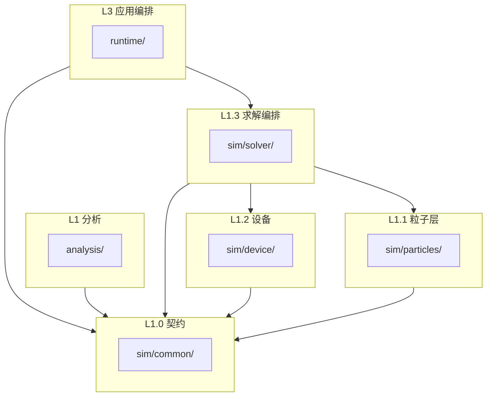
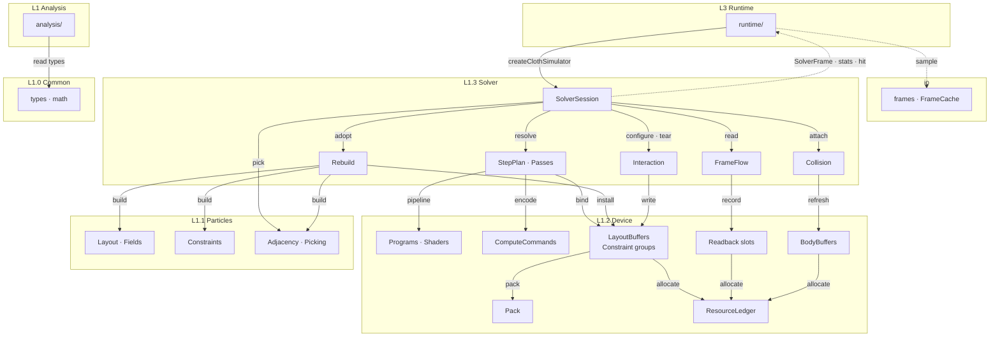
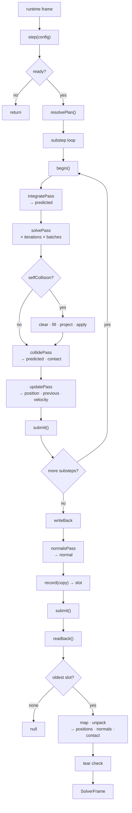

# 仿真架构

> 范围：`src/sim` 的内部结构与对外的对接面。

## 目录

1. [设计原则](#1-设计原则)
2. [分层总览](#2-分层总览)
3. [L1.0 Common](#3-l10-common)
4. [L1.1 Particles](#4-l11-particles)
5. [L1.2 Device](#5-l12-device)
6. [L1.3 Solver](#6-l13-solver)
7. [原则之外的约束](#7-原则之外的约束)
8. [关键流程](#8-关键流程)
9. [取舍与风险](#9-取舍与风险)
10. [附图](#10-附图)

---

## 1. 设计原则

分层原则见《代码规范》§1。`sim` 是 L1 的一个域，内部按 L1.0–L1.3 划分，职责见 2.1。

---

## 2. 分层总览

本文的 L1.0–L1.3 为 `sim` 内部的层号；《系统架构》将 `sim` 整体记为 L1。

### 2.1 分层结构

下图表示各层可以依赖的方向（含传递关系）。`sim` 之外只列引用它的域。



| 层 | 功能 | 内部模块 |
| --- | --- | --- |
| L1.0 common | 定义共享词汇：数据类型与换算纯函数，不含设备类型 | types, math |
| L1.1 particles | 产出粒子化的求解数据：逐粒子场、约束、拓扑与拾取查询 | layout, fields, constraints, adjacency, picking |
| L1.2 device | `sim` 的 WebGPU 实现：pipeline、WGSL、打包、buffer、命令、回读与碰撞面 | programs, shaders, pack, buffers, commands, resources, readback, bodyBuffers, kit |
| L1.3 solver | 决定推进方式：次步顺序、提交边界、热更新、交互与生命周期 | session, plan, passes, rebuild, frameFlow, collision, interaction, lift |

编号仅为标签，不表示线性依赖：L1.1 与 L1.2 同处第二级，互不引用，由 L1.3 交接。

`runtime`（L3）是唯一创建并驱动求解器的域，经 `sim/solver/` 与 `sim/common/` 两个入口；`analysis`（L1）只经 `sim/common/` 读契约类型。各层的 import 范围与引用者见该层边界一节，能力归属与门面规则见 §7。

### 2.2 目录布局

```text
src/sim/
  common/                L1.0：类型 + 纯函数，无设备、无状态
    types.ts math.ts index.ts
  particles/             L1.1：纯 CPU，产物的下标空间是粒子
    layout.ts fields.ts constraints.ts adjacency.ts picking.ts index.ts
  device/                L1.2：唯一创建 GPU 对象、唯一接触 queue 的层
    programs.ts pack.ts buffers.ts commands.ts readback.ts bodyBuffers.ts
    resources.ts kit.ts
    shaders/             integrate solve collide update normals setPin selfCollision
    index.ts
  solver/                L1.3：顺序、资源、交互、生命周期
    session.ts           接口 + 实现 + 工厂，一个文件
    plan.ts              阶段契约 + 顺序
    rebuild.ts frameFlow.ts collision.ts interaction.ts lift.ts
    passes/              substep.ts selfCollision.ts
    index.ts
```

`CachedFrame` 与采样缓存不在 `sim` 内：帧采样属导出与回放，落在 `io/frames.ts`，由 `runtime` 在每次成功回读后写入。

---

## 3. L1.0 Common

`sim/common` 是 L1.1–L1.3 共享的词汇：数据类型与纯函数，不含设备类型。文件归属唯一：契约类型在 `types.ts`，换算与几何纯函数在 `math.ts`，跨域入口为 `index.ts`。

以下为核心类型定义。

```ts
type ParticleIndex = number;
type ConstraintKind = 'structural' | 'shear' | 'crease' | 'seam';

/** Constraint groups the solver dispatches, in solve order. */
const CONSTRAINT_GROUP_ORDER: readonly ConstraintKind[];

/** Triangle mesh a panel contributes; structurally compatible with the pattern mesh. */
interface PanelMesh {
  /** Flat xy vertex positions in centimetres. */
  readonly positions: Float32Array;
  readonly indices: Uint32Array;
  readonly vertexCount: number;
  readonly triangleCount: number;
}

/** One GPU distance constraint: a particle pair held near a rest length. */
interface Constraint {
  p0: ParticleIndex;
  p1: ParticleIndex;
  restLength: number;
  compliance: number;
  /** Distance beyond which the constraint tears; absent never tears. */
  tearLength?: number;
}

/** One pattern piece inside the merged cloth. */
interface PanelInput {
  readonly panelId: string;
  /** First merged particle index of this piece. */
  readonly vertexOffset: number;
  readonly mesh: PanelMesh;
  /** Conformed 3D positions the rest lengths are measured from, in metres. */
  readonly positions3D: Float32Array;
  /** Flat-pattern positions, in metres. */
  readonly restPositions: Float32Array;
  physics: FabricPhysics;
  /** Collision layer, 0 is the innermost. */
  collisionLayer?: number;
  /** Collision clearance of the piece in metres. */
  thicknessMeters?: number;
  /** Flat local vertex index pairs the fold lines cross. */
  creaseEdges?: readonly number[];
}

/** Merged layout and constraints of every piece handed to the solver. */
interface ClothSimInput {
  /**
   * Merged particle positions, flat xyz in metres. Starts at the initial layout; the solver
   * writes readback into this array, so render mesh, picking and highlights share it.
   */
  positions: Float32Array;
  readonly indices: Uint32Array;
  readonly panels: readonly PanelInput[];
  seams: readonly Constraint[];
  readonly pinnedIndices?: readonly ParticleIndex[];
  readonly particleCount: number;
  readonly triangleCount: number;
}

/** Body surface the cloth collides with; structurally compatible with the avatar collider. */
interface CollisionSurface {
  readonly origin: [number, number, number];
  readonly cell: number;
  readonly dims: [number, number, number];
  readonly cellStart: Uint32Array;
  readonly cellTriangles: Uint32Array;
  /** Nine floats per triangle. */
  readonly vertices: Float32Array;
  readonly triangleCount: number;
}

/** Grid description of a collision surface, as the COLLIDE pass reads it. */
interface ColliderGrid {
  readonly triangleCount: number;
  readonly origin: [number, number, number];
  readonly cell: number;
  readonly dims: [number, number, number];
}

/** One simulated frame as the CPU receives it. */
interface SolverFrame {
  /** Flat xyz in metres; aliases the live merged array. */
  readonly positions: Float32Array;
  readonly normals: Float32Array;
  /** Per-particle indentation the body contact applied, in metres. */
  readonly contact: Float32Array;
}

type SolverStatus = 'empty' | 'building' | 'ready' | 'failed';

/** What the solver reports about itself. */
interface SolverStats {
  readonly status: SolverStatus;
  readonly particles: number;
  readonly triangles: number;
  readonly constraints: number;
  readonly batches: number;
  /** Resolved substeps, including the mesh-density multiplier. */
  readonly substeps: number;
  /** Compute dispatches of the last submitted frame. */
  readonly dispatches: number;
  /** Frames of lag between a step and the readback that describes it. */
  readonly readbackLagFrames: number;
  readonly timeSeconds: number;
  readonly lastError: string | null;
}

/** Closest particle to a pick ray or point. */
interface ParticlePickHit {
  index: number;
  distance: number;
  panelIndex: number;
}
```

`PanelMesh` 与 `pattern` 的网格类型结构相同，`CollisionSurface` 与 `avatar` 的碰撞体结构相同，装配处直接传入，不做映射。`SimulationConfig` 与 `FabricPhysics` 沿用 `model` 的类型；拾取接口的 `Vec3` 取自 `base/math`，本层不另立别名。

`DevicePort` 与 `ComputeCommands` 的签名即 `GPUDevice` 与 `GPUBuffer`，置于本层会使契约出现设备类型，故在 L1.2 `device/commands.ts`（见 §5.2）。本层只含类型与纯函数：不分配 buffer、不做设备调用、不持有可变状态。

```ts
function complianceMassScale(mesh: PanelMesh): number;
function meanParticleAreaM2(mesh: PanelMesh): number;
function meshDensitySubsteps(panels: readonly PanelInput[]): number;
function seamBreakStretch(strength: number): number;
function clothThicknessMeters(config: SimulationConfig): number;
function layerSpacingMeters(config: SimulationConfig): number;
```

`runtime` 的装配与 `analysis` 共用这些函数。本层的几何换算建立在 `base` 之上：顶点面积由 `base/geom` 的 `computeVertexAreas` 给出（平方厘米），乘 `base/units` 的 `cm2ToM2` 后才是质量所用的平方米。

---

## 4. L1.1 Particles

### 4.1 职责

输入是版片、面料与缝合关系，输出是以粒子索引为下标的求解数据：逐粒子场、约束与拓扑。三项展开在本层完成：索引（版片局部顶点 → 合并下标，缝合对 → 焊接组）、标量（每块面料一个数 → 每颗粒子一个数）、静止量（克重 × 顶点面积 → 质量，边长 → 静止长度，刚度 + dt → 柔度）。

两类数据的寿命不同：粒子场随布局建立，粒子数变化时重建；约束与拓扑随材料、折痕、缝份、dt 与几何变化，可热替换。本层另负责拾取：最近粒子的射线与点查询，读取位置与面板映射，不修改任何数据，也不触发回读。

### 4.2 模块

| 模块 | 功能 | 关键接口 |
| --- | --- | --- |
| `layout.ts` | 建立布局：粒子到面板的映射、碰撞间隙与层、阻尼与摩擦；合并布局的指纹 | `buildLayout(input, physics, fallback)` → `LayoutTables`、`layoutKey()` |
| `fields.ts` | 展开逐粒子场：质量、阻尼、摩擦、厚度与层 | `computeParticleMass()`、`computeBaseInvMass()`、`computeParticleDamping()`、`computeParticleFriction()`、`computeParticleThickness()`、`computeParticleLayers()` |
| `constraints.ts` | 生成约束：结构、剪切、折痕与缝合，含撕裂阈值 | `buildPanelConstraints()`、`buildCreaseConstraints()`、`tornSeamPairs()` |
| `adjacency.ts` | 构建焊接组：顶点组及其三角形 | `buildAdjacency()` → `NormalAdjacency` |
| `picking.ts` | 解析拾取：粒子哈希网格，射线与点查询 | `ParticlePicker.sync()`、`pickRay()`、`pickPoint()` |

### 4.3 边界

- 可以 import：L1.0、`base`（`picking` 用 `base/geom`）。
- 不得 import：L1.2、L1.3；`pattern`、`render`、`io`。
- 输出的数组是可直接上传的紧密布局（`Float32Array` / `Uint32Array`，无间隙）；约束以对象表示，由 L1.2 打包。
- `positions` 是唯一被求解器写回的数组，其余只读。
- `NormalAdjacency` 以 CSR 表达：CSR 是通用的图表示，不是某个 shader 的私有布局；写入 buffer 属 L1.2。
- 碰撞面的抬升属 L1.3，表形属消费它的 pass。
- 只被 L1.3 引用，跨域不可见；门面为 `particles/index.ts`。

---

## 5. L1.2 Device

### 5.1 职责

`sim` 的 WebGPU 实现：pipeline、WGSL、打包、buffer、uniform 布局、命令录制与回读。不参与求解语义的决定。

### 5.2 模块

| 模块 | 功能 | 关键接口 |
| --- | --- | --- |
| `programs.ts` | 创建全部管线：compute pipeline 与 bind group layout，并校验编译信息 | `createPrograms(device)`、`assertCompiled()` |
| `shaders/` | 提供 WGSL：每个 pass 一个 `XXX_WGSL` 模块 | `INTEGRATE_WGSL` … `SELF_COLLISION_SOLVE_WGSL` |
| `pack.ts` | 打包字节布局：uniform 块、约束 16 字节 stride、粒子 vec4、分批着色与 workgroup 数 | `packIntegrate()`、`packSolve()`、`packCollide()`、`packUpdate()`、`packPin()`、`packSelf()`、`packConstraints()`、`packParticleState()`、`colorConstraints()`、`workgroups()` |
| `buffers.ts` | 管理 buffer：storage / uniform 分配、增长重建与释放账簿 | `createStorage()`、`createUniform()`、`ResourceLedger` |
| `resources.ts` | 持有一个布局的资源：全部 buffer、bind group、约束组与调度表 | `LayoutBuffers.create()`、`bindAll()`、`installGroup()`、`uploadBatch()` |
| `commands.ts` | 提供命令端口：`DevicePort`、`ComputeCommands`、`DeviceServices` 与句柄别名；一子步一 encoder | `dispatch()`、`write()`、`copy()`、`submitted()`、`GpuCommands` |
| `readback.ts` | 双缓冲回读：copy → map → 解包 | `ReadbackSlots` |
| `bodyBuffers.ts` | 上传碰撞面：三个 buffer 的创建与原地刷新 | `refreshBodyBuffers(services, surface, buffers)` |
| `kit.ts` | 装配设备面：一次给出 programs、commands 与分配器 | `createSimDevice(port)` → `SimDevice` |

端口 `DevicePort`、`ComputeCommands`、`DeviceServices` 与 `createSimDevice` 同在 `commands.ts`、`kit.ts`：上层写入一律经 `write`，提交经 `submit`，等待完成经 `submitted`。

### 5.3 边界

- 可以 import：L1.0、`base`、`@webgpu/types`。
- 不得 import：L1.1、L1.3；`three`；任何业务模块。
- WGSL 只在本层，一个 pass 一个文件；`createPrograms` 读 `getCompilationInfo()`，编译错误在 `setup` 阶段抛出。
- `pack.ts` 只做格式：哪些约束可同批、约束如何排入 16 字节、粒子如何交错为 vec4、uniform 字段的偏移。它不判定撕裂与缝份闭合——那是 L1.3 的决定，L1.3 改写 `Constraint` 后要求重传。
- 全部 buffer 经 `ResourceLedger` 创建与释放；设备为借用，本层不销毁 `GPUDevice`，也不假设独占。
- 只被 L1.3 引用；`GPUDevice`、`queue` 与 WGSL 只出现在本层；门面是 `device/index.ts`。

---

## 6. L1.3 Solver

### 6.1 职责

决定推进方式：次步顺序、迭代与批、每帧的提交边界、热更新判定、交互写入、生命周期与读回节奏。

### 6.2 对象

| 对象 | 功能 | 关键接口 |
| --- | --- | --- |
| `ClothSimulator` | 提供对外接口：唯一的签名面 | 见 6.3 |
| `SolverSession` | 编排一帧：子步循环、提交边界、生命周期与转向调用 | `setup()`、`step()`、`readback()`、`destroy()` |
| `StepPlan` | 描述次步计划：阶段顺序与每阶段的重复次数 | `Phase`、`resolvePlan()` |
| `SolverPass` | 实现一个阶段：向当前命令列表编码 dispatch | `id`、`encode(context)`、`dispose?()` |
| `Rebuild` | 维护派生数据：逐粒子表、逆质量与三路热更新 | `init()`、`adopt()`、`adoptTimeStep()`、`restore()` |
| `FrameFlow` | 管理回读：回读槽、CPU 镜像、有限性守卫与版本号 | `allocate()`、`record()`、`readOldest()`、`readNewest()` |
| `Collision` | 管理碰撞面：上传、随体移动与重建 | `attach()`、`moveVertices()`、`refresh()` |
| `Interaction` | 记录交互写入：pin、抓取、撕裂判定与缝份进度 | `setPins()`、`setGrab()`、`resolveTears()`、`setSeamProgress()` |
| `lift` | 抬升起始布局：把埋在人体内的粒子推到体表 | `liftBuriedPositions()` |

### 6.3 对外接口

```ts
interface ClothSimulator {
  readonly stats: SolverStats;
  /** Latest CPU positions; aliases the merged array, empty before the first frame. */
  readonly positions: Float32Array;
  /** Per-particle body indentation read back with the last frame, in metres. */
  readonly contact: Float32Array;
  /** Normals read back with the last frame. */
  readonly normals: Float32Array;
  /** The frame the views should draw: the last finite one, or the live cache before any frame. */
  readonly frame: SolverFrame;

  setup(input: ClothSimInput, surface: CollisionSurface | null, config: SimulationConfig): Promise<void>;
  step(config: SimulationConfig, physics?: FabricPhysics): void;
  readback(): Promise<SolverFrame | null>;
  /** Newest copied frame, for callers that drive the solver themselves. */
  readbackLatest(): Promise<SolverFrame>;

  /** Adopts an in-place change; false when the change needs a rebuild. */
  apply(update: SolverUpdate): boolean;
  /** Restores the start state: positions, time, seam closure and tears. */
  reset(initialPositions: Float32Array): void;

  pin(indices: readonly ParticleIndex[], pinned: boolean): Promise<boolean>;
  pinned(): readonly ParticleIndex[];
  grab(weights: Float32Array, target: readonly [number, number, number]): boolean;
  moveGrab(target: readonly [number, number, number]): void;
  clearGrab(): void;
  grabForceN(): number | null;

  pickRay(origin: Vec3, direction: Vec3, maxDistance: number): ParticlePickHit | null;
  pickPoint(point: Vec3, maxDistance: number, panelSlot: number): ParticlePickHit | null;

  /** Steering writes: dressing progress, a CPU-placed layout, fit clearance and step length. */
  setSeamProgress(progress: number): void;
  setPositions(positions: Float32Array): void;
  setCollisionFields(thickness: Float32Array, layers: Uint8Array): void;
  setTimeStep(dt: number): boolean;
  updateColliderVertices(vertices: Float32Array): void;
  refreshCollider(surface: CollisionSurface): void;

  destroy(): void;
}

function createClothSimulator(port: DevicePort): ClothSimulator;
```

接口、实现与工厂同处 `solver/session.ts`：三者本为一体，不为打断类型引用环另立文件。对外只经 `solver/index.ts`，其中只导出工厂、接口与 `SolverUpdate`，不导出 `SolverSession` 本身。

`apply` 是唯一的热更新入口：材料、约束、几何分别对应 `SolverUpdate` 的一个分支；布局变化使 `apply` 返回 `false`，由调用方重建实例。`setSeamProgress` 与 `setPositions` 为着装流程逐帧驱动的写入，`setCollisionFields` 与 `setTimeStep` 为分析面板与设置面板的直接写入，均不经 `apply`。

输入为 `ClothSimInput`、`CollisionSurface` 与 `SimulationConfig`，输出为 `SolverFrame`、`SolverStats` 与拾取命中。无回调注册与事件总线：由调用方拉取，序列采样由调用方自行保存。

### 6.4 pass 与计划

```ts
interface PassContext {
  readonly commands: ComputeCommands;
  readonly programs: Programs;
  readonly resources: LayoutBuffers;
  readonly particleCount: number;
  /** Frame parameters with the substep time step already applied. */
  readonly config: SimulationConfig;
}

interface SolverPass {
  /** Name the step plan and the profiler report the phase by. */
  readonly id: string;
  encode(context: PassContext): void;
  /** Releases the buffers the pass owns. */
  dispose?(): void;
}

/** One run of a pass inside a substep. */
interface Phase {
  readonly pass: SolverPass;
  readonly repeat: number;
}

interface StepPlan {
  /** Substeps of one step, including the mesh-density multiplier. */
  readonly substeps: number;
  readonly phases: readonly Phase[];
}
```

阶段契约与顺序在 `plan.ts`，五个固定阶段在 `passes/substep.ts`：各约十行且无状态，故合为一文件。自碰撞有状态，单独成文件，其表形辅助函数同置其中——表形随持有 buffer 的 pass 放置。

迭代次数属计划而非 pass：`solve` 的 `repeat` 取 `constraintIterations`，其余阶段为 1；编码时只按 `repeat` 重复，不做槽位判断。

求解为一次 step 内的两层循环，批数由约束着色结果决定，在 `solve` 的一次编码内展开：

```text
一次 step = substeps × [ integrate → solve × iterations → selfCollision → collide → update ]
          + writeBack = normals → copy
```

打包归属按“语义或格式”划分：

| 数据 | 打包位置 | 原因 |
| --- | --- | --- |
| `SimParams` uniform 块 | L1.2 `pack.ts` | 布局是 shader 契约，字段偏移只在设备层 |
| 约束数组 | L1.2 `pack.ts` | 16 字节 stride 是 shader 契约 |
| 约束分批 | L1.2 `pack.ts` | 分批是 dispatch 结构 |
| 焊接顶点的 CSR 表 | L1.1 `adjacency.ts` | 拓扑是语义，CSR 是通用表示；写出 buffer 在 L1.2 |
| 缝合伙伴表、哈希尺寸 | `passes/selfCollision.ts` | 表形是自碰撞 shader 的索引方式，随该 pass 一起持有 buffer |
| 撕裂判定、缝份曲线 | `interaction.ts` | 是行为 |

一个阶段是否参与由 `StepPlan` 决定：自碰撞关闭时不进入 `phases`，而非由 pass 自行判断。`dispose` 由会话在布局销毁时调用；自碰撞是唯一持有 buffer 的阶段。

### 6.5 session / rebuild / frameFlow

三者按“变化原因”分工（见 9.1），会话只保留共享量：`status`、`time`、`lastConfig`、`densitySubsteps`、三个 step 开关、`dispatches`。

1. `SolverSession`：子步循环、提交边界、生命周期与转向调用。不保存逐粒子表与帧数组。
2. `Rebuild`：逐粒子表、逆质量、三路热更新、拓扑与约束组的重装。
3. `FrameFlow`：双缓冲回读、CPU 镜像、有限性守卫与版本号。

`Rebuild` 直接持有 `resources`、`commands`、`interaction` 与 `flow` 四个协作者，不经回调或中间接口：单一实现下再加一层接口只会拉长调用链。

### 6.6 边界

- 可以 import：L1.0、L1.1、L1.2、`base`。
- 唯一的业务依赖是 `avatar` 的 `pushOutOfBody`（其余禁止项见 §7）。
- 只有本层决定 pass 顺序、迭代次数与 submit 边界。
- 一个 `ClothSimulator` 对应一次布局：布局变化时调用方先 `destroy()` 旧实例再 `setup()` 新实例。粒子缓冲区、pipeline、bind group、回读槽与逐粒子表均由实例持有，`destroy()` 统一释放；设备为借用，不销毁。
- 门面：`solver/index.ts`；域外入口见 §7.1。

---

## 7. 原则之外的约束

### 7.1 能力归属

- `GPUDevice`、`createComputePipeline`、`beginComputePass`、`createBindGroup` 与 WGSL 只在 `sim/device`。
- `queue` 只在 `sim/device`：上层经 `ComputeCommands` 的 `write` / `copy` / `submit` / `submitted`。
- `common` 与 `particles` 不出现设备类型名。
- `sim` 不得 import `pattern`、`render`、`io`、`store`、`ui`；业务词汇在 `runtime` 翻译为 `ClothSimInput` 与 `CollisionSurface`。
- `avatar` 只经 `solver/lift.ts` 取 `pushOutOfBody` 一个纯查询，参数仍为 `CollisionSurface`。
- L1.1 与 L1.2 互不引用，也不经 L1.3 转发对方的内部对象。
- 域外入口只有两个：`runtime` 经 `@/sim/solver` 取 `createClothSimulator`、`ClothSimulator`、`SolverUpdate`、`layoutKey`，经 `@/sim/common` 取契约类型与纯函数；`analysis` 只读 `@/sim/common` 的类型；`store` / `ui` / `api` 经 `runtime`。
- `io` 与 `sim` 不接触：帧采样使用 `io/frames` 的 `CachedFrame`，由 `runtime` 在每次成功回读后写入。
- `sim` 依赖 `model` 的 `SimulationConfig`、`FabricPhysics` 与 `base` 的数学、单位、`frameProfiler`。

### 7.2 模块与装配

- 跨层引用只指向目标层的 `index.ts`；深相对导入为 0。
- 各层 `index.ts` 显式列名，不用 `export *`：`device` 的内部件（`ResourceLedger`、`packConstraints` 等）不暴露给上层。
- `solver/index.ts` 只导出 `createClothSimulator`、`ClothSimulator`、`SolverUpdate` 与 `layoutKey`；`SolverSession`、`Rebuild`、`FrameFlow`、`LayoutBuffers` 不出现在门面签名中。
- `ClothSimulator` 只由 `runtime` 创建。
- 新增 pass 落在 `solver/passes/` 并在 `plan.ts` 声明，顺序不写在 `session` 中。

### 7.3 检查

- 层序：`SIM_LAYER = { common: 0, particles: 1, device: 1, solver: 2 }`，向上引用为 0；`particles` 与 `device` 同值，互引由独立禁止项覆盖。`sim/` 下出现未登记的目录直接抛错，避免新目录静默继承 solver 的层级。
- 归属：WGSL 只在 `sim/device/shaders/`；GPU 调用只在 `sim/device/`；`queue` 只在 `sim/device/`；`common` 与 `particles` 不出现设备类型名。
- 门面：跨域 import 只命中 `sim/common/index.ts` 或 `sim/solver/index.ts`（`simDoorViolations` 为 0）；深相对导入为 0。
- 规模：单文件不超过 1000 行；文件级强连通环为 0。

以上约束由 `scripts/check-architecture.mjs`、ESLint `no-restricted-imports` 与类型检查覆盖。

---

## 8. 关键流程

### 8.1 一帧

```text
simulator.step(config)
  → session: 校验 ready 与上一帧有效性
  → plan = resolvePlan(config)          // substeps = config.substeps × meshDensitySubsteps
  → for sub in 0..substeps:
      commands.begin()
      integrate   → predicted
      for iteration: for batch: solve   → predicted
      selfCollision                  → predicted
      collide     → predicted, contact
      update      → position, previous, velocity
      commands.submit()
    writeBack: normals → normal; copy → readback slot; submit
simulator.readback()
  → frameFlow: 取最旧未读槽 → map → 解包 → 撕裂判定 → version++
```

一子步一次 submit：queue 写入与 submit 有序，uniform 只对本子步的 dispatch 可见。

### 8.2 读回

两个槽轮流写入，CPU 读上一个槽：`mapAsync` 面对已写完的副本，不排在刚提交的子步之后。画面、拾取与自碰撞修正因此比物理晚一帧。

槽与解包在 `device/readback.ts`，读取时机、镜像与守卫在 `solver/frameFlow.ts`。`readbackLatest()` 读取最新一帧，供自驱动求解的调用方使用。

### 8.3 更新判定

| 变化 | 做法 |
| --- | --- |
| 面料参数 | 重打包结构 / 剪切 / 折痕约束并重传逐粒子场，位置与速度保留 |
| 缝合、折痕边 | 替换对应约束组，位置保留，缝份进度与已撕裂集合不重置；折痕边由求解器持有，不写回调用方的输入 |
| 同粒子数、拓扑不变 | 换初始布局与索引，存活粒子继续模拟 |
| 粒子数或拓扑变化 | `apply` 返回 `false`，调用方重建 |

四路均在 `solver/rebuild.ts`；会话只转发判定结果。

### 8.4 交互

| 操作 | 路径 |
| --- | --- |
| 钉住 | 逆质量写入 → SET_PIN pass → `commands.submitted()` |
| 抓取 | 权重 buffer 与 integrate uniform；释放后保留速度 |
| 撕裂 | 读回后按 tearLength 判定，改写 `restLength`，由 `resources.uploadBatch` 重传；同一帧内把断开的缝从自碰撞的缝合伙伴表移除 |
| 缝份 | 同上，按闭合比例改写 `restLength` |
| 重置 | 位置回到初始，时间归零；缝份重开（`restLength` 回到开口长度）、已撕裂集合清空，缝合伙伴表按存活缝重建 |
| 拾取 | 粒子网格读 CPU 缓存位置，不触发回读 |

判定与改写均在 `interaction.ts`；`device` 只按改后的对象重新打包上传。

---

## 9. 取舍与风险

### 9.1 L1.3 的规模

`SolverSession` 体量最大，其次是 `Rebuild` 与 `FrameFlow`。三者按变化原因分置：改 pass 顺序只动会话，改约束派生只动 `Rebuild`，改回读节奏只动 `FrameFlow`。继续拆分会使一次常规改动跨越三个文件，收益不抵成本。

### 9.2 端口覆盖设备调用

`ComputeCommands` 覆盖写入、拷贝、提交与等待，故 `solver` 中不出现 `.queue`，测试只需实现该接口即可运行，无需伪造 `GPUDevice`。代价是若干构造参数，以及 `LayoutBuffers` 需持有 `commands` 方可重传批次。

分配由 `solver` 发起（`SelfCollisionPass` 自建 bind group）：分配不涉及排序，`gpuOutsideGpu` 只禁止原始设备调用，分配器在 `device/kit.ts`。

### 9.3 sim → model

`SimulationConfig` 与 `FabricPhysics` 是仿真的输入，直接沿用 `model` 的类型，不另立中立副本。`pattern` 的网格与 `avatar` 的碰撞体按结构契约传入，两端均无映射代码。

### 9.4 嵌套计划

`StepPlan` 是子步 × 迭代 × 批的嵌套结构，不做帧级资源状态机校验，只校验同资源不双写、读前已写。

### 9.5 编译校验的范围

`getCompilationInfo()` 只覆盖 WGSL 语法，不覆盖结构体对齐；对齐错误需在浏览器中确认回读位置。

---

## 10. 附图

### 10.1 数据流

> 实线表示创建、调用与写入，方向向下；虚线表示回传给外部。
> 图中省略两类边：`sim` 内部各对象对 `types · math` 的引用（四层均依赖 L1.0），以及 `createSimDevice` 的装配。
> `io` 不引用 `sim`：回读成功的帧由 `runtime` 采样后写入 `io/frames`。



`SolverSession` 是唯一持有其余五个对象的地方：计划由它解析，重建、回读与交互由它驱动，`Collision` 只在 `attach` 与 `refresh` 时被调用。回读槽的副本在 `FrameFlow.record` 时写入，在 `readback()` 时读出。

### 10.2 次步与读回

> 菱形是判定，`yes` / `no` 为其分支；`→` 后是该阶段写入的缓冲。`step` 与 `readback` 由调用方分别调用，一帧的副本经回读槽交接。


