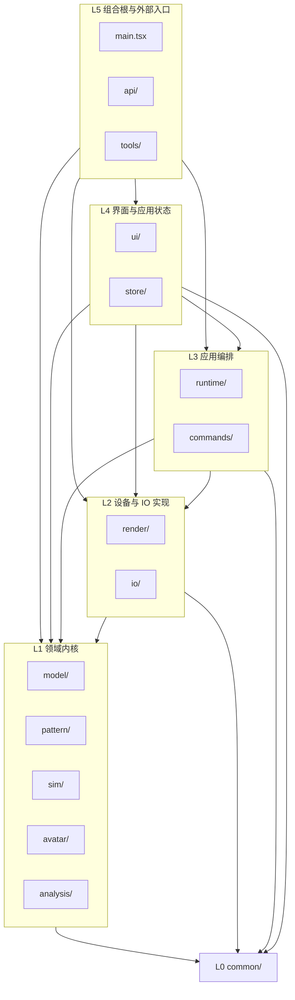
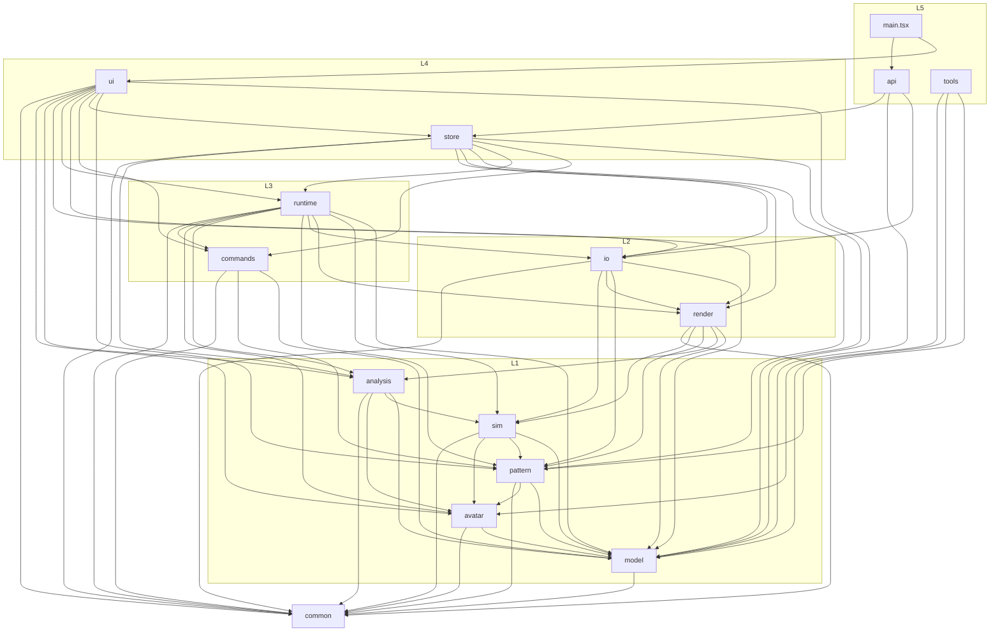
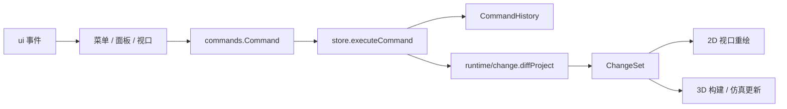
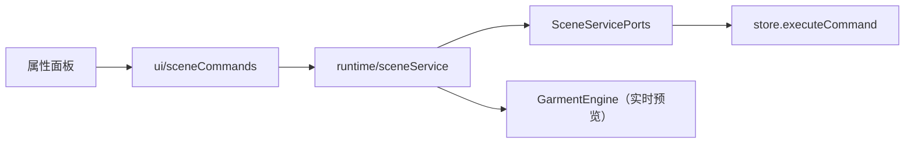
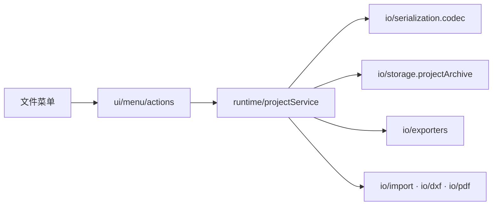
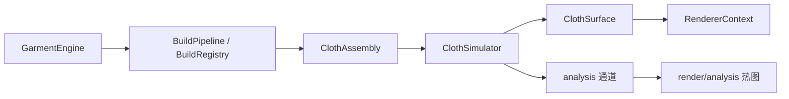

# OpenCloth 架构

> 本文描述当前代码的架构，不记录历史方案。结构与依赖变化时同步更新本文与 `scripts/architecture-baseline.json`。
> 快照日期：2026-11-06。

## 1. 规模与指标

| 指标 | 当前值 |
| --- | ---: |
| 源文件（`src/**/*.{ts,tsx}`） | 368 |
| 源文件行数 | 51,534 |
| 模块门面 `index.ts` | 51 |
| 跨域 import 语句 | 779 |
| 跨域运行时 import | 495（不含 `common` 为 391） |
| 向上违规边 `upwardEdges` | 0 |
| 文件级强连通环 `cycleCount` | 0 |
| 含 ≥2 层 `../` 的 import | 0 |
| 跨域绕过门面 `barrelViolations` | 0 |
| `common` 禁用依赖 | 0 |
| 单文件最大行数 | 977 |
| 单元测试 | 77 文件 / 631 用例 |
| e2e 关键路径 | 6 |

指标由 `npm run arch:report` 实测；`npm run arch:check` 对照基线执行门禁。

## 2. 分层



层级归属：

| 层 | 模块 | 职责 |
| --- | --- | --- |
| L0 | `common` | 数学、几何、ID、文本、时间、单位、格式、随机、事件、Result、平台适配、纯类型端口；零业务依赖 |
| L1 | `model` | 工程文档类型、默认值、校验、规范化、场景节点 id 与变换 |
| L1 | `pattern` | 版型几何、三角剖分、模板、排料、放码、POM、BOM |
| L1 | `sim` | XPBD 布料求解、约束批次、碰撞、帧缓存 |
| L1 | `avatar` | 模特参数、姿态、地标、碰撞体与生成器 |
| L1 | `analysis` | 合身、应变、压力的纯计算与统计报告 |
| L2 | `render` | Three.js / WebGPU 渲染器、材质、分析热图叠加 |
| L2 | `io` | 工程编解码、导入导出、DXF/PDF、IndexedDB 存储 |
| L3 | `runtime` | 引擎与流水线编排、场景/工程服务、变更集 |
| L3 | `commands` | 编辑命令、撤销历史、剪贴板与场景命名写入 |
| L4 | `store` | zustand 应用状态与命令提交 |
| L4 | `ui` | React 界面、2D/3D 视口、菜单、属性面板 |
| L5 | `api` | `window.opencloth` 自动化门面 |
| L5 | `tools` | 独立 Node CLI，不参与前端构建 |

## 3. 实际依赖图

箭头表示真实存在的跨域 import（含类型 import），不是“允许依赖”。所有跨域 import 都指向目标模块的 `index.ts` / `types.ts`。



依赖数量（按 import 语句计）：

| 模块 | 依赖 |
| --- | --- |
| `ui` | model 101、pattern 50、store 47、commands 35、io 28、runtime 14、render 12、common 10、analysis 6、avatar 4 |
| `store` | model 4、analysis 3、runtime 2、commands 2、pattern 1、render 1、io 1、common 1 |
| `runtime` | model 40、sim 21、pattern 16、render 15、io 12、analysis 11、avatar 10、common 6、commands 3 |
| `commands` | common 32、model 32、pattern 26 |
| `io` | model 28、pattern 22、common 19、render 1、sim 1 |
| `pattern` | model 51、common 21、avatar 1 |
| `sim` | model 6、avatar 4、pattern 3、common 1 |
| `analysis` | common 4、avatar 3、model 1、sim 1 |
| `render` | model 14、analysis 9、common 4、pattern 1、sim 1 |
| `avatar` | model 5、common 1 |
| `model` | common 9 |

L1 内部直接依赖（属于当前设计，不是违规）：

- `sim → pattern`：`TriangleMesh` 与邻接构建。
- `sim → avatar`：`AvatarCollider` / `MeshCollider`。
- `analysis → sim`：`ClothSimInput`。
- `analysis → avatar`：碰撞体距离计算。
- `pattern → avatar`：环绕落位的身体地标。

这些依赖都有向、无环；如果未来需要把 L1 做成可独立发布的包，再把共享类型上提到 `model` 或 `common`。

## 4. 关键运行链路

### 4.1 编辑提交



- 命令只描述执行与撤销，不直接操作 store 或引擎。
- `store` 负责深拷贝草稿、执行命令、维护历史并发布变更集。
- 视口根据 `ChangeSet` 决定重建网格、约束或只重绘。

### 4.2 场景属性编辑



`sceneService` 不 import store 或 UI；项目数据、历史提交、选择态和引用列表刷新都由 `ui/sceneCommands` 注入。

### 4.3 工程文件



- `.ocproj.json` 只接受当前 `PROJECT_FORMAT_VERSION`，没有旧版本迁移链。
- 当前格式内缺失的可选字段由 `normalize*` 补默认值。

### 4.4 仿真与渲染



- `runtime` 负责生命周期与阶段调度；`sim` 只做求解；`render` 只做绘制。
- 2D 与 3D 共用 `pattern/panel` 的网格缓存，避免同一版片构建两份网格。

## 5. 模块内部结构

当前模块采用“平铺实现 + `index.ts` 门面”，没有强制 `internal/` 目录。跨域 import 只能指向门面；同域内部可以按目录/文件直接引用。

```
src/
  common/        math geom id text time units format random events result platform ports
  model/         types defaults document schema + 校验/规范化/场景节点
  pattern/       auto drape geom grading marker panel pom seam template triangulate + bom
  analysis/      channel fit pressure strain + 报告 + dynamicPressure
  sim/           clothSimulator simTypes constraintBatches buffers shaders + 碰撞/拾取/缓存
  render/        renderer material analysis + clothSurface imageStore
  avatar/        collider generator + landmarks pose
  io/            serialization exporters import importers storage dxf pdf + projectSummary zip
  runtime/       garmentEngine 流水线 change sceneService projectService + 交互/叠加层
  commands/      command 历史 + 版型/放码/面料/POM/场景命名命令 + advanced
  store/         projectStore uiStore simStore perfStore prefs types
  ui/            app appHooks menu panels viewport2D viewport3D mobile widgets + 上下文模块
  api/           window.opencloth
  tools/         独立 Node CLI
```

模块门面数量按“被跨域引用的子模块”建立，例如 `@/pattern/panel`、`@/io/storage`、`@/runtime/change`，而不是每个域只有一把巨型出口。`ui` 作为顶层不设统一门面；`common` 明确不设总出口。

## 6. 门禁与约定

`npm run arch:check` 强制：

- 依赖只能指向同层或下层（`upwardEdges = 0`）。
- 文件级强连通环为 0（包含 `import type` 边）。
- 深相对导入为 0；跨域 import 必须命中目标的 `index.ts` / `types.ts`（`barrelViolations = 0`）。
- `common` 不得 import 业务模块，也不得 import `three` / React / zustand。
- 单文件不超过 1000 行。
- 指标对照 `scripts/architecture-baseline.json` 只减不增；白名单 `scripts/architecture-allowlist.json` 只减不增。

ESLint 额外禁止：

- `model` import `pattern` / `ui` / `render` / `sim` / `io`。
- `pattern` / `sim` import `ui`。
- `runtime` / `commands` import `ui` / `store`。

代码风格：注释只用英文；导出符号写文档注释；中文只用于 UI 字符串与用户可见文案。测试用 `test/` 镜像模块目录，e2e 在 `e2e/`。

## 7. 已知设计取舍

- **同层直接依赖**：L1 的 `sim/analysis/pattern` 直接引用彼此的公开门面，没有全部改成端口；当前无环，收益高于成本。
- **store 提交命令**：编辑链路是 `ui → commands → store`，不是“runtime 提交、store 只发布”。`store` 需要持有历史与变更集，这是 Zustand 单存储下的刻意选择。
- **跨层中文标签**：布料、光源、缝型、辅料、边角色标签留在 `model`，因为 `io`、`pattern`、`commands` 也会读取；仅 UI 专用的图层名与肤色预设放在 `ui/optionTables`。命令自带中文 `label`，供撤销菜单直接使用。
- **模块级单例**：`pattern/panel` 的网格缓存与 `ui/sceneCommands` / `ui/menu/actions` 的服务绑定在模块作用域创建；它们无跨模块可变状态，测试通过端口注入覆盖。
- **`ui` 无统一门面**：顶层的跨域消费方只有 `main.tsx`，UI 内部按目录组织，不额外制造一层巨型 barrel。
- **文件格式只读当前版本**：不做旧工程迁移；版本不一致时明确拒绝。

## 8. 维护

结构或依赖调整后：

1. 更新本文的模块表与依赖图。
2. 运行 `npm run arch:baseline` 重建基线，再运行 `npm run arch:check`。
3. 同步更新 `README.md` 的目录说明与 `docs/代码规范.md` 的边界规则。
