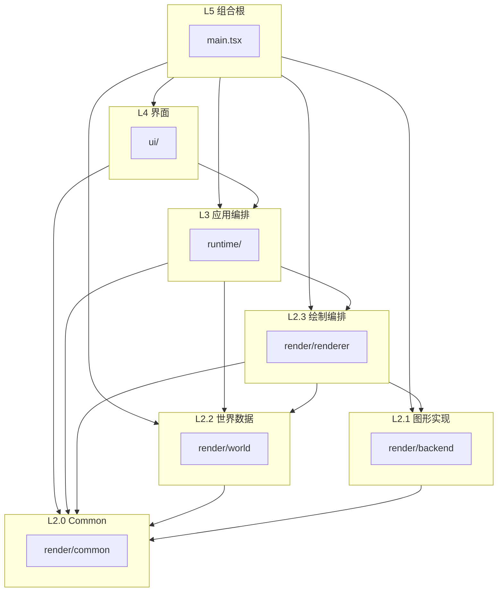
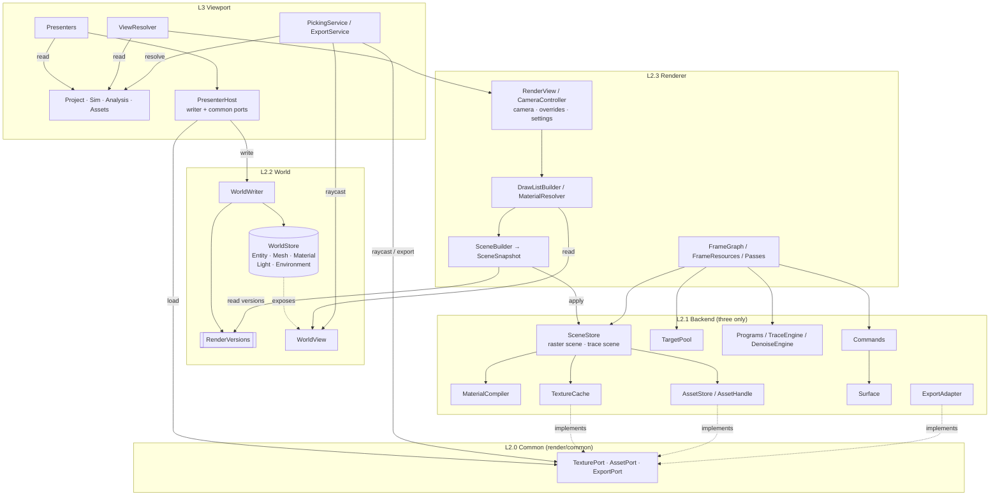
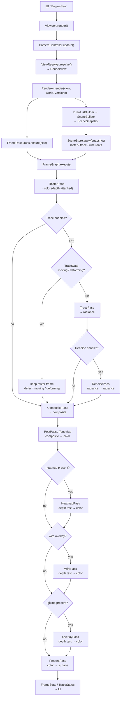

# 渲染架构

> 范围：3D 渲染层及其与 runtime、UI 的对接面。

## 目录

1. [设计原则](#1-设计原则)
2. [分层总览](#2-分层总览)
3. [L2.0 Common](#3-l20-common)
4. [L2.1 Backend](#4-l21-backend)
5. [L2.2 World](#5-l22-world)
6. [L2.3 Renderer](#6-l23-renderer)
7. [L3 Viewport](#7-l3-viewport)
8. [DisplayOverride 与材质](#8-displayoverride-与材质)
9. [拾取与导出](#9-拾取与导出)
10. [原则之外的约束](#10-原则之外的约束)
11. [关键流程](#11-关键流程)
12. [取舍与风险](#12-取舍与风险)
13. [附图](#13-附图)

---

## 1. 设计原则

分层原则见《代码规范》§1。本文的层号沿用《系统架构》的全局编号，并把 `render` 内部细化为 L2.0–L2.3。

---

## 2. 分层总览

本文的“业务模块”指 `model` / `pattern` / `sim` / `analysis` / `io`；它们由 L3 使用。

### 2.1 分层结构

下图表示各层可以依赖的方向（含传递关系）。



`src/main.tsx` 为唯一装配点：创建 Backend、World、Renderer 与 Viewport，并向 Viewport 注入 `common` 端口。

| 层 | 功能 | 内部模块 |
| --- | --- | --- |
| L2.0 Common | 定义跨层共享的渲染词汇：数据类型、资源端口接口与能力探测 | types, ports, capability |
| L2.1 Backend | 提供图形能力：设备、命令、目标、纹理、资产、场景缓存、材质编译、光追、降噪与导出适配 | surface, commands, targets, textures, assets, scene, programs, trace, denoise, export |
| L2.2 World | 保存场景数据：实体、网格、材质、灯光、环境与变更版本 | world, types, layers, transform, versions |
| L2.3 Renderer | 组织单帧绘制：相机、绘制列表、材质变体、帧顺序与各 pass | view, frame, passes, sceneBuilder |
| L3 Viewport | 连接业务模型与 UI：写入世界、解析视图、拾取与导出 | viewport, resolver, presenters, picking, export；由 `main.tsx` 装配 |
| L4 UI | 提供界面：布局、面板、命令与状态订阅 | app, panels, menu, viewport3D, mobile |

### 2.2 目录布局

```text
src/
  render/                 渲染子系统
    common/               L2.0：Common，纯类型 + 端口接口，无 three、无业务依赖
      types.ts ports.ts capability.ts viewMath.ts index.ts
    backend/              L2.1：three 唯一出现处
      surface.ts commands.ts targets.ts textures.ts types.ts
      assets/             assetStore、modelLoader、bodyMaterial、softBody
      scene/              sceneStore、materialCompiler、geometryCache、diagnostics
      programs.ts         合成、色调映射、呈现、blit
      trace/              traceEngine、traceGate、pathTracer、capability
      denoise/            denoiseEngine
      export/             exportAdapter、meshText
      index.ts
    world/                L2.2：纯数据
      world.ts types.ts layers.ts transform.ts versions.ts
      index.ts
    renderer/             L2.3：纯策略
      view/               cameraController、drawList、materialResolver、types
      frame/              graph、pass、previewGraph、resources
      passes/             raster、trace、denoise、composite、post、heatmap、wire、overlay、
                          present、previewScene、previewTone
      sceneBuilder.ts renderer.ts previewPipeline.ts
      index.ts
  runtime/                L3：Viewport + 业务适配
    viewport.ts viewResolver.ts domainBindings.ts
    garmentEngine.ts clothAssembly.ts dressingController.ts …   业务适配
    presenters/           host、cloth、stage、avatar、environment、light、overlay、analysis、printTextures
    picking.ts exportService.ts
  main.tsx                装配入口：创建视口的 Backend/World/Renderer/Viewport 与缩略图的
                          Backend/Previewer，注入 `common` 端口
  ui/                     L4
```

---

## 3. L2.0 Common

`render/common` 是 Backend、World、Renderer、Viewport 共享的词汇：纯数据类型与资源端口接口。以下为核心类型定义。

文件归属唯一：数据类型在 `render/common/types.ts`，端口在 `render/common/ports.ts`，能力探测在 `render/common/capability.ts`，相机与取景的纯函数在 `render/common/viewMath.ts`。`capability.ts` 只做探测与失败描述（`detectWebGPU()`、`RayTracingCapability`、`RayTracingUnsupportedError`），不持有任何 GPU 实现；`viewMath.ts` 只把 `CameraState` 换算成射线、屏幕点与取景距离，不读世界也不碰 three。后续章节为了贴近使用方而解释的类型同样属于 `common`，实现时不得放进 `render/world` 或 `render/renderer`：

| 类型 | 解释位置 |
| --- | --- |
| `MeshRef` / `MaterialRef` | 5.3 |
| `ViewSettings` / `RenderView` / `DisplayOverride` | 6.3 |
| `FrameSize` | 6.4 |
| `SceneItem` / `SceneMesh` / `SceneSnapshot` | 6.5 |

```ts
type EntityId = number;
type MeshId = number;
type MaterialId = number;
type LightId = number;
type AssetKey = string;

interface Bounds {
  readonly min: Vec3;
  readonly max: Vec3;
}

interface Transform {
  position: Vec3;
  rotationEuler: Vec3;
  scale: Vec3;
}

interface Ray {
  readonly origin: Vec3;
  readonly direction: Vec3;
}

interface RayHit {
  readonly entity: EntityId;
  readonly triangle: number;
  readonly distance: number;
  readonly point: Vec3;
  readonly barycentric: readonly [number, number, number];
}

interface MeshGroup {
  start: number;
  count: number;
  materialSlot: number;
}

interface InstanceData {
  /** Flat column-major 4x4 matrices, one per instance. */
  matrices: Float32Array;
  /** Optional flat rgb per instance. */
  colors?: Float32Array;
  count: number;
}

interface MeshData {
  readonly topology: 'triangle' | 'line' | 'point';
  readonly streams: {
    readonly position: Float32Array;
    readonly normal?: Float32Array;
    readonly uv?: Float32Array;
    readonly color?: Float32Array;
    /** One scalar per vertex, sampled by heatmap materials. */
    readonly field?: Float32Array;
  };
  readonly index?: Uint32Array;
  readonly groups?: readonly MeshGroup[];
  readonly instances?: InstanceData;
  /** Omitted only for procedural sources; World fills the bounds before the mesh is published. */
  readonly bounds?: Bounds;
}

interface MaterialData {
  readonly kind: 'surface' | 'unlit' | 'line' | 'heatmap' | 'wire' | 'diagnostic';
  /** Human-readable label; identity stays with `MaterialRef`. */
  readonly name?: string;
  readonly color?: string | number;
  readonly roughness?: number;
  readonly metalness?: number;
  readonly opacity?: number;
  readonly vertexColors?: boolean;
  readonly maps?: Partial<Record<'albedo' | 'normal' | 'roughness' | 'metallic', string>>;
  readonly uvTiling?: { x: number; y: number };
  readonly uvOffset?: { x: number; y: number };
  readonly blending?: 'opaque' | 'alpha' | 'additive';
  readonly depth?: 'tested' | 'always';
  readonly depthWrite?: boolean;
  readonly side?: 'front' | 'back' | 'double';
  readonly wireframe?: boolean;
  readonly polygonOffset?: { factor: number; units: number };
  readonly sheen?: number;
  readonly sheenColor?: string | number;
  readonly sheenRoughness?: number;
  readonly transmission?: number;
  readonly thickness?: number;
  readonly clearcoat?: number;
  readonly clearcoatRoughness?: number;
  readonly anisotropy?: number;
  readonly iridescence?: number;
  readonly normalScale?: number;
  readonly heatmap?: {
    readonly palette: readonly string[];
    readonly min: number;
    readonly max: number;
  };
}

interface CameraState {
  readonly projection: 'perspective' | 'orthographic';
  readonly position: Vec3;
  readonly target: Vec3;
  readonly up: Vec3;
  readonly fovDeg: number;
  readonly viewHeightMeters: number;
  readonly aspect: number;
  readonly near: number;
  readonly far: number;
}

type CameraProjection = 'perspective' | 'orthographic';

interface CameraPose {
  readonly position: Vec3;
  readonly target: Vec3;
  readonly up?: Vec3;
  readonly fovDeg: number;
  readonly viewHeightMeters: number;
  readonly projection: CameraProjection;
}

/** GPU device the domain simulation binds its own pipelines to; carries no three type. */
interface DevicePort {
  device(): GPUDevice;
}

interface CameraHost {
  update(): void;
  snapshot(aspect?: number): CameraState;
  projection(): CameraProjection;
  setProjection(projection: CameraProjection): void;
  setPose(pose: CameraPose): void;
  frame(bounds: Bounds): void;
  ray(ndcX: number, ndcY: number, aspect?: number): Ray;
  onChange(listener: () => void): () => void;
}

interface LightData {
  readonly type: 'directional' | 'point' | 'spot' | 'area';
  readonly name: string;
  readonly color: string;
  readonly intensity: number;
  readonly position: Vec3;
  readonly target: Vec3;
  readonly distance: number;
  readonly coneAngleDeg: number;
  readonly penumbra: number;
  readonly width: number;
  readonly height: number;
  readonly enabled: boolean;
}

interface EnvironmentData {
  readonly background: 'color' | 'texture' | 'none';
  readonly color: string;
  readonly textureKey: string | null;
  readonly intensity: number;
  /** Url the texture key was loaded from; empty while no image is used. */
  readonly url: string;
}

interface ResolvedMaterial {
  readonly technique: MaterialTechnique;
  readonly data: MaterialData;
  readonly source: MaterialRef;
  /** World material revision behind the variant; absent for view-generated variants. */
  readonly revision?: number;
  readonly diagnostic?: FillMode;
}

interface VersionStamp {
  readonly topology: number;
  readonly geometry: number;
  readonly transform: number;
  readonly material: number;
  readonly visibility: number;
  readonly lights: number;
  readonly environment: number;
}

type LayerId = 'underlay' | 'subject' | 'overlay' | 'gizmo';
type EntityTag = string;
type ChannelMask = number;

const CHANNEL_RASTER = 1;
const CHANNEL_TRACE = 2;
const CHANNEL_ALL = CHANNEL_RASTER | CHANNEL_TRACE;

interface EntityFilter {
  readonly layers?: readonly LayerId[];
  readonly channels?: ChannelMask;
  /** Entities must carry every listed tag. */
  readonly tags?: readonly EntityTag[];
}

type ExportFormat = 'glb' | 'obj' | 'fbx' | 'usd';

type MaterialTechnique =
  | 'surface'
  | 'unlit'
  | 'line'
  | 'heatmap'
  | 'wire'
  | 'diagnostic'
  | 'asset';

/** Diagnostic fill drawn by the `diagnostic` technique. */
type FillMode = 'physical' | 'uvCheck' | 'normal' | 'vertexNormal';

type DrawStage = 'scene' | 'postTone' | 'gizmo';
type DrawBucket = 'opaque' | 'transparent' | 'overlay' | 'gizmo';

interface TexturePort {
  load(key: string, url: string, options?: TextureOptions): void;
  paint(key: string, commands: readonly PaintCommand[]): void;
  release(key: string): void;
  readonly version: number;
}

interface AssetPort {
  load(key: AssetKey, source: AssetSource): Promise<AssetHandle>;
  handle(key: AssetKey): AssetHandle | null;
  release(key: AssetKey): void;
}

type AssetDisplay = 'visible' | 'hidden' | 'translucent';

interface AssetAppearance {
  readonly color?: string;
  readonly roughness?: number;
  readonly clearcoat?: number;
  /** Surface opacity, 1 for an opaque body. */
  readonly opacity?: number;
}

interface AssetHit {
  readonly distance: number;
  readonly point: Vec3;
}

interface AssetAnimation {
  readonly name: string;
  readonly duration: number;
}

interface AssetPlayback {
  /** Index into `animations()`. */
  readonly clip: number;
  readonly timeSeconds: number;
  readonly playing: boolean;
}

/** Triangles of the asset body in its local frame, used by the cloth collider. */
interface AssetCollision {
  readonly vertices: Float32Array;
  readonly indices: Uint32Array;
}

interface AssetHandle {
  readonly revision: number;
  readonly bounds: Bounds;
  pose(pose: Transform): void;
  setAppearance(appearance: AssetAppearance): void;
  setDisplay(display: AssetDisplay): void;
  setHighlighted(on: boolean): void;
  animations(): readonly AssetAnimation[];
  playback(): AssetPlayback;
  play(clip: number, loop?: boolean): boolean;
  seek(seconds: number): void;
  setPlaying(playing: boolean): void;
  advance(dtSeconds: number): boolean;
  raycast(ray: Ray): AssetHit | null;
  collision(): AssetCollision | null;
  /** Presses the body inward under cloth contact; false when the asset stays rigid. */
  deform?(positions: Float32Array, contact: Float32Array | null): boolean;
  restore?(): void;
  export(format: ExportFormat): Promise<ArrayBuffer>;
  dispose(): void;
}

/** One mesh a procedural asset source carries. */
interface AssetMesh {
  readonly name: string;
  readonly mesh: MeshData;
  readonly material?: MaterialData;
  readonly transform?: Transform;
}

type AssetSource =
  | {
    readonly kind: 'model';
    readonly fileName?: string;
    readonly targetHeight?: number;
  } & (
    | { readonly url: string; readonly data?: never }
    | { readonly url?: never; readonly data: ArrayBuffer }
  )
  | {
    readonly kind: 'meshes';
    readonly meshes: readonly AssetMesh[];
  };

interface TextureOptions {
  readonly colorSpace?: 'srgb' | 'linear';
  readonly tiling?: { readonly x: number; readonly y: number };
  readonly offset?: { readonly x: number; readonly y: number };
}

/** Placement of one print rectangle in a panel's normalised UV square. */
interface PrintPlacement {
  /** Rectangle centre, u right and v up, in 0..1. */
  readonly center: { readonly x: number; readonly y: number };
  /** Rectangle size as a fraction of the panel's UV box. */
  readonly width: number;
  readonly height: number;
  readonly angleDeg: number;
  readonly opacity: number;
  readonly repeat: { readonly x: number; readonly y: number };
  readonly imageUrl: string;
}

/** One repaint of a composed panel texture. */
interface PaintCommand {
  readonly width: number;
  readonly height: number;
  readonly baseColor: string;
  readonly albedo?: {
    readonly url: string;
    readonly tiling?: { readonly x: number; readonly y: number };
    readonly offset?: { readonly x: number; readonly y: number };
  };
  readonly panelSizeCm?: { readonly x: number; readonly y: number };
  readonly prints?: readonly PrintPlacement[];
}

interface TraceStats {
  readonly samples: number;
  readonly accumulating: boolean;
}

type DenoiseModel = 'small' | 'base';

interface TraceSettings {
  readonly maxBounces: number;
  readonly frameBudget: number;
  readonly maxSamples: number;
  readonly renderScale: number;
  readonly denoise: boolean;
  readonly denoiseModel: DenoiseModel;
  readonly filterGlossyFactor: number;
  readonly clampDirect: number;
  readonly clampIndirect: number;
}

type TraceStatus =
  | 'inactive'
  | 'building'
  | 'deforming'
  | 'moving'
  | 'blending'
  | 'traced'
  | 'unsupported';

interface FrameStats {
  readonly passes: readonly string[];
  readonly trace: TraceStats;
  readonly cpuMs: number;
}

type RayTraceFailure = 'gpu-error' | 'setup-failed';

/** Outcome of the one-time path tracing probe. */
interface RayTracingCapability {
  ok: boolean;
  failure: RayTraceFailure | null;
  /** Raw technical text shown beside the label. */
  detail: string;
}

interface ExportPort {
  export(
    snapshot: SceneSnapshot,
    assets: readonly AssetHandle[],
    format: ExportFormat,
  ): Promise<ArrayBuffer>;
}
```

`MeshRef` / `MaterialRef` 是 `World` 的引用类型，定义见 5.3。`TexturePort` / `AssetPort` / `ExportPort` 由 L2.1 实现、Viewport 使用。

`AssetSource`、`AssetAppearance`、`AssetHit`、`AssetAnimation`、`AssetPlayback`、`AssetDisplay`、`AssetCollision`、`ExportFormat`、`TextureOptions`、`PaintCommand`、`PrintPlacement`、`RayTracingCapability` 是端口的附属值类型。`DevicePort` 只暴露 WebGPU 的 `GPUDevice`，供仿真绑定自己的管线。

---

## 4. L2.1 Backend

### 4.1 职责

所有和 WebGPU/three 有关的实现：画布与设备、命令录制、渲染目标、纹理解码、资产、three 场景缓存、材质编译、固定全屏 shader、路径追踪、降噪、导出适配。

这一层只引用 `common` 里的数据和端口，以及 `base` 的纯工具（数学、几何、平台适配与帧内计时）。

### 4.2 对象

| 对象 | 功能 | 关键接口 |
| --- | --- | --- |
| `Surface` | 维护画布与绘制尺寸：尺寸读取、宽高比与 resize | `canvas`、`size`、`drawingBuffer`、`aspect`、`resize()` |
| `Commands` | 录制一帧的绘制命令：绑定目标、绘制场景、复制与恢复；另有 `drawMaterial()`、`cameraFor()`、`readTarget()`、`bindScene()` 四个 Backend 内部入口 | `setTarget()`、`drawScene()`、`copy()`、`restore()` |
| `TargetPool` | 管理渲染目标：常驻目标、临时目标与按尺寸重建 | `color`、`composite`、`radiance`、`texture()`、`ensure()`、`scratchAt()` |
| `TextureCache` | 管理纹理资源：图片与 HDR/EXR 加载、印花合成图绘制、纹理版本 | `load()`、`paint()`、`release()`、`version` |
| `AssetStore` | 管理不透明资产：GLTF 加载、句柄产出与释放 | `load()`、`handle()`、`release()` |
| `AssetHandle` | 提供资产操作入口：变换、显示、动画、拾取、压形与导出 | `revision`、`bounds`、`pose()`、`play()`、`advance()`、`setAppearance()`、`raycast()`、`collision()`、`deform()`、`export()` |
| `SceneStore` | 维护 `raster`、`trace` 与 `wire` 场景根：按快照应用、raster/trace/wire 出口与 stage 查询 | `apply()`、`raster`、`trace`、`wire`、`hasStage()`、`hasWire`、`sceneFor()`、`traceSceneRoot` |
| `MaterialCompiler` | 编译并缓存材质：材质描述到 three 材质、变体与纹理版本 | — |
| `ProgramLibrary` | 提供固定程序：合成、色调映射、呈现与 blit | `composite()`、`toneMap()`、`present()`、`blit()` |
| `TraceEngine` | 适配路径追踪：构建探测、配置、采样与恢复 | `capability`、`ready`、`samples`、`ensure()`、`configure()`、`trace()`、`recover()` |
| `DenoiseEngine` | 适配降噪：配置、执行与重置 | `configure()`、`run()`、`retry()`、`reset()` |
| `ExportAdapter` | 适配导出：从快照与资产生成 GLB、OBJ、FBX、USD | `export()` |

### 4.3 接口

```ts
interface SurfaceSize {
  readonly width: number;
  readonly height: number;
}

interface Surface {
  readonly canvas: HTMLCanvasElement;
  /** Drawing surface size in CSS pixels. */
  readonly size: SurfaceSize;
  /** Drawing-buffer size in device pixels. */
  readonly drawingBuffer: SurfaceSize;
  /** CSS aspect ratio of the drawing surface. */
  readonly aspect: number;
  resize(width: number, height: number): void;
}

interface TargetPool {
  /** Lit raster image; the only target that carries depth. */
  readonly color: TargetHandle;
  /** Raster image merged with traced radiance, linear. */
  readonly composite: TargetHandle;
  /** Path-traced radiance, linear HDR. */
  readonly radiance: TargetHandle;
  /** Texture view of a target, for programs that sample or blit it. */
  texture(target: TargetHandle): TextureHandle;
  ensure(size: FrameSize): boolean;
  /** Scratch target of one parity; `format` picks a linear HDR or an encoded display target. */
  scratchAt(
    index: number,
    width: number,
    height: number,
    format?: 'linear' | 'display',
  ): TargetHandle;
  dispose(): void;
}

interface BackendOptions {
  readonly antialias?: boolean;
  readonly onDeviceLost?: (reason: string) => void;
  readonly onDenoiseFailure?: (message: string) => void;
}

interface Backend {
  readonly surface: Surface;
  readonly commands: Commands;
  readonly targets: TargetPool;
  readonly textures: TexturePort;
  readonly assets: AssetPort;
  readonly scene: SceneStore;
  readonly programs: ProgramLibrary;
  readonly trace: TraceEngine;
  readonly denoise: DenoiseEngine;
  readonly export: ExportPort;
  /** Device shared with the domain simulation; the only WebGPU handle that leaves the layer. */
  readonly device: DevicePort;

  resize(width: number, height: number): void;
  dispose(): void;
}

function createBackend(
  canvas: HTMLCanvasElement,
  options?: BackendOptions,
): Promise<Backend>;
```

`TargetHandle`、`TextureHandle`、`ProgramHandle`、`SceneHandle` 是 Backend 的不透明句柄。`TargetHandle` 只用于绑定绘制目标；需要纹理视图时调用 `TargetPool.texture(target)`。曝光以 `ViewSettings.exposure` 为唯一来源，由 `PostPass` 交给 `ProgramLibrary.toneMap`；呈现由 `ProgramLibrary.present` 完成，帧末用 `Commands.restore()` 解绑目标；`Surface` 只持有画布与尺寸，曝光与呈现都由 `ProgramLibrary` 承担。

```ts
interface SceneStore {
  apply(snapshot: SceneSnapshot): void;
  readonly raster: SceneHandle;
  readonly trace: SceneHandle;
  readonly wire: SceneHandle;
  hasStage(stage: DrawStage): boolean;
  readonly hasWire: boolean;
  /** Scene root the command recorder binds for one stage of a handle. */
  sceneFor(handle: SceneHandle, stage: DrawStage): SceneRoot;
  /** Trace root the denoiser rasterizes its auxiliary guides from. */
  readonly traceSceneRoot: SceneRoot;
  dispose(): void;
}

interface SceneHandle {
  readonly id: 'raster' | 'trace' | 'wire';
  readonly revision: number;
  readonly geometryRevision: number;
  readonly materialRevision: number;
  readonly stage: DrawStage;
}
```

`SceneRoot` 是 Backend 内部对 three 场景的称呼，只在 Backend 内部使用；`SceneStore` 对外仍以 `SceneHandle` 出现。

```ts
/** The renderer-facing subset; scene binding and material draws stay inside Backend. */
interface Commands {
  setTarget(target: TargetHandle | null, clear: boolean): void;
  drawScene(scene: SceneHandle, stage: DrawStage, camera: CameraState): void;
  copy(source: TextureHandle, target: TargetHandle): void;
  restore(): void;
}
```

`Commands` 的完整实现另有四个 Backend 内部方法，不进入渲染契约：`bindScene()` 装上场景根解析器（由 `Backend` 在构造 `SceneStore` 后注入，避免两对象互相构造）、`drawMaterial()` 画全屏材质（`ProgramLibrary` 用它完成合成、色调映射与呈现）、`cameraFor()` 把 `CameraState` 换成 three 相机（`TraceEngine` 与 `DenoiseEngine` 复用）、`readTarget()` 回读 8 位目标（缩略图管线取 PNG 字节）。

```ts
interface ProgramLibrary {
  composite(
    commands: Commands,
    raster: TextureHandle,
    radiance: TextureHandle | null,
    weight: number,
    target: TargetHandle,
  ): void;
  toneMap(
    commands: Commands,
    source: TextureHandle,
    target: TargetHandle,
    curve: 'none' | 'aces' | 'reinhard' | 'linear',
    exposure: number,
  ): void;
  present(commands: Commands, source: TextureHandle): void;
  blit(commands: Commands, source: TextureHandle, target: TargetHandle): void;
}
```

```ts
interface TraceEngine {
  readonly capability: RayTracingCapability | null;
  readonly ready: boolean;
  readonly samples: TraceStats;
  /** Builds and probes the tracer on first use; a rejected device raises. */
  ensure(
    settings: TraceSettings,
    camera: CameraState,
    versions: Readonly<VersionStamp>,
  ): Promise<void>;
  configure(settings: TraceSettings): void;
  trace(
    camera: CameraState,
    versions: Readonly<VersionStamp>,
    target: TargetHandle,
  ): TraceFrame;
  recover(): void;
  dispose(): void;
}

interface TraceFrame {
  readonly drawn: boolean;
  readonly defer: TraceDefer | null;
  readonly samples: number;
  readonly weight: number;
  readonly accumulating: boolean;
}
```

```ts
interface DenoiseFrame {
  readonly radiance: TargetHandle;
  readonly samples: number;
  readonly weight: number;
  readonly accumulating: boolean;
  readonly restarted: boolean;
}

interface DenoiseEngine {
  configure(model: DenoiseModel): void;
  run(scene: SceneStore, camera: CameraState, frame: DenoiseFrame): TextureHandle | null;
  retry(): void;
  reset(): void;
  dispose(): void;
}
```

`AssetStore`、`TextureCache`、`ExportAdapter` 是 Backend 内部实现，分别实现 `common` 的 `AssetPort`、`TexturePort`、`ExportPort`；`Backend` 的 `index.ts` 只导出端口类型，实现类留在 Backend 内部。端口定义见 3。

### 4.4 场景根

`SceneStore` 维持 `raster`、`trace` 与 `wire` 场景根，stage 选择器决定 `raster` 根里哪一组可见：

- `raster`：绘制 `rasterMaterials`，按 `scene`、`postTone`、`gizmo` 划分 stage。`drawScene` 接收 stage 参数，`RasterPass` 绘制 `scene`，`HeatmapPass` 绘制 `postTone`，`OverlayPass` 绘制 `gizmo`。
- `trace`：只包含 `traceMaterials` 非空的实体，统一使用 surface 材质，统一在 `scene` stage。
- `wire`：只挂线框网格，由单独分组承载；线框材质为 unlit，场景只挂这一组网格。`WirePass` 在色调映射之后绘制它，句柄的 `stage` 固定为 `postTone` 表示绘制时机。

热图在 `raster` 根里把实体的 stage 从 `scene` 换到 `postTone`，几何与实体复用同一份。`postTone` 同时承载缝线、明线与辅料：它们与热图一样绕过色调曲线，由 `HeatmapPass` 按 stage 一并绘制。开启热图时 `OverlayKit` 隐藏明线与辅料，缝线保留在热图之上。各根共享几何、灯光与材质缓存；材质按快照中的材质记录分别解析，相同变体只保留一份，对象节点由各根各持一套。

### 4.5 资产与纹理

- GLTF、骨骼、动画保留为不透明的 `AssetHandle`；World 只存 `AssetKey` 与实体变换。
- `AssetHandle` 提供动画、外观、包围盒、射线检测和导出；对外只出现中性句柄与数据。
- HDR/EXR 解码、等距柱状投影、印花合成图的绘制都在 `TextureCache` 内完成；Viewport 只提交 URL 或中性的绘制命令。
- 材质编译按“材质 `revision`、`technique`、纹理版本”缓存，世界材质在帧内保持不变。

### 4.6 边界

- 输入是 `SceneSnapshot`；World 只在该快照生成时被读取。
- three 类型留在实现内部，`index.ts` 只导出 `Backend`/`createBackend`、`BackendOptions`、Renderer 使用的接口类型（`Surface`、`Commands`、`TargetPool`、`ProgramLibrary`、`SceneStore`、`TraceEngine`、`DenoiseEngine`）、`common` 端口与中性句柄。
- `ProgramLibrary` 只以接口类型导出，由 `Backend` 构造并持有；`MaterialCompiler` 与缓存实现类由 `Backend` 内部构造并持有。

---

## 5. L2.2 World

### 5.1 职责

只描述“画什么”：实体、网格、材质、灯光、环境与变更版本。

### 5.2 对象

| 对象 | 功能 | 关键数据与接口 |
| --- | --- | --- |
| `WorldStore` | 持有世界数据：实体、网格、材质、灯光与环境映射 | `entity`、`mesh`、`material`、`light`、`environment` |
| `RenderEntity` | 描述可绘制实体：所属 layer、tags、变换、网格、材质、channel 与包围盒 | `id`、`layer`、`tags`、`transform`、`mesh`、`materials`、`channels`、`bounds` |
| `Mesh` | 保存几何数据：`MeshData`、`id` 与 `revision` | `MeshData`、`id`、`revision` |
| `Material` | 保存着色数据：`MaterialData`、`id` 与 `revision` | `MaterialData`、`id`、`revision` |
| `RenderLight` | 描述灯光：类型、颜色、强度、位置、朝向与光锥参数 | `type`、`name`、`color`、`intensity`、`position`、`target`、`distance`、`coneAngleDeg`、`penumbra`、`width`、`height`、`enabled` |
| `RenderEnvironment` | 描述背景与环境光：背景模式、颜色、纹理 key 与强度 | `background`、`color`、`textureKey`、`intensity`、`url` |
| `LayerPolicy` | 规定 layer 语义：所属 stage、光追参与、可拾取与可导出 | `stage`、`traceable`、`pickable`、`exportable` |
| `RenderVersions` | 记录变更戳：拓扑、几何、变换、材质、可见性、灯光与环境 | `topology`、`geometry`、`transform`、`material`、`visibility`、`lights`、`environment` |
| `WorldWriter` | 提供世界写入口：mesh、material、entity 的增删改，灯光与环境，以及手动递增版本 | `createMesh()`、`updateMesh()`、`destroyMesh()`、`createMaterial()`、`updateMaterial()`、`destroyMaterial()`、`createEntity()`、`updateEntity()`、`destroyEntity()`、`addLight()`、`updateLight()`、`removeLight()`、`clearLights()`、`setEnvironment()`、`touch()` |
| `WorldView` | 提供世界读入口：实体、网格、材质、灯光、环境、包围盒与射线查询 | `entities()`、`entity()`、`mesh()`、`material()`、`lights()`、`environment()`、`bounds()`、`raycast()` |

### 5.3 数据类型

`common` 里的网格、材质、相机、灯光、环境、版本是唯一来源；World 只加 id 和 revision。

```ts
interface RenderEntity {
  readonly id: EntityId;
  readonly layer: LayerId;
  readonly tags: ReadonlySet<EntityTag>;
  readonly transform: Transform;
  readonly mesh: MeshRef;
  readonly materials: readonly MaterialRef[];
  readonly channels: ChannelMask;
  readonly bounds: Bounds;
}

interface Mesh extends MeshData {
  readonly id: MeshId;
  readonly revision: number;
}

interface Material extends MaterialData {
  readonly id: MaterialId;
  readonly revision: number;
}

interface RenderLight extends LightData {
  readonly id: LightId;
}

type RenderEnvironment = EnvironmentData;
```

```ts
// EntityId / MeshId / MaterialId / LightId / AssetKey are defined in `common` (3).
type MeshRef =
  | { readonly kind: 'mesh'; readonly id: MeshId }
  | { readonly kind: 'asset'; readonly key: AssetKey };

type MaterialRef =
  | { readonly kind: 'material'; readonly id: MaterialId }
  | { readonly kind: 'asset'; readonly key: AssetKey; readonly slot: number };
```

```ts
interface WorldWriter {
  createMesh(desc: MeshData): MeshId;
  updateMesh(id: MeshId, patch: MeshPatch): void;
  destroyMesh(id: MeshId): void;

  createMaterial(desc: MaterialData): MaterialId;
  updateMaterial(id: MaterialId, patch: MaterialPatch): void;
  destroyMaterial(id: MaterialId): void;

  createEntity(desc: EntityDesc): EntityId;
  updateEntity(id: EntityId, patch: EntityPatch): void;
  destroyEntity(id: EntityId): void;

  addLight(desc: LightData): LightId;
  updateLight(id: LightId, patch: Partial<LightData>): void;
  removeLight(id: LightId): void;
  clearLights(): void;
  setEnvironment(desc: Partial<EnvironmentData>): void;

  /** Bumps a version for changes the world cannot infer from a patch. */
  touch(kind: keyof RenderVersions): void;
}
```

```ts
interface WorldView {
  entities(filter?: EntityFilter): readonly RenderEntity[];
  entity(id: EntityId): RenderEntity | null;
  mesh(id: MeshId): Mesh | null;
  material(id: MaterialId): Material | null;
  lights(): readonly RenderLight[];
  environment(): RenderEnvironment;
  bounds(filter?: EntityFilter): Bounds;
  raycast(ray: Ray, filter?: EntityFilter): RayHit | null;
}
```

```ts
interface WorldPorts {
  readonly writer: WorldWriter;
  readonly view: WorldView;
  readonly versions: Readonly<RenderVersions>;
}

function createRenderWorld(): WorldPorts;
```

`WorldStore` 留在实现内部，公开导出只有 `createRenderWorld` 和端口类型。`WorldView.raycast` 只命中 `kind: 'mesh'` 的实体；资产实体由 `AssetHandle.raycast` 处理。

### 5.4 Layer 与可见性

```ts
interface LayerPolicy {
  readonly stage: DrawStage;
  readonly traceable: boolean;
  readonly pickable: boolean;
  readonly exportable: boolean;
}

const LAYERS: Record<LayerId, LayerPolicy> = {
  underlay: { stage: 'scene', traceable: true, pickable: true, exportable: true },
  subject: { stage: 'scene', traceable: true, pickable: true, exportable: true },
  overlay: { stage: 'postTone', traceable: false, pickable: true, exportable: true },
  gizmo: { stage: 'gizmo', traceable: false, pickable: false, exportable: false },
};
```

- `LAYERS` 是静态表，由 `render/world/index.ts` 导出；表本身只读，是全仓库判断 layer 行为的唯一来源：
  - `MaterialResolver` 用它决定实体的 `stage`（不再另写映射）；
  - `defaultChannels()` 用 `traceable` 给出默认 channel，`pickableLayers()` 用 `pickable` 供拾取使用；
  - `ExportService` 用 `exportable` 得出导出层集合（见 9.2）。
- 在 `LAYERS` 里加一个 layer 或改一条策略，绘制、拾取与导出同时生效；需要新行为时改表，不在使用方补判断。
- `stage` 决定画在色调映射前还是后；`traceable` 决定是否进入光追场景，两者正交。
- `pickable` 决定指针射线命中哪些 layer。
- `channels` 是 `RASTER | TRACE` 的位掩码，决定实体进入哪套绘制。
- 没有 `setLayerVisible`、`withoutUntracedLayers`、`withoutBackground`；绘制列表按 `layers / channels / tags` 过滤，光追场景按 `traceable` 构建。

### 5.5 版本

`RenderVersions` 是 `common` 中 `VersionStamp` 的别名（字段见 3）；写口只维护这一组计数：

- `topology`：实体/索引/分组/实例拓扑变化。
- `geometry`：顶点流变化，含布料帧。
- `transform`：实体变换变化。
- `material`：材质参数/纹理变化。
- `visibility`：`layer`、`tags`、`channels`、`bounds` 变化。
- `lights`：灯光变化。
- `environment`：背景/IBL 变化。

写口每次修改自动递增对应版本；消费者每帧比较自己持有的版本，World 只提供拉取。

### 5.6 边界

- 网格流只承载数据，上传与绘制由 Backend 完成；数组按可直传的紧密布局存放，上传时直接拷贝。

---

## 6. L2.3 Renderer

### 6.1 职责

把 World 与 `RenderView` 合成为图像。对外只有一个窄门面，内部按单向模块划分：

| 模块 | 功能 | 对象 |
| --- | --- | --- |
| `view/` | 描述单帧视图：相机、layer、channel 与 `DisplayOverride` | `CameraController`（实现 `common` 的 `CameraHost`）、`RenderView`、`DisplayOverride`、`DrawListBuilder`、`MaterialResolver` |
| `frame/` | 编排帧：绘制顺序、pass 调度与帧资源 | `RenderPipeline`、`FrameGraph`、`PassGraph`、`FrameResources`、`FrameConditions`、`PassContext`；填充 `common` 的 `FrameStats` |
| `passes/` | 实现绘制动作：光栅、光追、降噪、合成、色调映射、热图、线框、gizmo 与呈现 | `RasterPass`、`TracePass`、`DenoisePass`、`CompositePass`、`PostPass`、`HeatmapPass`、`WirePass`、`OverlayPass`、`PresentPass` |
| `sceneBuilder.ts` | 编译场景：绘制列表到纯数据快照 | `SceneBuilder` |
| `previewPipeline.ts` | 绘制资产缩略图：单张静帧走自己的图与目标，回读为 PNG | `PreviewPipeline`、`Previewer`、`PreviewGraph`、`PreviewScenePass`、`PreviewTonePass` |

`TraceGate` 属于 Backend 的 `trace/`（见 4.2、11.3），它按相机漂移决定光追采样策略，属于设备实现而非绘制编排。

### 6.2 对外接口

```ts
interface Renderer {
  readonly camera: CameraHost;
  render(
    view: RenderView,
    world: WorldView,
    versions: Readonly<RenderVersions>,
  ): FrameStats;
  traceStatus(view: RenderView): TraceStatus;
  buildExportSnapshot(
    world: WorldView,
    versions: Readonly<RenderVersions>,
    filter?: EntityFilter,
  ): SceneSnapshot;
  resize(size: { readonly width: number; readonly height: number }): void;
  dispose(): void;
}
```

`Renderer` 只暴露上述成员；世界、资产与导出能力由 Viewport 通过 `common` 端口直接使用。

```ts
interface RendererDeps {
  readonly backend: Backend;
  /** One-shot report when the path-tracing probe rejects the device. */
  readonly onTraceFailure?: (capability: RayTracingCapability) => void;
}

function createRenderer(deps: RendererDeps): Renderer;
```

`createRenderer` 在 L2.3 内部接收 `Backend`，创建 passes 与帧资源；该函数只由 `src/main.tsx` 调用。

缩略图是 Renderer 门面上的第二个工厂，只画静帧、不带帧循环与相机控制：

```ts
interface PreviewDeps {
  readonly backend: Backend;
}

interface Previewer {
  /** Body model drawn as a portrait; null when the file cannot be loaded. */
  model(url: string): Promise<string | null>;
  /** Panorama drawn as it looks around the horizon; null when it cannot be read. */
  environment(url: string): Promise<string | null>;
  dispose(): void;
}

function createPreviewer(deps: PreviewDeps): Previewer;
```

`Previewer` 不释放传入的 `Backend`：`Backend` 由装配方创建，也由装配方释放（见 7.6）。

降噪失败只由 `BackendOptions.onDenoiseFailure` 报告一次；`RendererDeps` 携带 `backend` 与 `onTraceFailure`。`traceStatus()` 把帧内的 `TraceReadiness` 与 `TraceDefer` 合成 `common` 的 `TraceStatus`：`unsupported → unsupported`，`building → building`，`moving / deforming → moving / deforming`，`ready` 且 `0 < weight < 1 → blending`，`ready` 且 `weight = 1 → traced`，`inactive → inactive`。

### 6.3 View 模块

```ts
type WireMode = 'off' | 'only' | 'over';
type RenderMode = 'raster' | 'pathtrace';
type ToneMappingMode = 'none' | 'aces' | 'reinhard' | 'linear';

interface WireOptions {
  readonly color: number;
  readonly depth: 'tested' | 'always';
}

interface ViewSettings {
  readonly fill: FillMode;
  readonly wire: WireMode;
  readonly mode: RenderMode;
  readonly wireOptions: WireOptions;
  readonly toneMapping: ToneMappingMode;
  readonly exposure: number;
  readonly trace: TraceSettings;
}
```

```ts
interface RenderView {
  readonly camera: CameraState;
  readonly viewport: { readonly width: number; readonly height: number };
  readonly layers: readonly LayerId[];
  readonly channels: ChannelMask;
  readonly settings: ViewSettings;
  readonly overrides: readonly DisplayOverride[];
  /** 隐藏携带任一标签的实体；仅简模时隐藏模特，让版片落在简模上。 */
  readonly hideTags?: readonly EntityTag[];
  readonly frame: number;
}
```

```ts
interface DisplayOverride {
  readonly tags: readonly EntityTag[];
  readonly technique: MaterialTechnique;
  readonly channels: ChannelMask;
  readonly stage: DrawStage;
  readonly mode: 'replace' | 'over';
  readonly params?: Partial<MaterialData>;
}
```

`CameraController` 实现 `common` 的 `CameraHost`，自行处理指针事件与球坐标；其输出为 `CameraState` 与拾取射线。

`DrawListBuilder` 按 `layers / channels / tags` 过滤实体，应用 `DisplayOverride`，产出有序的绘制项：

```ts
interface DrawItem {
  readonly entity: EntityId;
  readonly mesh: MeshRef;
  readonly materials: readonly MaterialVariant[];
  /** Surface variants the path tracer uses; empty for non-traceable entities. */
  readonly traceMaterials: readonly MaterialVariant[];
  readonly wire: MaterialVariant | null;
  readonly transform: Transform;
  readonly bounds: Bounds;
  readonly stage: DrawStage;
  readonly bucket: DrawBucket;
}

type MaterialVariant = ResolvedMaterial;
```

`items` 只包含视图可见的实体；`traceMaterials` 由 `channels` 的 TRACE 位决定，raster 与 trace 因此可以按帧分离（见 8.4）。

`MaterialResolver` 合并世界材质、视图设置与 override 参数；世界材质在帧内保持不变。`SceneBuilder` 把 `MaterialVariant` 原样写进快照，`diagnostic` 模式随 `ResolvedMaterial` 进入 Backend。

### 6.4 Frame 与 Passes

```ts
type PassSlot =
  | 'raster'
  | 'trace'
  | 'denoise'
  | 'composite'
  | 'post'
  | 'heatmap'
  | 'wire'
  | 'overlay'
  | 'present';

type TraceDefer = 'moving' | 'deforming';
type TraceReadiness = 'inactive' | 'building' | 'ready' | 'unsupported';
type ResourceId = 'color' | 'composite' | 'radiance' | 'surface';

interface FrameSize {
  readonly width: number;
  readonly height: number;
  readonly traceWidth: number;
  readonly traceHeight: number;
}

interface TraceOutput {
  traced: boolean;
  defer: TraceDefer | null;
  samples: number;
  weight: number;
  radiance: TextureHandle | null;
  restarted: boolean;
  accumulating: boolean;
}

interface FrameResources {
  readonly color: TargetHandle;
  readonly composite: TargetHandle;
  readonly radiance: TargetHandle;
  /** Texture view of a frame target, for passes and programs that sample it. */
  texture(target: TargetHandle): TextureHandle;
  ensure(size: FrameSize): void;
}

/** Overlay contents of the snapshot the frame is about to draw. */
interface FrameOverlays {
  readonly postTone: boolean;
  readonly gizmo: boolean;
  readonly wire: boolean;
}

interface FrameConditions {
  readonly view: RenderView;
  readonly traceState: TraceReadiness;
  readonly defer: TraceDefer | null;
  readonly overlays: FrameOverlays;
}

interface RenderPass {
  readonly id: string;
  readonly slot: PassSlot;
  readonly reads: readonly ResourceId[];
  readonly writes: readonly ResourceId[];
  enabled(frame: FrameConditions): boolean;
  execute(ctx: PassContext): void;
  resize?(size: FrameSize): void;
  dispose?(): void;
}

interface PassContext extends FrameConditions {
  readonly world: WorldView;
  readonly versions: Readonly<RenderVersions>;
  readonly resources: FrameResources;
  readonly commands: Commands;
  readonly scene: SceneStore;
  readonly trace: TraceOutput;
}
```

`PassContext` 携带帧条件与渲染输入（`world`、`versions`、`resources`、`commands`、`scene`、`trace`）。每个 pass 在构造时接收自己需要的窄接口（`ProgramLibrary`、`TraceEngine`、`DenoiseEngine`），由 `Renderer` 从 `Backend` 取出后注入。

`FrameOverlays` 是 `Renderer` 在快照应用之后从 `SceneStore` 读出的开关（`hasStage('postTone')`、`hasStage('gizmo')`、`hasWire`），下一张表格“何时”一列的判断全部落在 `enabled()` 里，`execute()` 不再重复判空；因此 `FrameStats.passes` 只列出真正执行过的 pass。

| Slot | Pass | 读 | 写 | 何时 |
| --- | --- | --- | --- | --- |
| `raster` | `RasterPass` | scene 实体、`RenderView` | color（含 depth 附件） | 总是 |
| `trace` | `TracePass` | trace scene、相机 | radiance | `traceState === 'ready'` 且 `wire !== 'only'` |
| `denoise` | `DenoisePass` | radiance、场景引导 | radiance | 光追且开降噪 |
| `composite` | `CompositePass` | color、radiance、权重 | composite | 总是 |
| `post` | `PostPass` | composite | color | 总是 |
| `heatmap` | `HeatmapPass` | postTone 实体、color 的 depth | color | `overlays.postTone` |
| `wire` | `WirePass` | wire scene、color 的 depth | color | `overlays.wire`：布料线框或简模网格任一存在 |
| `overlay` | `OverlayPass` | gizmo 实体、color 的 depth | color | `overlays.gizmo` |
| `present` | `PresentPass` | color | surface | 总是 |

`color` 目标同时携带 depth 附件（见 4.3 `TargetPool`），因此 `ResourceId` 只列颜色与纹理资源，depth 由 `color` 的附件承载；pass 的 `reads / writes` 声明这些资源，深度测试发生在 `color` 的附件上。

未启用光追（未就绪、移动/形变门控或纯线框）时，`CompositePass` 直接把 `color` 复制到 `composite`；`radiance` 目标由 `FrameResources` 常驻，避免每帧重建。

`FrameGraph` 按固定槽位顺序编排各 pass，并校验 pass 声明的 `reads / writes` 与资源状态是否一致。pass 是一等对象，构造时接收所需的 Backend 窄接口及 `resize`、`dispose` 生命周期。

```ts
interface RenderPipeline {
  render(
    view: RenderView,
    world: WorldView,
    versions: Readonly<RenderVersions>,
  ): FrameStats;
  dispose(): void;
}
```


### 6.5 SceneBuilder

`SceneBuilder` 是 World 和 Backend 之间唯一的翻译点，位于 Renderer，签名只使用 `common` 与 World 的类型：

1. 读取 `DrawList`、世界版本、视图 override。
2. 为每个实体解析 `rasterMaterials` 和 `traceMaterials`。
3. 把网格、材质、变换、stage、bucket、灯光、环境编译成 `SceneSnapshot`，并附上本帧被引用的网格。
4. 版本与 override 未变化时复用上一帧快照；否则重建快照，未变化的网格记录直接复用。

Backend 只认识 `SceneSnapshot`：

```ts
interface SceneItem {
  readonly key: EntityId;
  readonly mesh: MeshRef;
  readonly transform: Transform;
  /** Stage inside the raster root; the trace root always draws in `scene`. */
  readonly rasterStage: DrawStage;
  readonly bucket: DrawBucket;
  readonly rasterMaterials: readonly ResolvedMaterial[];
  readonly traceMaterials: readonly ResolvedMaterial[];
  readonly wire: ResolvedMaterial | null;
}

interface SceneMesh extends MeshData {
  readonly id: MeshId;
  readonly revision: number;
}

interface SceneSnapshot {
  readonly items: readonly SceneItem[];
  /** Geometry of every mesh referenced by `items`; Backend never reads World. */
  readonly meshes: readonly SceneMesh[];
  readonly lights: readonly LightData[];
  readonly environment: EnvironmentData;
  readonly versions: Readonly<VersionStamp>;
}
```

热图实体的 `rasterStage` 是 `postTone`、`rasterMaterials` 是 heatmap；同一项的 `traceMaterials` 仍是 surface，光追场景始终在 `scene` stage。`SceneStore` 把它们分别放进 `raster` 与 `trace` 根，几何与实体复用同一份。线框是辅助显示，单独成根（`wire` scene，unlit），由 `WirePass` 在色调映射之后绘制：`CompositePass` 用采样图整个替换光栅图，画在合成之后线框才能覆盖最终图像，光栅与光追管线也由此呈现同一线色。简模是一条经纬线网格，`MaterialResolver` 以 `wireGuide` 标签为它生成 `wire` 变体，`SceneStore` 按网格拓扑在 `wire` 根创建 `LineSegments`，因此与布料线框共用同一个 pass。

资产实体通常不带 material ref（`MaterialResolver` 为它补一个 `slot: 0` 的内置变体，`technique` 为 `asset`），此时 `rasterMaterials` 与 `traceMaterials` 都由这个内置 slot 构成，`SceneStore` 因此仍按 `traceMaterials` 是否为空判断，`channels` 只含 RASTER 的资产不会进光追场景。`buildExportSnapshot` 复用同一个 `SceneBuilder`，只按 layer 过滤，产出仍是纯数据快照。

### 6.6 缩略图管线

资产面板需要在没有视口的情况下画一张静帧：`PreviewPipeline` 因此与 `RenderPipeline` 并列，运行在自己的 `Backend` 上、不碰视口的设备，只走自己的两个槽位。

```ts
type PreviewSlot = 'scene' | 'tone';

interface PreviewResources {
  readonly color: TargetHandle;
  /** 8-bit sRGB image a preview leaves the layer as. */
  readonly display: TargetHandle;
  texture(target: TargetHandle): TextureHandle;
}

interface PreviewFrame {
  readonly commands: Commands;
  readonly scene: SceneStore;
  readonly resources: PreviewResources;
  readonly camera: CameraState;
}
```

1. `PreviewScenePass` 把场景画进常驻 `color`（带 depth，尺寸由 `ensure()` 按缩略图边长给出）。
2. `PreviewTonePass` 把 `color` 走一遍与视口相同的 `ProgramLibrary.toneMap`，写进 `scratchAt(idx, size, size, 'display')` 的 8 位 sRGB 目标。
3. `commands.readTarget()` 回读该目标，`pixelsToPngDataUrl()` 转成 data url 交给 UI。

`PreviewGraph` 与 `FrameGraph` 共用泛型 `PassGraph`：槽位顺序、`reads / writes` 校验与 `dispose` 生命周期只有一份实现。请求经 `Previewer` 串行排队，避免两张缩略图写进同一帧；模型与全景各自构造一次快照，灯光与相机是写死的内置值，不走 `RenderView`。

### 6.7 边界

- 只读 World（`WorldView`），写入方是 L3 的 Presenter。
- 快照是它与 Backend 之间唯一的数据产物，绘制由 Backend 消费快照完成；缩略图管线同样只从快照与资产键出发，不读工程或业务对象。

---

## 7. L3 Viewport

### 7.1 职责

L3 是唯一依赖业务实现的层，同时作为运行时门面。装配由 `src/main.tsx` 完成，Viewport 只接收注入的依赖：

- 持有全部 Presenter，把工程、仿真、分析结果与 UI 状态翻译成世界写入与 `RenderView`。

`applyView` 只更新 Viewport 保留的偏好，`ViewPrefs` 覆盖视口按钮直接切换的偏好；色调映射、曝光与光追参数随工程一起进入 Viewport。`ViewResolver` 每帧把这些输入合进 `RenderView.settings`，输入全部来自 Viewport，帧循环只调用 `render`。设置以 `RenderView` 为唯一来源：Renderer 在帧首比较 `TraceSettings` 等变化并重新配置 pass 与 TraceEngine。

### 7.2 对象

| 对象 | 功能 | 关键接口 |
| --- | --- | --- |
| `Viewport` | 提供运行时门面：相机、画布、业务运行时、帧循环与拾取导出入口 | `camera`、`canvas`、`engine`、`applyProject()`、`applyView()`、`applyEnvironment()`、`render()`、`traceStatus()`、`pick()`、`exportScene()`、`resize()`、`dispose()` |
| `GarmentEngine` | 提供业务运行时：仿真、着装、PIN、引用物与相机预设 | `engine`（由 Viewport 暴露） |
| `ViewResolver` | 解析单帧视图：工程、UI 状态与相机到 `RenderView` | `resolve()` |
| `PresenterHost` | 提供写入端口：世界写入、纹理、资产、相机与绑定 | `writer`、`textures`、`assets`、`camera`、`bind()`、`unbind()` |
| `ClothPresenter` | 生成布料表现：网格、面板分组与 material slot | `create()`、`updateFromSim()`、`applyFabrics()` |
| `StagePresenter` | 生成舞台：地面与网格 | `create()`、`dispose()` |
| `AvatarPresenter` | 驱动模特：资产装配、动画与外观 | `build()`、`apply()`、`advance()` |
| `OverlayPresenters` | 绘制叠加内容：缝线、明线、辅料、PIN、选择、草图与测量 | `apply()`、`follow()`、`clear()` |
| `EnvironmentPresenter` | 写入环境：HDR/EXR 纹理与世界环境 | `apply()`、`release()` |
| `LightPresenter` | 写入灯光：工程灯光到世界灯光 | `apply()` |
| `AnalysisPresenter` | 写入分析结果：合身、应变与压力转 field 流 | `setField()`、`writeStats()` |
| `PrintTexturePresenter` | 生成印刷表现：版片 UV 与绘制指令 | `paint()`、`placement()` |
| `PickingService` | 解析拾取：屏幕射线到世界或资产命中，再到业务命中 | `pick()` |
| `ExportService` | 生成导出文件：世界网格与资产到字节 | `export()` |
| `DomainBindings` | 维护绑定表：实体、三角形与业务对象映射 | `bind()`、`resolve()` |

### 7.3 接口

```ts
interface ViewPrefs extends Pick<ViewSettings, 'fill' | 'wire' | 'mode'> {
  /** Hide the model so the cloth reads on the simplified body proxy. */
  readonly proxyOnly: boolean;
}

interface ExportOptions {
  /** Keep the stage meshes in the exported file; kept by default. */
  readonly includeStage?: boolean;
  /** Keep the body in the exported file; kept by default. */
  readonly includeAvatar?: boolean;
}

interface Viewport {
  readonly camera: CameraHost;
  /** Presentation surface; the only rendering object UI may hold, used for capture. */
  readonly canvas: HTMLCanvasElement;
  /** Domain runtime facade; UI calls it through Viewport, never through a runtime import. */
  readonly engine: GarmentEngine;

  applyProject(project: Project): void;
  applyView(prefs: ViewPrefs): void;
  /** Applies the background image and the project lights in one scene update. */
  applyEnvironment(project: Project): Promise<void>;

  render(): FrameStats;
  traceStatus(): TraceStatus;
  pick(ndcX: number, ndcY: number): PickResult | null;
  exportScene(format: ExportFormat, options?: ExportOptions): Promise<ArrayBuffer>;
  size(): { readonly width: number; readonly height: number };

  resize(width: number, height: number): void;
  dispose(): void;
}
```

`Viewport` 的公开接口是 `camera`、`canvas`、`engine`、`apply*`、`render`、`traceStatus`、`pick`、`exportScene`、`resize` 与 `dispose`；`PresenterHost`、`WorldView`、Renderer 与 Backend 留在内部。UI 通过 `exportScene`、`apply*` 和 `render` 访问渲染能力；视口内的指针命中走 `engine` 的粒子与板片拾取，`pick` 供自动化与测试使用。`engine` 是业务运行时门面（仿真、着装、PIN、引用物、相机预设），渲染对象经 `Viewport` 的渲染方法访问。`traceStatus()` 读取最近一帧的 `RenderView`；没有帧时返回 `inactive`。`Project` 是业务类型（来自 `store` / `model`），只出现在 Viewport 的公开签名里，Renderer、World 与 Backend 只看到中性类型。`applyEnvironment` 同时写入环境与灯光，同一场景的更新一次提交完成。

`GarmentEngine` 定义在 `src/runtime/garmentEngine.ts`，`Project` 定义在 `src/model/types.ts`；本节只约束它们在渲染侧可见的部分。UI 以类型方式引用 `GarmentEngine`，运行期实例一律经 `Viewport.engine` 取得。`ExportOptions` 只属于 Viewport，由 `ExportService` 转成快照过滤条件，`ExportPort` 只接收快照、资产与格式。

```ts
/** Internal to Viewport. */
interface PresenterHost {
  readonly writer: WorldWriter;
  readonly textures: TexturePort;
  readonly assets: AssetPort;
  readonly camera: CameraHost;
  bind(domainKey: string, entity: EntityId): void;
}
```

```ts
interface ViewportDeps {
  readonly renderer: Renderer;
  readonly world: WorldPorts;
  readonly textures: TexturePort;
  readonly assets: AssetPort;
  readonly export: ExportPort;
  readonly device: DevicePort;
  readonly canvas: HTMLCanvasElement;
}

function createViewport(deps: ViewportDeps): Viewport;
```

`src/main.tsx` 把 `backend.textures`、`backend.assets`、`backend.export`、`backend.device` 和 `canvas` 注入。

`Viewport` 保存最近一次 `resize` 的 CSS 尺寸，用于 `ViewResolver` 和 `size()`；drawing buffer 和 render scale 由 Renderer/Backend 自己度量。

### 7.4 内容侧

布料是一个世界网格，多个 material slot；热图只是在 View 里换显示规则：

```ts
const mesh = writer.createMesh({
  topology: 'triangle',
  streams: { position, normal, uv, field },
  index,
  groups,
  bounds,
});

const fabric = plan.slots.map(slot => writer.createMaterial(fabricDesc(slot)));
writer.createEntity({
  layer: 'subject',
  tags: ['subjectSurface'],
  mesh: { kind: 'mesh', id: mesh },
  materials: fabric.map(id => ({ kind: 'material', id })),
  channels: CHANNEL_ALL,
});
```

分析模式开启时，Viewport 只换显示规则，实体、channel 与网格复用原样：

```ts
const view = resolveView({
  ...inputs,
  overrides: [{
    tags: ['subjectSurface'],
    technique: 'heatmap',
    channels: CHANNEL_RASTER,
    stage: 'postTone',
    mode: 'replace',
  }],
});
```

`AnalysisPresenter` 只把标量 field 写进网格流；调色板和范围作为材质参数由 Viewport 提供。光追场景仍然使用 surface 材质，热图只影响光栅的 `postTone` stage。

### 7.5 边界

- `engine` 提供业务运行时能力，UI 经 `Viewport.engine` 调用；渲染能力走 `Viewport` 的方法。
- 资产与纹理经 `common` 端口获取，绘制资源由 Renderer 与 Backend 持有。
- Presenter 只持有 `PresenterHost`，提交世界写入与视图输入，绘制由 Renderer 完成。
- Renderer、World 与端口由 `src/main.tsx` 持有，Presenter 只借用；`dispose` 只释放 Presenter 与监听。

### 7.6 装配示例（`main.tsx`）

```ts
const backend = await createBackend(canvas);
const world = createRenderWorld();
const renderer = createRenderer({ backend });
const viewport = createViewport({
  renderer,
  world,
  textures: backend.textures,
  assets: backend.assets,
  export: backend.export,
  device: backend.device,
  canvas,
});
```

销毁顺序为 `Viewport.dispose → Renderer.dispose → Backend.dispose`；World 只持有 CPU 数据，随页面销毁回收。

缩略图由同一入口另行装配，退出时按 `Previewer.dispose → Backend.dispose` 顺序释放：

```ts
// Off-screen canvas: previews never reach the viewport's surface.
const previewBackend = await createBackend(document.createElement('canvas'));
const previewer = createPreviewer({ backend: previewBackend });
```

`Previewer` 只释放自己创建的图与目标，`Backend` 由入口释放——与视口那条链的持有关系一致：谁创建，谁释放。

---

## 8. DisplayOverride 与材质

### 8.1 Technique

材质 `technique`：surface、unlit、line、heatmap、wire、diagnostic、asset。

诊断填充、线框、热图与 UV/法线检查都是材质 `technique` 的变体，由 `MaterialResolver` 按 `RenderView` 解析，世界材质保持不变。

### 8.2 Override 规则

`DisplayOverride` 的形状见 6.3，规则如下：

- `replace`：该 channel 的基础绘制项被 override 项替代。
- `over`：保留基础项，再叠加变体（例如线框 over、选择高亮）。
- `stage`：`postTone` 用于分析色这类需要绕过色调映射的显示；线框由 `WirePass` 单独绘制，见 6.5。
- `channels`：override 只作用于 raster 或 trace 其中之一，两者互不影响。

### 8.3 热图

- 网格增加 `field?: Float32Array`，每顶点一个标量，与 `color` 流并列。
- `heatmap` 材质读取 field，按 `palette`、`min`、`max` 映射颜色。
- ViewResolver 在分析模式开启时加入 override：`technique: heatmap`、`channels: RASTER`、`stage: postTone`、`mode: replace`。
- DrawListBuilder 在 raster channel 用 heatmap 项替代布料的基础项；trace channel 继续使用 surface。
- `HeatmapPass` 在色调映射之后绘制 `postTone` 项并复用场景 depth，颜色绕过色调曲线，遮挡关系与场景一致。
- World 保持不变：实体、channel 与属性流由显示规则在渲染侧承接。

### 8.4 光栅与光追分离

- 光栅场景使用 `rasterMaterials`，包含 override 与线框。
- 光追场景只使用 `traceMaterials`，只包含 `traceable` 的实体，始终 surface。
- `SceneStore` 只按 `traceMaterials` 是否为空决定实体进不进 `trace` 根，因此 `channels` 不含 `TRACE` 的实体（含资产）不会出现在光追结果里；资产的内置 slot 由 `MaterialResolver` 写进快照，见 6.5。
- `raster` 与 `trace` 共享几何和灯光，材质在构建快照时分别解析，帧内直接绘制。
- 背景和环境在各根上共享；光追保留环境背景。线框根只挂线框网格，材质为 unlit。

### 8.5 材质缓存

`MaterialCompiler` 的缓存键由材质 `revision`、`technique` 与纹理版本组成。纹理版本变化时只失效引用纹理的材质；世界材质数组在帧内保持不变。

---

## 9. 拾取与导出

### 9.1 拾取

```ts
interface PickResult {
  readonly entity: EntityId;
  readonly domainKey: string;
  readonly triangle: number;
  readonly barycentric: readonly [number, number, number];
  readonly point: Vec3;
  readonly distance: number;
}
```

`PickingService.pick(ndcX, ndcY)`：

1. `camera.ray(ndcX, ndcY)` 得到世界射线。
2. `world.view.raycast(ray, { layers: pickable, channels: RASTER })` 查询世界网格。
3. 对资产实体调用 `AssetHandle.raycast(ray)`。
4. 取最近命中，用 `DomainBindings` 把实体与三角形映射回版片、粒子或辅料。
5. 返回纯数据（实体、三角形与属性值）。

这条路径由 `Viewport.pick` 暴露，目前的使用方是自动化脚本与测试。

视口内的悬停与按下走另一条路径：3D 视口需要在仿真网格上定位到具体粒子，`GarmentEngine.pickClothParticleAtScreen` 与 `pickPanelAtScreen`（实现为 `ClothPicker`）直接对仿真三角求交，返回粒子索引、板片序号与重心坐标。各条拾取路径的射线都来自 `CameraHost.ray`。

### 9.2 导出

`ExportService.export(format, options?)`：

1. 由 `ExportOptions` 得到 layer 过滤：`LAYERS` 中 `exportable` 为真的层（`underlay`、`subject`、`overlay`）；`includeStage` 为假时再从其中去掉 `underlay`，得到 `['subject', 'overlay']`。
2. `renderer.buildExportSnapshot(world.view, world.versions, { layers })` 取这些层级的实体并生成纯数据 `SceneSnapshot`。
3. `includeAvatar` 为假时，从快照 items 中排除带 `avatar` tag 的实体。
4. 从剩下的资产项收集 `AssetHandle`。
5. 调 `ExportPort.export(snapshot, assets, format)`（由应用入口注入），端口只接收快照、资产与格式。
6. 返回文件字节。

Backend 在内部构建临时 three 场景并调用 three 的导出器；Viewport 只提交快照、资产与格式。

### 9.3 绑定

`DomainBindings` 由 Presenter 在创建实体时登记：

- 布料绑定到自己的 domain key，并可按三角形区间解析版片。
- 辅料、PIN、缝线绑定到各自的业务对象。
- 资产绑定到模特或参考物。

拾取和选择只依赖绑定表。

---

## 10. 原则之外的约束

§1 的原则确定依赖方向、接口边界与持有关系；以下约束在原则之外单独成立。

### 10.1 能力归属

- `three` 只出现在 `render/backend`；其他层需要 GPU 能力时只经 `common` 的端口。
- 业务模块是渲染子系统的外部输入：`render` 不得 import `model`、`pattern`、`sim`、`analysis`、`io`；业务词汇只在 L3 翻译为世界写入与 `RenderView`。
- L3 不得 import `render/backend`；纹理、资产、导出与设备只经 `common` 的 `TexturePort`、`AssetPort`、`ExportPort`、`DevicePort`。这是对“上层可引用下层”的例外，换来 Backend 可整体替换。
- UI 访问渲染只经 `Viewport` 与 `render/common`，`render` 的实现目录（`backend`、`world`、`renderer`）只在 `render` 内部使用。UI 只调用 `runtime` 与业务模块的模块门面。

### 10.2 模块与装配

- 跨层引用只能指向目标层的 `index.ts`；`src/render` 的入口由各层 `index.ts` 提供。
- 深相对导入为 0。
- 实现类只经工厂创建：构造入口只导出工厂，`WorldStore` 与 `MaterialCompiler` 留在实现内部，`SceneStore` 只以接口类型出现。`renderer/index.ts` 同样只导出 `createRenderer`、`createPreviewer` 与视图类型，`SceneBuilder`、`FrameGraph`、`PassGraph`、`PreviewGraph`、`RendererFrameResources` 只供本目录内部使用。
- `src/main.tsx` 是唯一装配点，也是唯一同时 import `render/backend` 与 `runtime` 的文件；视口与缩略图两条链都在这里装配（见 7.6），`render/` 的实现目录对上层只经各层 `index.ts` 出现。

### 10.3 检查

上述约束由 `scripts/check-architecture.mjs`、ESLint `no-restricted-imports` 与类型检查覆盖；新增约束必须落到其中一处，否则视为未实现。

---

## 11. 关键流程

### 11.1 内容编辑

```text
store / commands / sim
  → Viewport Presenter
    → WorldWriter.createMesh / updateMesh / updateMaterial / updateEntity
    → RenderVersions++
  → 下一帧
    → DrawListBuilder / SceneBuilder / SceneStore 按版本重建需要的部分
```

Presenter 经 `PresenterHost` 提交数据，绘制由 Renderer 完成。

### 11.2 一帧

```text
UI / EngineSync
  → Viewport.render()
    → CameraController.update()
    → ViewResolver.resolve() → RenderView
    → Renderer.render(view, world.view, world.versions)
      → FrameResources.ensure(size)
      → DrawListBuilder.build() → DrawList
      → SceneBuilder.build() → SceneSnapshot
      → SceneStore.apply(snapshot)
      → FrameGraph.execute()
        → RasterPass → color（含 depth 附件）
        → TracePass → radiance（可选）
        → DenoisePass → radiance（可选）
        → CompositePass → composite
        → PostPass → color
        → HeatmapPass → color（可选）
        → WirePass → color（可选）
        → OverlayPass → color（可选）
        → PresentPass → surface
    → FrameStats / TraceStatus → UI
```

### 11.3 光追门控

`TraceGate`（`render/backend/trace/traceGate.ts`）按相机漂移与几何版本给出这一帧的采样策略；`TracePass` 只把它的结果写进 `TraceOutput`，`Renderer.traceStatus()` 再合成 UI 读的状态。

```text
TraceGate
  ├─ 相机移动 → defer = moving，保留光栅帧
  ├─ 几何版本变化 → defer = deforming，保留光栅帧
  └─ 稳定 → TracePass → DenoisePass（可选）→ CompositePass
```

- `TraceEngine` 首次需要光追时在帧首异步构建并探测；此后只在 `TraceSettings` 变化时 `configure`。未就绪时帧停在光栅路径。
- `topology` / `geometry` / `visibility` 变化时重建或 refit BVH（索引与 group 范围不变则 refit）；`material`、`lights`、`environment`、`transform` 各自按版本增量同步。

### 11.4 分析热图

```text
AnalysisPresenter
  → 计算 fit / strain / pressure 标量
  → writer.updateMesh(mesh, { streams: { field } })
  → ViewResolver 加入 heatmap override（RASTER / postTone / replace）
  → MaterialResolver 在 raster channel 用 heatmap 替代基础项；DrawListBuilder 只负责过滤、分桶与排序
  → SceneBuilder 同时给出 rasterMaterials = heatmap、traceMaterials = surface
  → SceneStore.raster 画在 postTone；SceneStore.trace 仍画 surface
```

World 的实体、材质与 channel 在这一过程中保持不变。

### 11.5 拾取与导出

```text
pointer
  → PickingService.pick(ndc)
    → CameraHost.ray(ndc)
    → WorldView.raycast(ray, filter)
    → AssetHandle.raycast(ray)
    → DomainBindings.resolve(entity, triangle)
  → PickResult

export
  → ExportService
    → WorldView.entities({ layers: exportable })
    → Renderer.buildExportSnapshot(world.view, world.versions, { layers })
    → AssetHandle[]
    → ExportPort.export()
  → bytes
```

---

## 12. 取舍与风险

### 12.1 Backend 层变大

把 shader、场景缓存、光追、降噪、导出都放进 L2.1，会让 Backend 层比“设备包装”更大。这是刻意选择：它们共享同一个变化原因（three/WebGPU 实现），并且只有这样，three 才留在 L2.1 内部。

### 12.2 场景根分离

`raster` 与 `trace` 各自持有一组对象节点，`wire` 只持有线框节点，几何、灯光与材质缓存共享；同一材质在 `raster` 与 `trace` 中解析为不同变体。相比帧内 `object.visible` 和材质替换，它免去恢复状态的风险，也能让光追和光栅的材质策略彻底分开。

### 12.3 数据化 Presenter

缝线、辅料、PIN、选择、测量都改成世界网格数据，会比直接创建 three 对象多一些 CPU 组装和上传。收益是 three 退出 Viewport，拾取与导出统一走世界查询；性能由版本、`revision`、实例化与共享数组控制。

### 12.4 资产端口

`AssetHandle` 必须覆盖变换、显示、动画、外观、包围盒、射线检测、碰撞/压形和导出。它是刻意保留的不透明资产出口，GLTF、骨骼与动画原样留在句柄内部；`collision()` / `deform()` 只传顶点与接触数组。

### 12.5 导出临时场景

导出在 Backend 内部构建临时 three 场景。这会多一次对象组装，但优于让 Viewport 持有 `Object3D[]`；导出发生在帧路径之外，成本可接受。

### 12.6 热图与 postTone

`postTone` stage 复用场景 depth，保证分析色绕过色调映射，遮挡关系与场景一致。它要求 `color` 目标同时携带 depth；如果未来改成独立的 overlay 深度，需要保持同样的遮挡关系。热图与 gizmo 分属 `heatmap`、`overlay` 段，线框的 `wire` 段夹在两者之间，因此线框压在热图之上、gizmo 之下。

### 12.7 相机控制器

自行实现轨道控制，让 Renderer 与 three 保持隔离。成本是维护相机模块，收益是 L2.3 的 three 依赖彻底消失。

### 12.8 装配入口

把 Backend 的创建放在 `src/main.tsx`，由它注入 Viewport。代价是入口承担装配代码；收益是 L3 的依赖图止于 `common`，端口可以用假实现单测，Backend 的生命周期也只在一个地方管理。

### 12.9 设计取舍

以下取舍来自实现约束与复杂度权衡，与第 1 章的分层原则相互独立。

- 单视口：Renderer 与视口一一对应，相机与帧资源随实例持有。
- 缩略图独占一条链：资产面板的静帧由 `Previewer` 驱动，落在第二个 `Backend` 上（128×128 的目标、串行请求）。代价是启动后可能同时存在两个 `WebGPURenderer`；收益是缩略图不抢占视口的帧预算，也不需要在 `Renderer` 上开一个与帧循环无关的入口。视口从不复用缩略图的设备，两者的销毁顺序各自独立（见 7.6）。
- WebGPU 单后端：光追、计算与存储缓冲区依赖 WebGPU 特性，后端只维护 WebGPU 实现。
- 实体、网格、材质：场景内容由 L2.2 的实体、网格与材质记录表达，帧图按需组合。
- 线性帧图：帧序列按固定槽位执行，资源校验落在 pass 边界。
- 视口分离：3D 视口与 2D Canvas 视口各自渲染。
- 显式失败：能力探测失败时直接报错，由调用方决定后续。
- 资产适配：three 的资产、骨骼与动画栈原样保留，在端口之后适配。
- 结构性替换：新结构一次替换到位，旧结构直接删除。
- 直接委托：调用方直接使用下一层的接口。

---

## 13. 附图

### 13.1 资源数据流

> 实线表示使用与读取关系，依赖方向向下；虚线表示暴露或实现。World 是只读存储，Renderer 和 Viewport 拉取。
> L3 对资源只依赖 `common` 端口，由 Backend 实现；`src/main.tsx` 负责装配，图中省略，以免把启动装配混入资源流。

导出时 `QUERY` 先调用 `Renderer.buildExportSnapshot` 生成快照，再走 `PORT`；图中省略这条 L3→L2.3 的边。



### 13.2 执行流程

> 方括号是该 pass 写入的帧资源；菱形是启用条件或门控。


