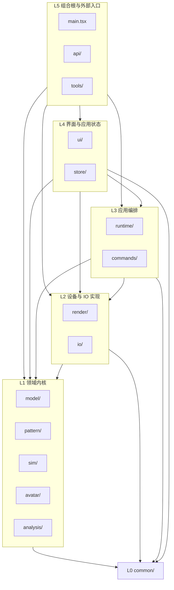
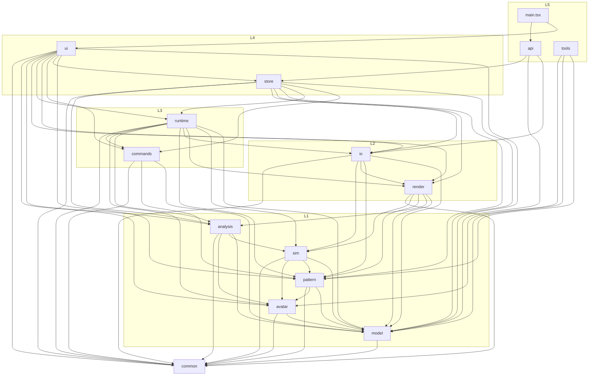
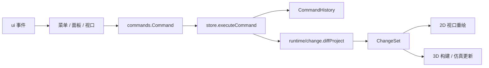
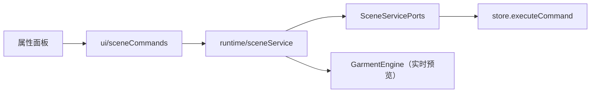
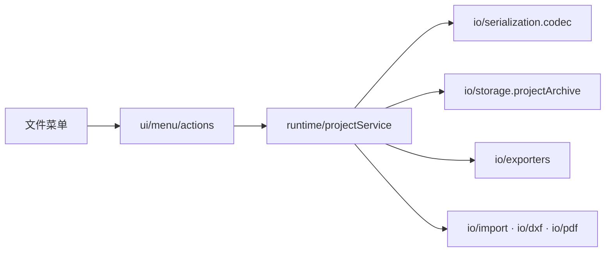
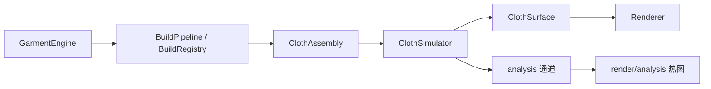

# OpenCloth 源码架构

> 本文描述当前代码的结构与依赖，不记录历史方案。结构与依赖变化时同步更新本文。

## 1. 分层



层级归属：

| 层 | 模块 | 职责 |
| --- | --- | --- |
| L0 | `common` | 数学、几何、ID、文本、时间、单位、格式、随机、事件、Result、平台适配、纯类型端口；零业务依赖 |
| L1 | `model` | 工程文档类型、默认值、校验、规范化、场景节点 id 与变换 |
| L1 | `pattern` | 版型几何、三角剖分、模板、排料、放码、POM、BOM |
| L1 | `sim` | XPBD 布料求解、约束批次、碰撞、帧缓存 |
| L1 | `avatar` | 模特参数、姿态、地标、碰撞体与生成器 |
| L1 | `analysis` | 合身、应变、压力的纯计算与统计报告 |
| L2 | `render` | WebGPU 渲染器与设备上下文、场景层与场景槽位、七个渲染通道、光栅与光追、材质与分析热图 |
| L2 | `io` | 工程编解码、导入导出、DXF/PDF、IndexedDB 存储 |
| L3 | `runtime` | 引擎与流水线编排、场景/工程服务、变更集 |
| L3 | `commands` | 编辑命令、撤销历史、剪贴板与场景命名写入 |
| L4 | `store` | zustand 应用状态与命令提交 |
| L4 | `ui` | React 界面、2D/3D 视口、菜单、属性面板 |
| L5 | `api` | `window.opencloth` 自动化门面 |
| L5 | `tools` | 独立 Node CLI，不参与前端构建 |

## 2. 实际依赖图

箭头表示真实存在的跨域 import（含类型 import），不是“允许依赖”。所有跨域 import 都指向目标模块的 `index.ts` / `types.ts`。



L1 内部直接依赖（属于当前设计，不是违规）：

- `sim → pattern`：`TriangleMesh` 与邻接构建。
- `sim → avatar`：`AvatarCollider` / `MeshCollider`。
- `analysis → sim`：`ClothSimInput`。
- `analysis → avatar`：碰撞体距离计算。
- `pattern → avatar`：环绕落位的身体地标。

这些依赖都有向、无环。

## 3. 关键运行链路

### 3.1 编辑提交



- 命令只描述执行与撤销，不直接操作 store 或引擎。
- `store` 负责深拷贝草稿、执行命令、维护历史并发布变更集。
- 视口根据 `ChangeSet` 决定重建网格、约束或只重绘。

### 3.2 场景属性编辑



`sceneService` 不 import store 或 UI；项目数据、历史提交、选择态和引用列表刷新都由 `ui/sceneCommands` 注入。

### 3.3 工程文件



- `.ocproj.json` 只接受当前 `PROJECT_FORMAT_VERSION`，没有旧版本迁移链。
- 当前格式内缺失的可选字段由 `normalize*` 补默认值。

### 3.4 仿真与渲染



- `runtime` 负责生命周期与阶段调度；`sim` 只做求解；`render` 只做绘制。
- `render` 分三层：`scene` 持有 three.js 场景（四层 `underlay/subject/overlay/gizmo`、场景槽位 `SceneSlot`、相机、灯光、材质与对象，以及供光追比对的修订计数；只有可追踪层的插槽增删才递增拓扑版本），`frame` 按固定顺序执行七个通道（scene → trace → denoise → composite → post → overlay → present），`trace` 负责路径追踪的生命周期、GPU 探针与采样门控。
- `RenderContext` 只保留画布与 `GPUDevice`，由 `Renderer` 私有持有；`THREE.WebGPURenderer` 是 `Renderer` 的私有数据成员，创建、配置、resize 与 dispose 都在 `Renderer` 内完成。`FrameMgr` 负责帧尺寸与渲染目标，并把该 renderer 通过 `FrameContext` 交给各通道；各通道直接提交自己的绘制命令。外部只能通过 `Renderer` 的 `canvas`、`aspect()`、`gpuDevice()`、`gpuProvider()`、`resize()` 访问底层资源。
- 工程的 `RenderConfig` 只保存 `toneMapping`、`rayTracing` 与 `wireOptions`；填充、线框与后端属于界面偏好（`store/prefs`），由 `liveRenderConfig` 合并成 `ViewConfig` 后交给 `Renderer`。`ViewConfig` 解析成 `ViewModeSpec`：填充（physical / uvCheck / normal / vertexNormal）、线框（off / only / over）与后端（raster / pathtrace）三个正交轴；热图是叠加在表面的分析着色，始终走光栅。帧内三张线性缓冲是 `FrameTargets.color`（场景颜色与深度）、`composite`（光栅与光追合成）和 `radiance`（路径追踪结果）。
- 2D 与 3D 共用 `pattern/panel` 的网格缓存，避免同一版片构建两份网格。

## 4. 模块内部结构

当前模块采用“平铺实现 + `index.ts` 门面”，没有强制 `internal/` 目录。跨域 import 只能指向门面；同域内部可以按目录/文件直接引用。

```
src/
  common/        math geom id text time units format random events result platform ports
  model/         types defaults document schema + 校验/规范化/场景节点
  pattern/       auto drape geom grading marker panel pom seam template triangulate + bom
  analysis/      channel fit pressure strain + 报告 + dynamicPressure
  sim/           clothSimulator simTypes constraintBatches buffers shaders + 碰撞/拾取/缓存
  render/        renderer context scene frame modes trace analysis
  avatar/        collider generator + landmarks pose
  io/            serialization exporters import importers storage dxf pdf + projectSummary zip
  runtime/       garmentEngine 流水线 change sceneService projectService + 交互/叠加层
  commands/      command 历史 + 版型/放码/面料/POM/场景命名命令 + advanced
  store/         projectStore uiStore simStore perfStore prefs types
  ui/            app appHooks menu panels viewport2D viewport3D mobile widgets + 上下文模块
  api/           window.opencloth
  tools/         独立 Node CLI
```

模块门面数量按“被跨域引用的子模块”建立，例如 `@/pattern/panel`、`@/io/storage`、`@/runtime/change`，而不是每个域只有一把巨型出口。`ui` 作为顶层不设统一门面；`common` 明确不设总出口。

## 5. 门禁与约定

`npm run arch:check` 强制：

- 依赖只能指向同层或下层（`upwardEdges = 0`）。
- 文件级强连通环为 0（包含 `import type` 边）。
- 深相对导入为 0；跨域 import 必须命中目标的 `index.ts` / `types.ts`（`barrelViolations = 0`）。
- `common` 不得 import 业务模块，也不得 import `three` / React / zustand。
- 单文件不超过 1000 行。
- 上述指标均为绝对阈值，不依赖基线文件；`common` 层白名单 `scripts/architecture-allowlist.json` 只减不增。

ESLint 额外禁止：

- `model` import `pattern` / `ui` / `render` / `sim` / `io`。
- `pattern` / `sim` import `ui`。
- `runtime` / `commands` import `ui` / `store`。

## 6. 已知设计取舍

- **同层直接依赖**：L1 的 `sim/analysis/pattern` 直接引用彼此的公开门面，没有全部改成端口；当前无环，收益高于成本。若未来要把 L1 做成可独立发布的包，再把共享类型上提到 `model` 或 `common`。
- **store 提交命令**：编辑链路是 `ui → commands → store`，不是“runtime 提交、store 只发布”。`store` 需要持有历史与变更集，这是 Zustand 单存储下的刻意选择。
- **跨层中文标签**：布料、光源、缝型、辅料、边角色标签留在 `model`，因为 `io`、`pattern`、`commands` 也会读取；仅 UI 专用的图层名与肤色预设放在 `ui/optionTables`。命令自带中文 `label`，供撤销菜单直接使用。
- **模块级单例**：`pattern/panel` 的网格缓存与 `ui/sceneCommands` / `ui/menu/actions` 的服务绑定在模块作用域创建；它们无跨模块可变状态，测试通过端口注入覆盖。
- **`ui` 无统一门面**：顶层的跨域消费方只有 `main.tsx`，UI 内部按目录组织，不额外制造一层巨型 barrel。
- **文件格式只读当前版本**：不做旧工程迁移；版本不一致时明确拒绝。
