# OpenCloth 系统架构

> 本文描述代码**当前**的结构与依赖，不记录历史方案与迁移计划。结构或依赖变化时同步更新本文。

## 1. 分层

### 1.1 依赖方向

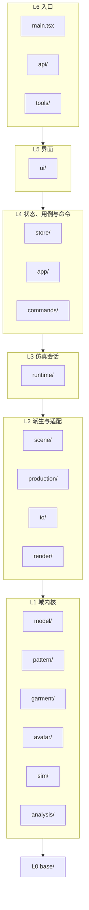

上层可依赖下层，下层不得依赖上层。同层直连只允许已登记且无环的边（见 §2）。

### 1.2 层级归属

| 层 | 模块 | 职责 |
| --- | --- | --- |
| L0 | `base` | 数学、几何、颜色、ID、文本、时间、单位、格式、Result、性能、PDF 图元、平台适配 |
| L1 | `model` | 工程文档类型、默认值、校验、规范化、场景图、元素引用、面料与印花参数、素材与审版词汇 |
| L1 | `pattern` | 2D 版型几何：边求值、轮廓与缝份、网格化、缝合几何、放码、版型模板类型 |
| L1 | `garment` | 着装：包裹区间、3D 摆位、层序、缝合收敛、按身高排位 |
| L1 | `avatar` | 模特参数、MakeHuman 体型、地标与碰撞体、围度圈 |
| L1 | `sim` | XPBD 求解：`common`（契约）、`particles`、`device`、`solver` |
| L1 | `analysis` | 合身、应变、压力的纯计算与统计 |
| L2 | `scene` | 派生层：`common`（网格设置）、`cache`（网格缓存与几何签名）、`derive`（高度视图、人体轮廓） |
| L2 | `production` | 生产数据：BOM、排料、POM、技术包、裁片数据、工单集成 |
| L2 | `io` | 编解码与持久化：`.ocproj`/`.ocpat`、DXF/Gerber/SVG/PDF、IndexedDB、归档、帧序列 |
| L2 | `render` | 渲染契约、后端、世界、绘制编排；只依赖 `base` |
| L3 | `runtime` | 仿真会话：`common`（`ChangeSet`、签名）、`engine`（装配与求解）、`world`（场景呈现）、`view`（视口、相机、拾取、导出快照）、`diff`（文档差异） |
| L4 | `app` | 用例与服务：工程存取、场景服务、缩略图、模板目录与启动工程 |
| L4 | `commands` | 域命令、撤销历史、`assist`（自动缝合建议）、`advanced`（镜像/圆角/省道） |
| L4 | `store` | zustand 应用状态、命令提交与历史 |
| L5 | `ui` | React 界面、2D/3D 视口、菜单、属性面板、移动端壳 |
| L6 | `api` | `window.opencloth` 自动化门面 |
| L6 | `tools` | 独立 Node CLI（版型预览、导出） |

### 1.3 模块内部结构

```
src/
  base/          math geom color id text time units format result platform perf pdf
  model/         types defaults normalize validatePattern patternTopology elementRef
                 sceneNodes sceneNodeState assetLibrary review fabric knit print layers lightUnits
  pattern/       geom panel grading seam template triangulate
  garment/       drapeInfer drapePlacement wrapPlan sewnTargets layers layout
  sim/           common particles device solver
  analysis/      channel fit pressure strain dynamicPressure
  avatar/        collider envelope landmarks makehuman simplifiedBody
  scene/         common cache derive
  production/    marker pom reports
  io/            codec dxf exporters import serialization storage zip frames
  render/        common backend world renderer
  runtime/       common engine world view diff
  app/           assembly services
  commands/      assist advanced
  store/         projectStore uiStore simStore perfStore prefs templateLibrary auxView renderPresets
  ui/            app menu panels viewport2D viewport3D mobile widgets assets debug commands
  api/           window.opencloth
  tools/
```

跨域 import 只能指向目标的 `index.ts`（或 `types.ts`）；同域内部可按目录或文件直接引用。

## 2. 实际依赖图

箭头为真实存在的跨域 import（含 `import type`）。

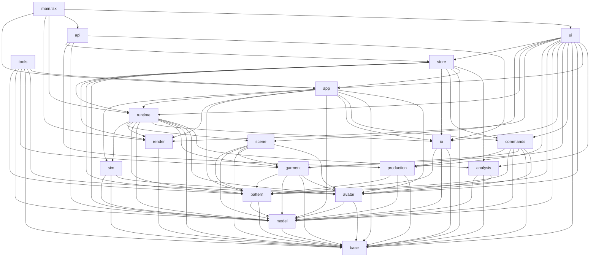

关键事实：

- `pattern` 不依赖 `avatar`，也不依赖任何上层模块；版型核是纯 2D。
- `garment` 依赖 `pattern`（`PanelMesh`、轮廓采样）与 `avatar`（地标、碰撞体），是唯一同时触达版型与人体几何的模块。
- `scene` 只依赖 L1 内核，是 2D 视图、3D 引擎、生产报表的共同派生源；不含 GPU、React、DOM。
- `runtime` 不依赖 `app`、`commands`、`store`、`ui`。
- `io` 不依赖 `runtime`、`store`、`ui`、`production`；排料图的 DXF/SVG 序列化器接收 `io/markerSheet` 的 `MarkerSheet` 端口，排料布局由调用方用 `production` 计算后传入。
- 文档差异 `diffProject` 在 `runtime/diff`，变更集在 `runtime/common`。

## 3. 关键运行链路

### 3.1 编辑提交

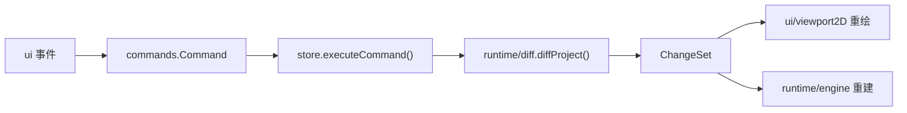

### 3.2 派生

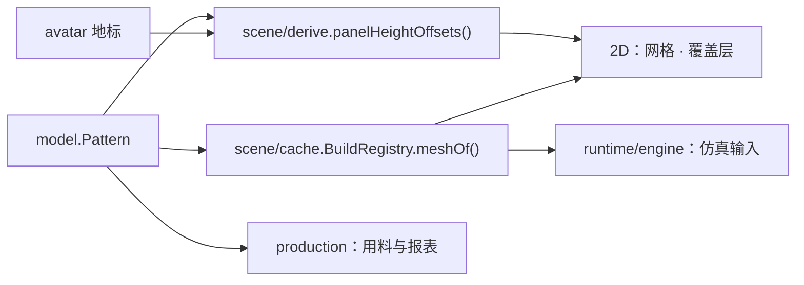

- 网格按 `Pattern` 实例、网格设置、`panelId + 几何签名` 缓存，最近最少使用先淘汰，2D 覆盖层与 3D 引擎取到同一实例；拖动预览按 `EditPreviewTier` 取低分辨率网格。
- 高度视图 `panelHeightOffsets` 按 `Pattern` 与人体地标计算，2D 与属性面板共用。

### 3.3 场景属性编辑

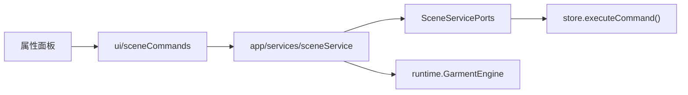

`app/services/sceneService` 不 import store 或 UI；工程数据、历史提交、选择态由 `ui/sceneCommands` 注入。

### 3.4 工程文件

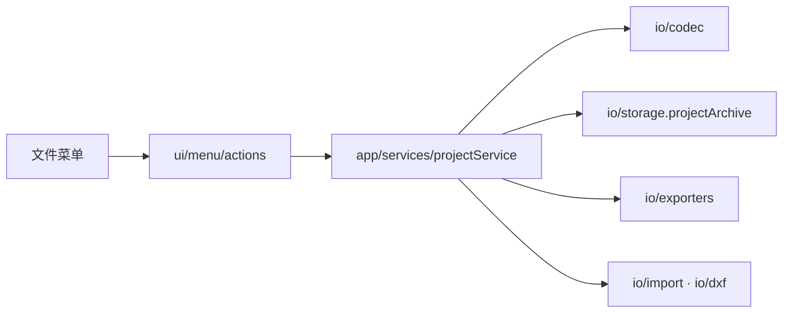

### 3.5 版片

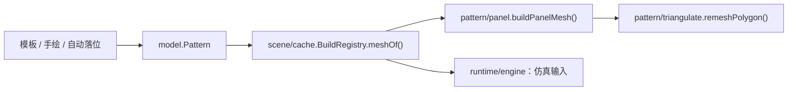

- `Panel` 只存点、边、省的 ID 引用与摆位参数，不存网格。
- 缝份外扩在 `pattern/panel.panelOutlineWithAllowance`：按 `outlineEdgeIds` 顺序铺放逐边放量与角型；轮廓为顺时针时同步反转采样下标，保证逐边属性不串位。

### 3.6 仿真

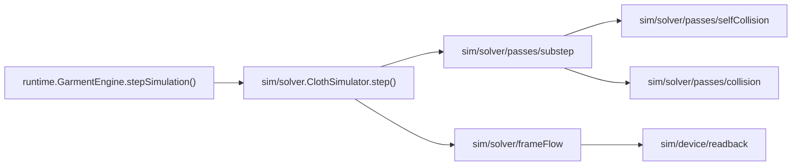

### 3.7 渲染

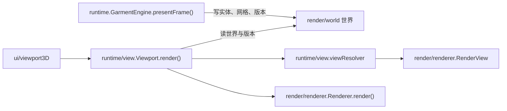

### 3.8 拾取

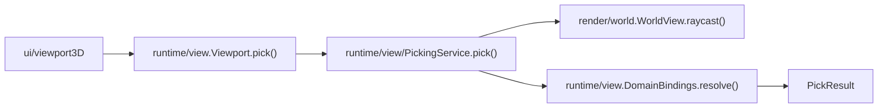

### 3.9 导出

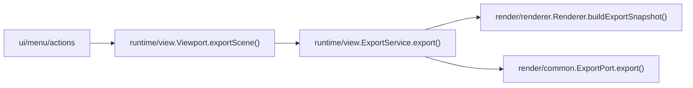

## 4. 门禁与约定

`npm run arch:check` 强制：

- 依赖只能指向同层或下层（`upwardEdges = 0`）。
- `render` 内部按 `common ← backend ← world ← renderer` 引用（`renderLayerViolations = 0`）；对外只依赖 `base`。
- `sim` 内部按 `common ← particles / device ← solver` 引用（`simLayerViolations = 0`、`simSiblingImports = 0`）。
- 文件级强连通环为 0（含 `import type` 边）。
- 深相对导入为 0；跨域 import 必须命中 `index.ts` / `types.ts`（`barrelViolations = 0`）。
- `base` 不得 import 业务模块，也不得 import `three` / React / zustand。
- `pattern` 不得 import `avatar`（`patternAvatarImports = 0`），不得使用 `import.meta`（`patternBundlerApi = 0`）。
- `scene` 不得接触 GPU / `three` / React / `render` / DOM（`scenePurityViolations = 0`）。
- `runtime` 不得 import `app`（`runtimeAppImports = 0`）。
- 单文件不超过 1000 行；`base` 层依赖禁令不设白名单豁免。

ESLint 额外禁止：

- `model` import `pattern` / `ui` / `render` / `sim` / `io`。
- `pattern` / `sim` import `ui`。
- `runtime` / `commands` import `ui` / `store`。

其余层向违规（含 `garment`、`app` 触达上层）由 `npm run arch:check` 的层向检查拦截。

## 5. 已知设计取舍

- **派生集中在 `scene`**：网格缓存、高度视图、人体轮廓都由 `scene` 提供单一实现，2D 覆盖层与 3D 引擎共用同一批函数与同一份网格实例；`scene` 不持文档、不触 GPU，可在无渲染环境下运行。
- **`garment` 与 `pattern` 分离**：版型核不依赖人体，`garment` 承接包裹与摆位。`garment → pattern`、`scene → pattern`、`production → pattern` 均为有向无环，收益高于成本。
- **`production` 拥有报表数据，`io` 只写字节**：`production` 计算 BOM/排料/POM/技术包，`io` 负责 DXF/SVG/PDF/CSV 编码；两者之间只通过 `io/markerSheet` 的端口传递结果，互不 import。
- **`app` 不持有状态**：用例通过端口（`SceneServicePorts`）接外部能力，`store` 负责历史与提交；`store → app` 仅用于取启动工程，`app` 不依赖 `store`。
- **`model` 保留素材与审版词汇**：`FabricAsset`、`ReviewStatus` 属文档词汇，`io/storage`（IndexedDB 存储）直接引用；放进 `app` 会形成 L2 → L4 的向上依赖。
- **`ui` 是最大的上层模块**：菜单动作、导入导出触发、2D 编辑工具都在 `ui` 内，业务由 `app` 服务与 `commands` 承接；再往下沉的前提是先为 `store` 与提示组件定义端口。
- **模块级缓存**：`scene/cache` 的网格缓存按几何签名缓存，脏数据由 `ChangeSet` 与文档实例变化驱动。
- **文件格式不带版本号**：`.ocproj` 与 `.ocpat` 只接受当前结构，读取时补齐可选字段，结构或拓扑不合法直接拒绝。
