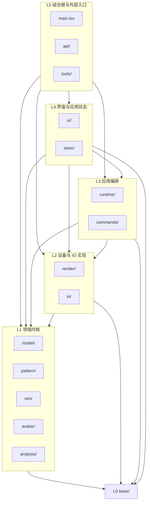
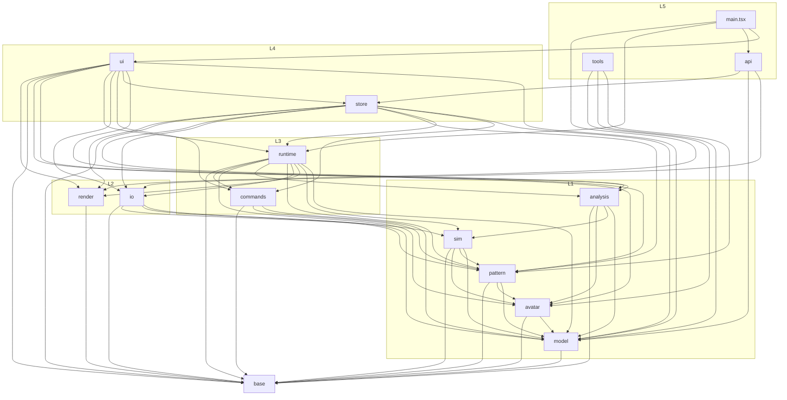
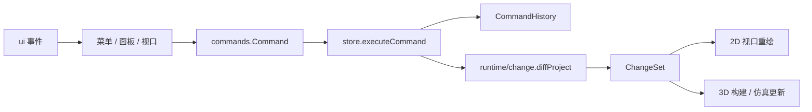
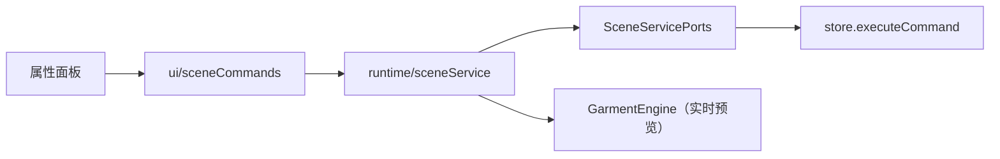
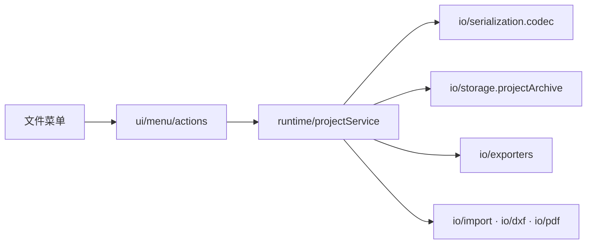

# OpenCloth 系统架构

> 本文描述当前代码的结构与依赖，不记录历史方案。结构与依赖变化时同步更新本文。

## 1. 分层

下图表示各层可以依赖的方向（含传递关系），真实存在的跨域 import 见第 2 节。



层级归属：

| 层 | 模块 | 职责 |
| --- | --- | --- |
| L0 | `base` | 数学、几何、ID、文本、时间、单位、格式、随机、事件、Result、平台适配、纯类型端口；零业务依赖 |
| L1 | `model` | 工程文档类型、默认值、校验、规范化、场景节点 id 与变换 |
| L1 | `pattern` | 版型几何、三角剖分、模板、排料、放码、POM、BOM |
| L1 | `sim` | XPBD 布料求解、约束批次、碰撞、帧缓存 |
| L1 | `avatar` | 模特参数、MakeHuman 体型生成、实测地标与碰撞体 |
| L1 | `analysis` | 合身、应变、压力的纯计算与统计报告 |
| L2 | `render` | `common`（渲染契约）、`backend`（设备与 three 边界）、`world`（世界数据）、`renderer`（绘制编排）；只依赖 `base` |
| L2 | `io` | 工程编解码、导入导出、DXF/PDF、IndexedDB 存储 |
| L3 | `runtime` | 引擎与流水线编排、场景/工程服务、变更集 |
| L3 | `commands` | 编辑命令、撤销历史、剪贴板与场景命名写入 |
| L4 | `store` | zustand 应用状态与命令提交 |
| L4 | `ui` | React 界面、2D/3D 视口、菜单、属性面板 |
| L5 | `api` | `window.opencloth` 自动化门面 |
| L5 | `tools` | 独立 Node CLI，在前端构建之外运行 |

## 2. 实际依赖图

箭头表示真实存在的跨域 import（含类型 import）。所有跨域 import 都指向目标模块的 `index.ts` / `types.ts`。



L1 内部直接依赖（属于当前设计）：

- `sim → pattern`：`TriangleMesh` 与邻接构建。
- `sim → avatar`：`AvatarCollider` / `MeshCollider`。
- `analysis → sim`：`ClothSimInput`。
- `analysis → avatar`：碰撞体距离计算。
- `pattern → avatar`：环绕落位的身体地标。

这些依赖都有向、无环。

`ui` 与 `store` 对 `render` 的依赖只指向 `render/common`（渲染契约的纯类型与能力探测），不指向 `render` 的实现目录。

## 3. 关键运行链路

### 3.1 编辑提交



- 命令只描述执行与撤销，不直接操作 store 或引擎。
- `store` 负责深拷贝草稿、执行命令、维护历史并发布变更集。
- 视口根据 `ChangeSet` 决定重建网格、约束或只重绘。

### 3.2 场景属性编辑



`sceneService` 不 import store 或 UI；项目数据、历史提交、选择态和引用列表刷新都由 `ui/sceneCommands` 注入。

### 3.3 工程文件



- `.ocproj.json` 只接受当前 `PROJECT_FORMAT_VERSION`，没有旧版本迁移链。
- 当前格式内缺失的可选字段由 `normalize*` 补默认值。

### 3.4 仿真与渲染

`runtime` 把仿真结果写入 `WorldWriter`、把工程配置与界面偏好解析为 `RenderView`，`Viewport` 每帧交给 `Renderer` 输出。渲染只读世界与视图，不读工程、版型或版片数据。UI 只经 `Viewport` 的 `engine` 与 `canvas` 访问 3D，不接触 World 与 Backend。

求解器把每帧 GPU 回读写入合并输入的唯一位置数组；布料渲染网格、3D 拾取与选中高亮引用同一数组，模拟后的形状在绘制、命中与高亮上保持一致。合并的初始布局另存一份，供重置与着装使用。

`ui/viewport3D` 的坐标轴指示器只读相机快照；版片变换 Gizmo 在屏幕空间布局与命中，拖动期间由 `GarmentEngine` 把增量写入布料网格的位置流做实时预览，松手后经 `sceneService.commitPanelTransforms` 一条命令写入 `panel.transform`，再由变更集重建布料。`runtime/gizmoMath` 只做版片变换的业务组合，线性代数统一走 `base/math`，相机投影纯函数在 `render/common/viewMath`，UI 不接触世界数据。

### 3.5 拾取与导出

`PickingService` 经 `DomainBindings` 把命中实体翻译为业务键；`ExportService` 取快照后交 `ExportPort` 写文件。UI 只拿到业务键与文件字节，不接触渲染对象。

## 4. 模块内部结构

当前模块采用“平铺实现 + `index.ts` 门面”，没有强制 `internal/` 目录。跨域 import 只能指向门面；同域内部可以按目录/文件直接引用。

```
src/
  base/          math（标量 · 角度 · vec2/vec3/tuple3 · matrix3 · 旋转）geom（线段/射线/三角形 · 法线 · 缓冲 · 曲线/多边形）color（颜色空间）id text time units format random events result platform ports perf（帧内分段计时）
  model/         types defaults document schema + 校验/规范化/场景节点
  pattern/       auto drape geom grading marker panel pom seam template triangulate + bom
  analysis/      channel fit pressure strain + 报告 + dynamicPressure
  sim/           clothSimulator simTypes constraintBatches buffers shaders + 碰撞/拾取/缓存
  render/        common backend world renderer
  avatar/        collider generator + landmarks pose
  io/            serialization exporters import storage dxf pdf + projectSummary zip
  runtime/       viewport garmentEngine presenters viewResolver picking exportService domainBindings 流水线 change sceneService projectService + 交互/叠加层
  commands/      command 历史 + 版型/放码/面料/POM/场景命名命令 + advanced
  store/         projectStore uiStore simStore perfStore prefs types
  ui/            app appHooks menu panels viewport2D viewport3D mobile widgets debug + 上下文模块
  api/           window.opencloth
  tools/         独立 Node CLI
```

模块门面按“被跨域引用的子模块”建立，例如 `@/pattern/panel`、`@/io/storage`、`@/runtime/change`；每个域按子模块拆分出口。`ui` 与 `base` 各自按子模块暴露能力。

帮助 ▸ 调试：一帧耗时 打开 `ui/debug/perfPanel`；它在帧首、模拟回读、自碰撞、结果上屏、快照重建和每个渲染通道上读取 `base/perf` 的分段计时。采样关闭时埋点直接调用原函数，不记录时间。

## 5. 门禁与约定

`npm run arch:check` 强制：

- 依赖只能指向同层或下层（`upwardEdges = 0`）。
- `render` 内部按 `common ← backend ← world ← renderer` 自下而上引用（`renderLayerViolations = 0`）；对外只依赖 `base`，`three` 只出现在 `backend`，且不 import 任何领域模块。
- 文件级强连通环为 0（包含 `import type` 边）。
- 深相对导入为 0；跨域 import 必须命中目标的 `index.ts` / `types.ts`（`barrelViolations = 0`）；`ui` 与 `base` 按子模块门面命中。
- `base` 不得 import 业务模块，也不得 import `three` / React / zustand。
- 单文件不超过 1000 行。
- 上述指标均为绝对阈值；`base` 层白名单 `scripts/architecture-allowlist.json` 只减不增。

ESLint 额外禁止：

- `model` import `pattern` / `ui` / `render` / `sim` / `io`。
- `pattern` / `sim` import `ui`。
- `runtime` / `commands` import `ui` / `store`。

## 6. 已知设计取舍

- **同层直接依赖**：L1 的 `sim/analysis/pattern` 直接引用彼此的公开门面，没有全部改成端口；当前无环，收益高于成本。若未来要把 L1 做成可独立发布的包，再把共享类型上提到 `model` 或 `base`。
- **store 提交命令**：编辑链路是 `ui → commands → store`，由 `store` 持有历史与变更集。这是 Zustand 单存储下的刻意选择。
- **跨层中文标签**：布料、光源、缝型、辅料、边角色标签留在 `model`，因为 `io`、`pattern`、`commands` 也会读取；仅 UI 专用的图层名与肤色预设放在 `ui/optionTables`。命令自带中文 `label`，供撤销菜单直接使用。
- **模块级单例**：`pattern/panel` 的网格缓存与 `ui/sceneCommands` / `ui/menu/actions` 的服务绑定在模块作用域创建；它们无跨模块可变状态，测试通过端口注入覆盖。
- **装配点在 `main.tsx`**：`createRenderSession` 是视口的唯一装配点，创建 `Backend`、World、Renderer 与 Viewport 并经 `RenderHostContext` 注入；`ui/viewport3D` 只消费工厂、持有画布尺寸与设备回调，并在 StrictMode 二次挂载时释放被弃用的会话。销毁顺序 `Viewport.dispose → Renderer.dispose → Backend.dispose`。资产缩略图在同处另行装配一条独立链（离屏 `Backend` + `Previewer`，首次请求时创建），退出时按 `Previewer.dispose → Backend.dispose` 释放。
- **`ui` 按目录组织**：顶层的跨域消费方只有 `main.tsx`，UI 内部以子模块门面暴露能力。
- **文件格式只读当前版本**：版本不一致时明确拒绝，提示按当前格式另存。
